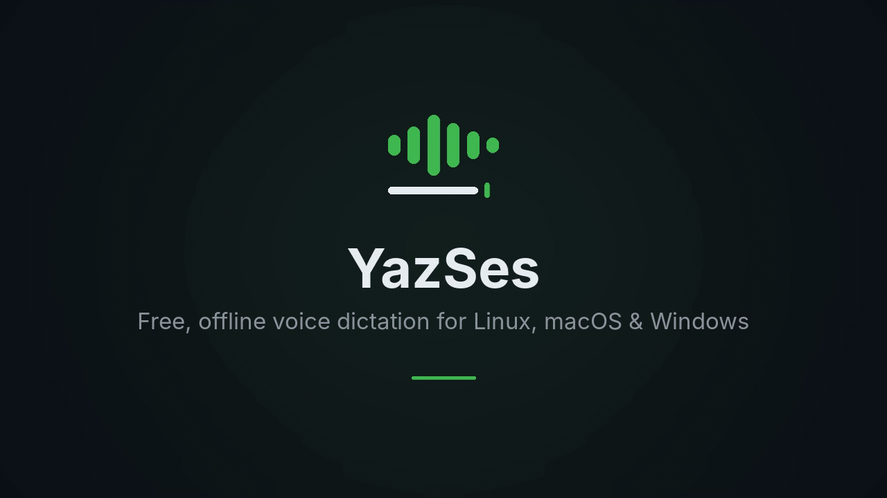
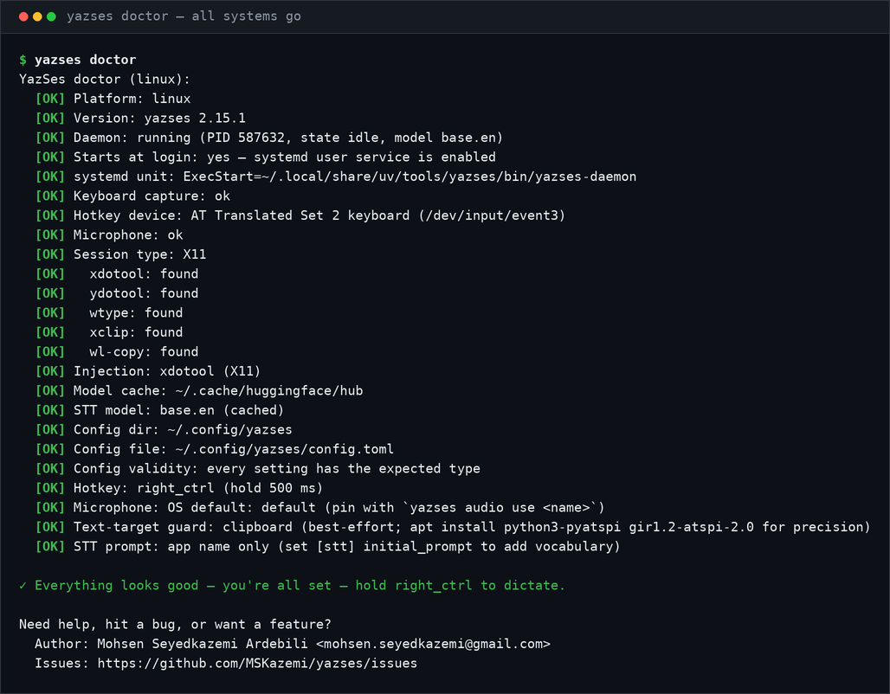

# YazSes

<!-- mcp-name: io.github.MSKazemi/yazses -->

**Offline voice typing for Linux, macOS and Windows.** Hold a key, speak, release, and your
words are typed into whatever app you are using.

Speech recognition runs on your own computer, so your voice never leaves it. There is no
account, no subscription and no API key. YazSes is free and open source under Apache 2.0.

[](https://github.com/MSKazemi/yazses/actions/workflows/test.yml)
[](https://pypi.org/project/yazses/)
[](https://pepy.tech/projects/yazses)
[](https://snapcraft.io/yazses)
[](LICENSE)
[](https://doi.org/10.5281/zenodo.21856271)
[](https://mskazemi.com/yazses/)
[](https://huggingface.co/spaces/mskazemi/yazses-offline-transcription-demo)
[](https://www.codetriage.com/mskazemi/yazses)
[](#contributors)



*A 40-second tour of dictation, the command line and the system tray. The terminal output is
real; the command-line typing was re-enacted so it is easier to read.*
▶️ **[Watch it on YouTube](https://www.youtube.com/watch?v=nn8WUKsCvZ4)**, with chapters.

**[Install](#-install)** · **[Quick start](#quick-start)** · **[Voice commands](#what-you-can-say)** ·
**[Compare](#comparison--alternatives)** · **[FAQ](#faq)** · **[Documentation](https://mskazemi.com/yazses/)** ·
**[Contribute](#-help-build-yazses)**

<details>
<summary>🌐 Read this in other languages (27)</summary>

**Read this in other languages:** **English** · [Deutsch](docs/de/index.md) · [Nederlands](docs/nl/index.md) · [Tiếng Việt](docs/vi/index.md) · [Türkçe](docs/tr/index.md) · [bahasa Indonesia](docs/id/index.md) · [español](docs/es/index.md) · [français](docs/fr/index.md) · [italiano](docs/it/index.md) · [polski](docs/pl/index.md) · [português do Brasil](docs/pt-BR/index.md) · [svenska](docs/sv/index.md) · [čeština](docs/cs/index.md) · [ελληνικά](docs/el/index.md) · [Русский](docs/ru/index.md) · [українська](docs/uk/index.md) · [اردو](docs/ur/index.md) · [العربية](docs/ar/index.md) · [فارسی](docs/fa/index.md) · [हिंदी](docs/hi/index.md) · [বাংলা](docs/bn/index.md) · [தமிழ்](docs/ta/index.md) · [తెలుగు](docs/te/index.md) · [ไทย](docs/th/index.md) · [日本語](docs/ja/index.md) · [简体中文](docs/zh-CN/index.md) · [繁體中文](docs/zh-TW/index.md) · [한국어](docs/ko/index.md)

</details>

## ✨ What it does

| | |
|---|---|
| 🎙️ **Type with your voice** | Hold your hotkey, speak, release. The text appears in the window you are using: email, browser, chat, editor or terminal. |
| 🗣️ **Voice commands** | Say *"scratch that"*, *"new line"* or *"go to line 42"* and YazSes carries out the action instead of typing the words. |
| 📄 **Transcribe recordings** | `yazses transcribe interview.m4a` turns an audio or video file into text, optionally with **who said what**. |
| 👥 **Meeting notes** | `yazses meeting start` … `yazses meeting stop` records a meeting in the room and produces a **speaker-labelled transcript**, plus optional minutes from a local AI model. |
| 🔒 **Private by default** | Everything runs on your CPU. By default, no audio and no text leave your computer. |

**Also included:** multi-step voice **macros** and a personal **vocabulary** for words it
mishears · **Dysfluency-Friendly Mode**, which collapses stutters and repeats
(`b-b-because` → `because`) · opt-in, encrypted **on-device learning**, where `yazses tune`
proposes accuracy fixes from your own corrections · **editor navigation** through your
editor's LSP (`yazses jump`, Neovim bridge, opt-in) · **EMG (muscle-sensor) triggering** and
mic calibration for accessibility · an optional **voice-activity overlay** near the cursor.
The [feature catalog](docs/features.md) lists every capability and how to turn it on.

> **What's optional:** dictation works out of the box. Speaker labels need the
> diarization extra (`pipx install 'yazses[diarization]'`, ~45 MB of models, downloaded
> once). Meeting minutes also need the `notes` extra and a local GGUF model that you supply.
> Both are off by default. See [offline meeting notes](docs/meeting-notes-offline.md).

## ⬇️ Install

Choose your operating system. Each install is one command followed by a short first-run setup.

**🐧 Linux** (the most tested platform)

```bash
bash <(curl -fsSL https://raw.githubusercontent.com/MSKazemi/yazses/main/install.sh)
```

Then **log out and back in once**, which gives YazSes access to the keyboard, and run
`yazses start`. [Full Linux guide →](https://mskazemi.com/yazses/install-linux.html)

**🍎 macOS, Apple silicon (M1 or newer)** (preview)

```bash
brew tap MSKazemi/yazses && brew trust MSKazemi/yazses && brew install --cask yazses
```

Open YazSes from Applications. The app is not signed yet, so macOS blocks it the first time:
click **Open Anyway** in System Settings → Privacy & Security, then allow **Microphone**,
**Accessibility** and **Input Monitoring** when asked. On an Intel Mac, download the
`-macos-x86_64.dmg` from [Releases](https://github.com/MSKazemi/yazses/releases/latest)
instead. Releases after 2.43.2 put a `yazses` command on your PATH through the Homebrew cask;
with the `.dmg`, or on 2.43.2, run the CLI as
`/Applications/YazSes.app/Contents/MacOS/YazSes --cli doctor`.
[Full macOS guide →](https://mskazemi.com/yazses/macos-install.html)

**🪟 Windows** (preview)

```powershell
winget install MSKazemi.YazSes
```

winget can lag behind the newest release; the
[installer](https://github.com/MSKazemi/yazses/releases/latest), Scoop and Chocolatey track
every release. The installer is not code-signed yet, so if Windows SmartScreen warns you,
click **More info → Run anyway**. Then open YazSes from the Start menu.
[Full Windows guide →](https://mskazemi.com/yazses/windows-install.html)

**Then start talking.** Hold your hotkey, speak and release. The default hotkey is
**Right Alt** on Linux, **Right Option** on macOS and **Right Ctrl** on Windows;
`yazses hotkey set <key>` changes it. If nothing happens, run **`yazses doctor`**. It checks
your microphone, hotkey and typing, and tells you what to fix.

> **macOS and Windows are previews.** Linux has the most reports from real machines. The
> macOS and Windows builds are newer, and the [validation matrix](docs/validation-matrix.md)
> shows exactly what has and has not been confirmed on real hardware. If you try one, a short
> report is one of the most useful contributions you can make.

**Not ready to install?** [Try it without installing](https://mskazemi.com/yazses/try-without-installing.html)
in Docker or your browser, or read [what installing actually costs](https://mskazemi.com/yazses/install-cost.html)
first. APT, Snap, pipx, `.dmg` and `.exe` are covered under
[all install options](#all-install-options).

> **Hugging Face, in one paragraph.** The speech models YazSes downloads once are hosted on
> the Hugging Face Hub; after that, recognition runs on your own computer. The
> [hosted demo](https://huggingface.co/spaces/mskazemi/yazses-offline-transcription-demo) is
> a separate page that processes audio **on Hugging Face's servers**, so it is for judging
> accuracy, not for private use. GitHub stays the home of the code and of contributions.
> The project's Hugging Face organization is [huggingface.co/yazses](https://huggingface.co/yazses).
> Details: [YazSes and Hugging Face](docs/hugging-face.md).

## 🙌 Help build YazSes

**New to open source? You are welcome here.** You need no speech or AI background, and
several tasks need no Python at all:

- **Test it** on your computer and [report what happened](https://mskazemi.com/yazses/contribute/start.html).
- **Translate or review** the README [in your language](https://github.com/MSKazemi/yazses/issues/18).
- **Add your microphone** to the [known-good list](https://github.com/MSKazemi/yazses/blob/main/docs/known-good-microphones.md).
- **Write code:** pick a [good first issue](https://github.com/MSKazemi/yazses/issues?q=is%3Aissue+is%3Aopen+label%3A%22good+first+issue%22). The test suite is fully offline, so you need no microphone, model or GPU.

**[Start here](https://mskazemi.com/yazses/contribute/start.html):** one page where you pick
the row that matches what you have and finish in 15–45 minutes. No permission is needed and
nothing is assigned. [#22](https://github.com/MSKazemi/yazses/issues/22) lists everything
open, and [Contributing](#contributing) below covers the development workflow.

> ⭐ **If YazSes is useful to you, a star is how other people find it.** There is no company
> and no advertising budget behind this project; word of mouth is how it reaches people.

---

## About YazSes

YazSes is a free, open-source, offline voice dictation and speech-to-text daemon for
**Linux (X11 and Wayland), macOS and Windows**, built on
[faster-whisper](https://github.com/SYSTRAN/faster-whisper). Use it when audio must not be
sent to Google, Apple, Microsoft or Otter: because the meeting is confidential, because the
machine is air-gapped, or because you do not want a subscription.

- **Compared with cloud dictation** such as Wispr Flow, YazSes runs entirely on-device.
- **Compared with Talon Voice**, it aims at plug-and-play use rather than advanced scripting.
- **Compared with other free on-device tools** (Handy, OpenWhispr), it adds voice
  **commands**, speaker-labelled meeting capture and published benchmarks.
- **It is not the right tool** if you need a conversational AI agent, non-English models out
  of the box, or a mobile or web app.

📖 **Full documentation: [mskazemi.com/yazses](https://mskazemi.com/yazses/)**, with install
guides, the CLI reference, configuration, features and troubleshooting.



**Prefer text to video?** [Watch the CLI in your browser](https://mskazemi.com/yazses/watch-the-cli.html):
an asciinema recording of the happy path (`-h` → `about` → `quickstart` → `features` →
`status`) in which every byte is real command output. The player is served from the docs site
itself, not a CDN, so watching it does not report you to anyone. In your own terminal, run
`asciinema play docs/demo/yazses-cli.cast`.

---

## Quick Start

> **Want to hear how accurate it is first?** [Try it without installing](https://mskazemi.com/yazses/try-without-installing.html)
> in Docker or your browser. A sample clip ships with the repository, and `--network none`
> proves the transcription happens on your own machine.

### Step 1 — Install

Use the command for your system in [Install](#-install) above, or any route in
[all install options](#all-install-options).

The **recommended** Linux one-liner installs `uv` if needed, installs the latest YazSes, sets
up every system prerequisite (audio, keystroke injection, clipboard, the `input` group and
Wayland `ydotoold`), and finishes by running **`yazses doctor`** so that any missing tool
shows up during the install rather than later.

> **Wary of piping a script from the internet into your shell?** Add `--dry-run`. The script
> inspects your machine, prints every change it would make, and exits without making any:
> `bash <(curl -fsSL .../install.sh) --dry-run`
>
> Both [what installing actually costs](https://mskazemi.com/yazses/install-cost.html)
> (1.1 GB plus a 141 MB model, and what it changes on your system) and
> [how to uninstall](https://mskazemi.com/yazses/uninstall.html) are published up front.

**Only need to transcribe a recording?** The container needs no install at all:
`docker run --rm -v "$PWD:/data" ghcr.io/mskazemi/yazses transcribe /data/talk.m4a
--diarize`. It produces a transcript with speaker labels. It does **not** do hold-to-talk
dictation, which needs a real desktop session; see [the Docker page](https://mskazemi.com/yazses/docker.html).

### Step 2 — Prepare the system (Linux only)

The one-liner and the APT install do this for you, and the Snap does not need it. After a
`pipx` or source install, run:

```sh
yazses setup        # installs audio + injection deps, joins the input group, sets up ydotoold
# then log out and back in (the input-group change needs a fresh login)
```

`yazses setup` is safe to re-run and only does what is missing. It ends with a numbered
checklist of the steps only you can do (the re-login, voice calibration with
`yazses mic-level --set`, and `yazses start`) and offers to run the calibration right away.

> **The log-out and log-in is required, once.** Joining the `input` group only takes effect
> in a *new login session*. Opening another terminal tab is **not** enough, because it
> inherits the old session's groups and the hotkey stays dead. `yazses start` warns you while
> the re-login is still pending. To dictate immediately without logging out, bridge the group
> for one session with `sg input -c "yazses restart"`.

<details>
<summary>What <code>yazses setup</code> installs, and how to do it by hand</summary>

- **`libportaudio2`** for audio capture. Without it the daemon crashes on start with
  `OSError: PortAudio library not found`.
- **Injection backends:** `xdotool` and `xclip` on X11; `wtype`, `ydotool` and
  `wl-clipboard` on Wayland.
- **The `input` group**, which is required to read the hold-to-talk hotkey from the kernel.
- **`ydotoold`**, the virtual-input daemon. On **GNOME and KDE Wayland** it is the *only* way
  to inject keystrokes (`wtype` is blocked there), so `setup` installs and enables it.

By hand: `sudo apt install libportaudio2 xdotool ydotool wtype xclip wl-clipboard pipx && sudo usermod -aG input "$USER"`,
then enable `ydotoold` (see [install-linux](docs/install-linux.md)). Check the result at any
time with `yazses doctor`; you want `[OK] Keyboard capture`, `[OK] Microphone` and
`[OK] Injection`.

</details>

On macOS and Windows, skip this step and grant the Accessibility and Microphone permissions
when prompted.

### Step 3 — Calibrate and start

```sh
yazses quickstart           # not sure what's next? a 3-step guide tailored to your machine
yazses doctor               # check mic, injection backend, permissions (want all [OK])
yazses mic-level --set      # tune the silence gate to your room and voice (~6 s)
yazses enroll               # optional: a longer guided calibration (20 short phrases)
yazses autostart enable     # run it at login, so it's there after a reboot
yazses start                # start the dictation daemon
yazses verify               # speak once and prove the whole pipeline works
```

`yazses quickstart` is safe to run at any time. It looks at what is already set up, tells you
what to do next, and changes nothing.

### Step 4 — Dictate

Hold the hotkey, speak and release. The text is typed into the focused app.

| OS | Default hotkey |
|---|---|
| Linux | `Right Alt` |
| macOS | `Right Option` |
| Windows | `Right Ctrl` |

Try *"the quick brown fox"* (typed as text), then *"undo that"*, *"go to line 42"* or
*"run the tests"* (carried out as commands). On a modern laptop CPU, the time from releasing
the key to seeing text is a median of **1.6 s** with the default `base.en` model, or
**0.9 s** with `tiny.en` ([measured](docs/benchmarks.md)).

**Shell completion:** `yazses --install-completion`, or `yazses --show-completion` to print
the script. See the [CLI reference](docs/cli-reference.md).

---

## What you can say

Hold the key and **talk**: by default, everything you say is typed at the cursor. YazSes also
recognises a set of **voice commands** and turns them into editor and terminal **key
sequences** instead of typing them:

| Say something like… | What happens |
|---|---|
| *"the quick brown fox"* | Types the text at the cursor (dictation) |
| *"delete the last three words"* | Deletes the last 3 words |
| *"undo that"* / *"undo five times"* | Sends undo |
| *"save file"* · *"copy"* · *"paste"* | Save / copy / paste |
| *"select all"* · *"select to end"* | Selection commands |
| *"comment this line"* | Toggles a comment |
| *"go to line 42"* | Jumps to line 42 |
| *"go to function parse_config"* | Jumps to the symbol (via LSP, opt-in) |
| *"run the tests"* / *"run the build"* | Runs the editor/terminal action |
| *"rename this to user_id"* | Renames the symbol |

Commands are recognised by a fast regex grammar. You can add multi-step **macros** and a
personal **vocabulary** of misheard words; see the [CLI reference](docs/cli-reference.md).

---

## How it works

```
Hold hotkey → record audio → VAD gate → faster-whisper (CPU) → clean + disfluency filter
            → command grammar (Tier 1 regex; Tier 2 SLM router designed, not wired)
            → dictate? type the text   ·   command? send the key sequence
```

Everything runs on your CPU, with no GPU and no network. **faster-whisper** (int8) transcribes
the audio, and a regex grammar decides whether each utterance is dictation or a command. A
~0.5B SLM router was designed to take a second look when confidence is low. Its seam exists
(`grammar.classify()` accepts one), but nothing constructs it yet, so **the regex grammar
decides every utterance today**.

**Performance.** Measured on a 13th-gen Core i7 laptop, int8 on CPU: **4.07 % WER** on
LibriSpeech test-clean with the default `base.en`, a **1.56 s median** decode, and **0.29 ms**
of total non-decode pipeline overhead. Almost all of the latency is the speech model. The
method behind these numbers is on the [benchmarks page](docs/benchmarks.md).

**Models**

- **Speech-to-text:** faster-whisper `tiny.en` (fastest), `base.en` (default) or `small.en`
  (most accurate), int8 on CPU.
- **Dictation cleanup** (optional, off by default): a small offline LLM can tidy grammar and
  punctuation. Length and token-preservation guards stop it from changing your meaning.
- **Command routing** (not wired yet): a Qwen2.5-0.5B SLM for Tier 2 intent classification.
  `yazses model download` can fetch it, but **nothing loads it yet**, so downloading it today
  gains you nothing. The command is still the right way to pre-fetch a *speech* model behind
  a firewall.

---

## Requirements

| | |
|---|---|
| **OS** | Linux (primary) · macOS 14+ (preview) · Windows 10 (21H2)+ (preview) |
| **RAM** | 4 GB minimum · 8 GB comfortable |
| **Disk** | ~250 MB–1 GB for the faster-whisper model (downloaded on first run) |
| **CPU** | 2+ cores · no GPU required |
| **Mic** | Any USB or built-in microphone |

Using Apple silicon, an Intel Mac, ARM64 Windows, a Raspberry Pi or another less common CPU?
The [platform support matrix](https://mskazemi.com/yazses/platform-support.html) lists the
tested install channel for each OS and architecture. `pipx install yazses` is a portable
fallback on supported Python and platform combinations, but a native package gives a better
desktop experience where one exists.

---

## Use cases

| Who | Why YazSes fits |
|---|---|
| **Writers and journalists** | Draft long-form text hands-free, without your words leaving the machine. |
| **Developers** | Dictate comments and commit messages, and drive the editor or terminal by voice: undo, save, go to line, run tests, rename a symbol. |
| **Developers on remote machines** | Text is injected at the OS level, so dictation works in **VS Code or Cursor Remote-SSH panes, terminals running a remote shell, `tmux` and container shells**, where built-in voice input usually stops. See [dictation over SSH](https://mskazemi.com/yazses/how-to/remote-dictation.html). |
| **Privacy-conscious professionals** | Dictate in law, medicine or research, where audio must never touch a cloud service. |
| **Teams with confidential meetings** | Record and summarise internal, clinical, legal or pre-publication meetings without a note-taking SaaS or a bot in the call. |
| **Researchers with recordings** | Batch-transcribe interviews, lectures and field recordings offline, with speaker labels, under your own retention rules. |
| **People with motor disabilities** | Hold-to-talk or EMG (muscle-sensor) triggering for hands-free input, with Dysfluency-Friendly Mode for stuttered or dysarthric speech. |
| **Offline and air-gapped sites** | Dictation on machines with no reliable internet, or where outbound network calls are not allowed. |

**Guides with setup steps:**
[voice typing on Linux (X11 and Wayland)](https://mskazemi.com/yazses/use-cases/voice-dictation-linux.html) ·
[voice dictation on Wayland](https://mskazemi.com/yazses/use-cases/voice-dictation-wayland.html) ·
[dictation over SSH and Remote-SSH](https://mskazemi.com/yazses/how-to/remote-dictation.html) ·
[private and confidential work](https://mskazemi.com/yazses/use-cases/private-offline-dictation.html) ·
[coding by voice](https://mskazemi.com/yazses/use-cases/voice-coding.html) ·
[accessibility and RSI](https://mskazemi.com/yazses/use-cases/accessibility-rsi-hands-free.html) ·
[transcribing recordings](https://mskazemi.com/yazses/use-cases/transcribe-audio-offline.html) ·
[multilingual dictation](https://mskazemi.com/yazses/use-cases/multilingual-dictation.html)

---

## Limitations / when *not* to use YazSes

- **It is not an LLM agent.** YazSes dictates text, transcribes recordings and runs editor and
  terminal commands. It does **not** browse, reason over your files or hold a conversation
  (it can set an offline timer by voice, opt-in); that was the paused [Rust exploration](#rust-hci-exploration-archived).
- **Speaker labels and minutes are extras, not defaults.** `--diarize` and meeting minutes
  each need an opt-in extra, and minutes also need a local GGUF model that you supply. Plain
  dictation and plain transcription need neither.
- **It uses faster-whisper on the CPU, not a cloud service.** On a noisy microphone, a cloud
  speech service may still achieve a lower word-error rate. The trade-off is that nothing
  leaves your machine.
- **It is tuned for English by default.** It ships with `*.en` Whisper models; other
  languages need a different model.
- **It is desktop only, for now.** There is no mobile or web build. An **Android app is in
  design**: the architecture and its ten decision records are public at
  [docs/mobile](docs/mobile/index.md), and contributors are building it in the open. iOS and
  iPadOS will follow Android.

---

## Comparison & alternatives

An honest comparison with other voice-dictation tools. Every claim is about publicly
documented behaviour, and each tool has strengths YazSes does not.

| | **YazSes** | **Dragon** | **Talon Voice** | **Windows Voice Access** | **Wispr Flow** |
|---|---|---|---|---|---|
| Runs offline / on-device | ✅ | ✅ | ✅ | ✅ | ❌ (cloud) |
| Voice commands | ✅ regex grammar | ✅ | ✅ advanced scripting | ✅ | limited |
| Linux | ✅ | ❌ | ✅ | ❌ | ❌ |
| macOS | ✅ preview | ❌ (discontinued) | ✅ | ❌ | ✅ |
| Windows | ✅ preview | ✅ | ✅ | ✅ (built in) | ✅ |
| Price | Free, Apache-2.0 | Paid | Free (paid beta features) | Free (built into Windows 11) | Paid subscription |
| Open source | ✅ | ❌ | ❌ | ❌ | ❌ |

*Preview* means supported and installable, but not yet verified on hardware by a person on a
current build; the [validation matrix](docs/validation-matrix.md) shows what testers have
confirmed so far.

### The open-source, local, free ones

A growing group of tools shares YazSes's licence model and privacy model. Leaving them out
would make this comparison evasive to exactly the readers who already know about them.

| | **YazSes** | **Handy** | **OpenWhispr** | **FluidVoice** | **VoiceInk** |
|---|---|---|---|---|---|
| Runs offline / on-device | ✅ | ✅ | ✅ (cloud optional, BYOK) | ✅ | ✅ |
| Linux | ✅ | ✅ | ✅ | ❌ (announced) | ❌ |
| macOS | ✅ preview | ✅ | ✅ | ✅ | ✅ |
| Windows | ✅ preview | ✅ | ✅ | community port | ❌ |
| Price | Free | Free | Free | Free | Paid (from $29) |
| Licence | Apache-2.0 | MIT | MIT | GPLv3 | open source |
| Voice **commands**, not just dictation | ✅ | ❌ | ✅ spoken instructions | ✅ Command Mode | limited |
| Meeting capture with **speaker labels** | ✅ | ❌ | transcription, no diarization documented | ❌ | ❌ |
| **Published benchmarks** with method | ✅ | ❌ | ❌ | ❌ | ❌ |

**Handy is the closest alternative.** It is MIT-licensed, free, cross-platform and on-device,
with the same hold-a-key-and-speak loop. If you want dictation and nothing else, it is an
excellent choice and considerably smaller than YazSes.

**Good reasons to choose another tool:**

- **Handy:** you want dictation only, with the smallest possible install.
- **OpenWhispr:** you want a polished Electron app, and falling back to a cloud model with
  your own API key is a feature for you rather than a dealbreaker.
- **FluidVoice:** you are on macOS and want voice control of the OS itself (launching apps,
  running Shortcuts), which goes beyond YazSes's editor-oriented commands.
- **VoiceInk:** you are on macOS, want a native app, and prefer paying once.
- **Talon Voice:** you want deep, scriptable voice control and are willing to learn its
  scripting model. YazSes and Talon can run side by side.
- **Windows Voice Access:** you are on Windows 11 and want zero install and OS integration.
- **Dragon:** you want a mature, professionally supported Windows product and can pay for it.
- **Wispr Flow:** you prefer a polished cloud service and are comfortable sending audio
  off-device.

### So what is actually different about YazSes?

Being open source, local, cross-platform and free **no longer sets YazSes apart**: Handy and
OpenWhispr are all four. The real differences are narrower:

1. **Voice commands as well as dictation**, with a documented grammar. Most of the tools
   above do dictation only.
2. **Linux as a first-class target**, not a port: X11 and Wayland injection, evdev
   hold-to-talk, systemd autostart, a `.deb`, an APT repository and a snap.
3. **Meeting capture with speaker labels**, entirely on-device.
4. **Published benchmarks with a stated method**, plus an explicit list of what was *not*
   measured. See [benchmarks](https://mskazemi.com/yazses/benchmarks.html).
5. **Accessibility as a design constraint**, not an add-on: dysfluency-friendly filtering,
   calibrated silence gates, and activation that does not depend on a keyboard.

> **How current is this?** It was compiled from each project's own documentation in August
> 2026, **not** from testing each tool. This space moves quickly. If a row is out of date,
> [tell us](https://github.com/MSKazemi/yazses/issues); a comparison that flatters us by
> being stale is worth less than no comparison at all.

---

## FAQ

**What is YazSes?**
An open-source, offline hold-to-talk voice-dictation daemon for Linux, macOS and Windows. You
hold a key, speak and release; your speech is transcribed on-device with faster-whisper and
typed into the focused application. It also supports editor and terminal voice commands and
macros.

**Is there a good offline voice-dictation tool for Linux?**
Yes. YazSes runs natively on Linux (X11 and Wayland), transcribes locally on the CPU, and needs
no cloud service or API key. It installs with a one-line script, APT, Snap or `pipx`.

**How does YazSes compare with Talon?**
Both are cross-platform and work offline. YazSes focuses on plug-and-play dictation plus a
practical command grammar. Talon offers far more advanced, scriptable voice control. You can
use them side by side.

**Does it work without internet?**
Yes. Transcription runs locally with faster-whisper, and by default no audio or text is sent
anywhere. YazSes works fully offline, including on air-gapped machines.

**Is it free and open source?**
Yes. YazSes is released under the Apache 2.0 licence, with no subscription or API key.

**What hardware do I need?**
No GPU. It runs on the CPU with 4 GB of RAM at minimum (8 GB is comfortable) and any USB or
built-in microphone.

**Is it an AI agent?**
No. YazSes dictates text and runs editor and terminal voice commands; it does not browse,
reason over your files or hold a conversation. An agentic version was prototyped in the
archived Rust branch but has not shipped.

More in the **[full FAQ](https://mskazemi.com/yazses/faq.html)** and the side-by-side
**[comparison page](https://mskazemi.com/yazses/comparison.html)** (YazSes vs Talon, Dragon,
Wispr Flow, nerd-dictation and others).

---

## CLI commands

The most common commands. Run `yazses --help`, or see the [CLI reference](docs/cli-reference.md),
for everything else.

| Command | Description |
|---|---|
| `yazses quickstart` | New here? A 3-step, machine-tailored getting-started guide (read-only) |
| `yazses start` | Start the YazSes daemon in the background (restarts cleanly if one is already running; verifies it actually came up) |
| `yazses restart` | Stop all daemons (including detached) and start exactly one |
| `yazses stop` | Stop the running daemon |
| `yazses status` | Show daemon status — queries the daemon over IPC when reachable |
| `yazses doctor` | Check prerequisites (version, daemon, model, mic, injection backend, permissions) — ends with a ✓/▲/✗ verdict |
| `yazses enroll` | Calibrate your microphone — tunes `vad_threshold` for your voice and room |
| `yazses mic-level` | Measure mic speech level and recommend (or `--set`) the VAD threshold |
| `yazses features` | List capabilities and toggle them (`enable`/`disable <name>`). Designed but unbuilt ones are listed [separately](https://mskazemi.com/yazses/v2-features.html#designed-not-built) |
| `yazses settings` | The same switchboard as a window — every capability as a checkbox (needs a display). [Guide](https://mskazemi.com/yazses/settings-gui.html) · `--install-launcher` adds it to your app grid |
| `yazses vocab` | Personal dictionary of mis-heard words (`add`/`list`/`remove`) |
| `yazses hotkey` | Show or change the hold-to-talk key (`set`) and the dedicated command key (`command`) |
| `yazses overlay` | Launch the sonar voice-activity overlay (requires the `overlay` extra) |
| `yazses inject TEXT` | Type arbitrary text into the focused window — test injection without speaking |
| `yazses say TEXT` | Speak text aloud (offline TTS) |
| `yazses test` | End-to-end self-test: focuses a window and types `YazSes OK` |
| `yazses logs` | Show the daemon diagnostic log (metadata only — no dictated text is stored) |
| `yazses mark-wrong` | Flag the last dictation as a misrecognition (feeds the learning corpus) |
| `yazses tune` | Analyse the learning corpus and propose accuracy improvements; `--apply` to write changes |
| `yazses corpus` | Manage the local learning corpus (`status`, `forget`, `destroy`) |
| `yazses model` | List or download the optional SLM intent-routing model |
| `yazses remote HOST` | Forward voice typing to a remote host over SSH |

---

## Configuration

The settings file lives here:

| OS | Path |
|---|---|
| Linux | `~/.config/yazses/config.toml` |
| macOS | `~/Library/Application Support/yazses/config.toml` |
| Windows | `%LOCALAPPDATA%\yazses\config.toml` |

You rarely need to edit it by hand. `yazses features`, `yazses hotkey` and `yazses vocab`
change it safely and keep your comments. The essential settings are:

```toml
[stt]
model = "base.en"           # tiny.en (fast) | base.en | small.en (accurate); CPU int8
initial_prompt = ""         # vocabulary/context primed into Whisper

[hotkey]
key = "auto"                # hold-to-talk key; "auto" = Right Alt on Linux,
                            # Right Option on macOS, Right Ctrl on Windows
                            # (yazses hotkey set <key>)
command_key = ""            # optional dedicated key that forces command mode
hold_threshold_ms = 500     # how long to hold before recording starts

[audio]
sample_rate = 16000
max_record_seconds = 300    # a single hold is cut at this many seconds

[injection]
backend = "auto"            # auto | type | ydotool | wtype | clipboard
                            # ("xdotool" is not a token — on X11 `auto` already
                            #  uses xdotool; asking for it on Wayland gets ydotool)

[accessibility]
vad_threshold = 0.01        # lower for quiet speech, raise if room noise triggers (yazses mic-level --set)
```

Every option is documented in the [configuration reference](https://mskazemi.com/yazses/configuration.html)
and in [`examples/config.example.toml`](examples/config.example.toml).

### Microphone not working?

If YazSes does nothing and the log shows `Silent audio -- discarding`, your speech is below
the voice-activity threshold. Measure your voice, set the threshold, and restart:

```sh
yazses mic-level --set   # measure your voice and set the right threshold
yazses restart
```

---

## All install options

### Upgrading

`pipx install yazses` always installs the **latest published release** from PyPI. To upgrade
an existing install in place:

```bash
pipx upgrade yazses          # upgrade an existing install to the latest release
pipx install --force yazses  # reinstall the latest (if upgrade reports "already at latest")
```

To pin an exact version, use `pipx install yazses==2.15.0`. Check what you have with:

```sh
yazses --version
```

`yazses doctor` also reports the version of the running daemon.

### Linux

**APT** (Debian and Ubuntu). This tracks tagged releases; the one-line installer
[above](#-install) remains the recommended route.

```bash
bash <(curl -fsSL https://raw.githubusercontent.com/MSKazemi/yazses/main/install-apt.sh)
```

**pipx** (any distribution with Python ≥ 3.11):

```bash
sudo apt install pipx build-essential python3-dev   # evdev is compiled from source
pipx install 'yazses[desktop]'                      # [desktop] adds the tray + overlay (Qt)
yazses setup                                        # audio/injection deps, input group, ydotoold
# then log out and back in once (the input-group change needs a new login)
```

[](https://snapcraft.io/yazses)

**Snap** works on X11, and on GNOME and KDE Wayland through the `xdg-desktop-portal`
RemoteDesktop API. Both `snap connect` lines are required. A snap cannot connect its own
interfaces, and without them the daemon starts and looks healthy but never hears you or never
sees the key. See [what the snap can and cannot do](docs/install-linux.md#3e-what-the-snap-can-and-cannot-do).

```bash
sudo snap install yazses
sudo snap connect yazses:audio-record   # microphone; without it, no audio
sudo snap connect yazses:raw-input      # hold-to-talk key; without it, nothing fires
yazses doctor                           # says if anything is still missing
yazses start
```

A Snap install does not need `yazses setup`. Strict confinement stops it from changing host
packages, groups or services, so current builds only use it to print the manual permission
checklist; the snap already bundles its X11 dependencies. Run `yazses doctor` and every other
YazSes command as your normal desktop user, never through `sudo`.

**From source** (for contributors). One command does the whole loop: an editable install,
`yazses setup` provisioning, and a start that bridges the `input` group so you can test
before logging out.

```bash
bash scripts/dev-install.sh
```

### macOS

```sh
# Homebrew — Apple Silicon only (see below)
brew tap MSKazemi/yazses
brew trust MSKazemi/yazses          # required: Homebrew now gates third-party taps
brew install --cask yazses

# pipx — Apple Silicon: Python ≥ 3.11.  Intel: Python 3.11–3.13 (see below)
pipx install yazses

# App bundle (.dmg) — unsigned developer preview; separate Apple Silicon and Intel builds
# https://github.com/MSKazemi/yazses/releases/latest
```

> **On an Intel Mac, use the `-macos-x86_64.dmg` or pipx, not Homebrew.** Since v2.22.0 each
> release carries both `…-macos-arm64.dmg` and `…-macos-x86_64.dmg`. The Homebrew **cask** is
> still Apple silicon only: it declares `arch: :arm64` and refuses to install rather than
> installing a broken app. Details in [docs/macos-install.md](docs/macos-install.md).
>
> ⚠ **Intel Macs have a Python ceiling set upstream.** `pipx install yazses` needs
> **Python 3.11–3.13** there, and `yazses[all]` needs **3.11–3.12**, because upstream stopped
> building Intel macOS wheels: `onnxruntime` published none after 1.23.2 (which has no
> Python 3.14 build) and `torch` none after 2.4.1 (no 3.13 build). On Python 3.14 the install
> fails with a resolver error naming `onnxruntime`. It looks like a YazSes bug but is not one.
> On an Intel Mac, `yazses doctor` shows where you stand against this ceiling, so you learn
> about it *before* an upgrade. Apple silicon is unaffected.

### Windows

```powershell
winget install MSKazemi.YazSes                  # may trail the newest release
scoop bucket add yazses https://github.com/MSKazemi/yazses; scoop install yazses
choco install yazses                            # administrator PowerShell
# Installer (.exe) — unsigned developer preview: https://github.com/MSKazemi/yazses/releases/latest
pipx install yazses                             # Python ≥ 3.11
```

---

## Documentation

**[mskazemi.com/yazses](https://mskazemi.com/yazses/)** is the full, searchable documentation
site: install guides, the complete CLI and configuration reference, the feature catalog,
architecture and troubleshooting.

| Guide | What it covers |
|---|---|
| [Install on Linux](docs/install-linux.md) | Permissions, injection backends, service setup |
| [Install on macOS](docs/macos-install.md) | Gatekeeper, Accessibility and Microphone permissions |
| [Install on Windows](docs/windows-install.md) | SmartScreen, antivirus exceptions, privacy settings |
| [CLI reference](docs/cli-reference.md) | Every command and flag, including macros and vocabulary |
| [Privacy statement](docs/privacy-statement.md) | What stays on-device and what is never collected |
| [YazSes and Hugging Face](docs/hugging-face.md) | Where the models come from, what the hosted demo does with audio, how the paper and benchmarks relate |
| [Research: the science of post-keyboard input](docs/research/index.md) | Cited surveys of eye, voice and muscle/brain input, with every design decision traced to a measurement |
| [Students, researchers and industry](docs/research/get-involved.md) | Thesis-sized projects with open issues, the research platform, how to cite |
| [Record your own demo GIF](docs/demo-guide.md) | How to capture a short hold-to-talk demo |

**Man page:** the Debian package installs one, so `man yazses` works after an APT or `.deb`
install. In a source checkout, read it with `man -l man/yazses.1` (regenerate it with
`make man`). `pipx`, `pip` and Snap installs do not put man pages on the system path; use
`yazses --help` there.

---

## Contributing

Contributions of every kind are welcome: bug reports, documentation, translations, packaging
and code.

**There is nothing to sign.** No CLA, no DCO, no sign-off line, no bot to authorise, and no
account beyond GitHub. Opening the pull request is the whole contract; section 5 of the
Apache 2.0 licence already covers the licence grant.

**Ways to start**

- 🚀 **First time?** [Start here](https://mskazemi.com/yazses/contribute/start.html). Pick the
  row that matches what you have in front of you and finish in 15–45 minutes.
- 🎯 **Want the full list?** [Filter the open tasks](https://mskazemi.com/yazses/contribute/find.html)
  by what you have (a browser, a terminal, a specific app or unusual hardware), how much time
  you have, and whether you want to write code. Each task names the files you may touch, the
  command that says you are done, and an honest time estimate.
- ⏱️ **Fifteen minutes and no Python?** [Browser-only tasks](https://github.com/MSKazemi/yazses/issues?q=is%3Aopen+label%3Abrowser-only)
  can be done entirely in the GitHub web editor, with no clone and no install. Several are
  open to many contributors at once:
  [translate the README](https://github.com/MSKazemi/yazses/issues/18) (the introduction and
  Quick Start alone make a complete PR),
  [add your microphone](https://github.com/MSKazemi/yazses/blob/main/docs/known-good-microphones.md),
  [share a config for your app or editor](https://github.com/MSKazemi/yazses/blob/main/docs/how-to/app-profiles.md), or
  [add your setup to SHOWCASE.md](https://github.com/MSKazemi/yazses/edit/main/SHOWCASE.md).
- 🐞 **Found a bug or have an idea?** Open an [issue](https://github.com/MSKazemi/yazses/issues/new/choose)
  (the output of `yazses doctor` resolves most reports on its own) or ask in
  [Discussions](https://github.com/MSKazemi/yazses/discussions).

**AI coding tools are optional, and you never need to pay for one.** If you use one, read the
[safe agent guide](docs/contribute/ai-agents.md) first, and do not assume YazSes authorises or
reimburses its costs. Using Google Jules? [Connect Jules to your fork](docs/contribute/jules.md);
no upstream collaborator access is needed, and direct upstream Jules remains gated by #447.

### Development setup

YazSes is a Python 3.11+ project managed with [`uv`](https://docs.astral.sh/uv/):

```bash
git clone https://github.com/MSKazemi/yazses
cd yazses
uv sync
uv run python -m pytest tests/ -v
bash scripts/install-local.sh        # install locally + run as a user service
```

Before you open a pull request, run the same gates as CI (see [CONTRIBUTING.md](.github/CONTRIBUTING.md)):

```bash
uv run python -m pytest tests/   # tests — must be green
uv run ruff check src tests scripts   # lint — must be green
uv run mypy src                  # types — advisory (currently clean; don't add errors)
```

`make check` runs the tests, lint and the hygiene check in one step. Everything is fully
offline: no microphone, model download or optional extras are needed. The suite is large, so
a full run takes minutes rather than seconds; that is normal, not a hang. While you work,
narrow it with `uv run python -m pytest tests/test_foo.py` or `-k pattern`.

**No local setup?** The repository ships a [Dev Container](.devcontainer/devcontainer.json),
so [opening it in GitHub Codespaces](https://codespaces.new/MSKazemi/yazses) gives you a
ready environment in the browser. Documentation, configuration, tests and pure-logic changes
work fully there; anything that needs a real microphone, hotkey device or window focus needs
a local machine.

**Running unreleased code.** To install your working tree as the system-wide `yazses`
command (the Snap only ever carries a published release):

```bash
uv tool install --from . yazses --force   # (re)install the working tree as the `yazses` command
yazses restart                            # restart the daemon onto the new build
yazses --version                          # confirm the installed build
```

YazSes is offline-first. Please do not add network calls or telemetry.

### Rust HCI exploration (archived)

This repository holds **one product** with **two implementations**: two generations of the
same idea, not two apps. The one you install and run is the **Python** implementation on
`main`. An early-stage Rust rewrite lives on the **`archive/rust-hci-v1`** branch. Nothing
here builds, installs or depends on it.

<details>
<summary>How the two implementations compare</summary>

| | **Python** · `main` | **Rust HCI exploration** · `archive/rust-hci-v1` |
|---|---|---|
| What it is | The shipping app — dictation, file transcription, Meeting Mode, voice commands, macros | An early-stage rewrite exploring deeper **human–computer interaction**: an on-device *agent* (LLM tool-use, personal memory, editor awareness) |
| Status | ✅ **Active — current product** (v2.46.0, installed & maintained) | ⏸️ **Paused / archived** — not shipped, not installable |
| Offline STT | ✅ faster-whisper (CPU int8) | ✅ Whisper + Moonshine v2 (~9 ms) |
| Voice commands | ✅ regex grammar (+ optional SLM router) → key sequences | ✅ via LLM tool-calls |
| Voice macros · Mid-Thought Undo · Punch-In · Prosody Ink · Ghost Ahead | ✅ | ❌ |
| Dysfluency-Friendly Mode · learning corpus + `yazses tune` | ✅ | ❌ |
| On-device **LLM agent** (OS tools: git commit, media, notes, screenshots…) | ❌ (optional offline text *cleanup* only) | ✅ |
| **Personal memory** (encrypted on-device vector store) | ❌ | ✅ |
| Editor context (Neovim / VS Code) | ✅ LSP **navigation** (`yazses jump`), opt-in; LSP-into-prompt not wired | ✅ 5-tier window detection + bridges |
| Screen-reader integration (AT-SPI / NVDA) | ❌ | ✅ |
| Packaged & distributed (PyPI, snap, APT) | ✅ | ❌ |

Revisiting the Rust effort is a deliberate future decision, not part of day-to-day work here.
To look at it:

```bash
git checkout archive/rust-hci-v1
cargo build && cargo test --workspace   # optional backends: whisper, moonshine, llama-cpp, ollama, silero
```

</details>

---

## Contributors

Thank you to everyone who has helped build YazSes ✨. Every bug report, documentation fix and
patch counts. Contribution types follow the [all-contributors emoji key](https://allcontributors.org/reference/emoji-key/)
(💻 code · 📖 docs · 🌍 translation · ⚠️ tests · 🛡️ security · 🚧 maintenance):

<!-- ALL-CONTRIBUTORS-LIST:START - Do not remove or modify this section -->
<!-- prettier-ignore-start -->
<!-- markdownlint-disable -->
<table>
  <tbody>
    <tr>
      <td align="center" valign="top" width="14.28%"><a href="https://github.com/MSKazemi"><br /><sub><b>Mohsen Seyedkazemi Ardebili</b></sub></a><br /><a href="#maintenance-MSKazemi" title="Maintenance">🚧</a> <a href="https://github.com/MSKazemi/yazses/commits?author=MSKazemi" title="Code">💻</a> <a href="https://github.com/MSKazemi/yazses/commits?author=MSKazemi" title="Documentation">📖</a></td>
      <td align="center" valign="top" width="14.28%"><a href="https://github.com/lntutor"><br /><sub><b>lntutor</b></sub></a><br /><a href="https://github.com/MSKazemi/yazses/commits?author=lntutor" title="Documentation">📖</a></td>
      <td align="center" valign="top" width="14.28%"><a href="https://github.com/HeaTTap"><br /><sub><b>HeaTTap</b></sub></a><br /><a href="https://github.com/MSKazemi/yazses/commits?author=HeaTTap" title="Code">💻</a></td>
      <td align="center" valign="top" width="14.28%"><a href="https://github.com/jackie-cqz"><br /><sub><b>jackie-cqz</b></sub></a><br /><a href="https://github.com/MSKazemi/yazses/commits?author=jackie-cqz" title="Code">💻</a></td>
      <td align="center" valign="top" width="14.28%"><a href="https://github.com/Parinitha-26"><br /><sub><b>Parinitha-26</b></sub></a><br /><a href="https://github.com/MSKazemi/yazses/commits?author=Parinitha-26" title="Documentation">📖</a></td>
      <td align="center" valign="top" width="14.28%"><a href="https://github.com/AshSgDe29071999"><br /><sub><b>AshSgDe29071999</b></sub></a><br /><a href="https://github.com/MSKazemi/yazses/commits?author=AshSgDe29071999" title="Code">💻</a> <a href="https://github.com/MSKazemi/yazses/commits?author=AshSgDe29071999" title="Documentation">📖</a></td>
      <td align="center" valign="top" width="14.28%"><a href="https://github.com/Maqbool61"><br /><sub><b>Maqbool Ahmed</b></sub></a><br /><a href="https://github.com/MSKazemi/yazses/commits?author=Maqbool61" title="Code">💻</a></td>
    </tr>
    <tr>
      <td align="center" valign="top" width="14.28%"><a href="https://github.com/MSKazemi/yazses/commits?author=waterlemonnn"><br /><sub><b>Renji</b></sub></a><br /><a href="https://github.com/MSKazemi/yazses/commits?author=waterlemonnn" title="Code">💻</a> <a href="https://github.com/MSKazemi/yazses/commits?author=waterlemonnn" title="Tests">⚠️</a> <a href="https://github.com/MSKazemi/yazses/commits?author=waterlemonnn" title="Documentation">📖</a> <a href="#security-waterlemonnn" title="Security">🛡️</a> <a href="#infra-waterlemonnn" title="Infrastructure (Hosting, Build-Tools, etc)">🚇</a></td>
      <td align="center" valign="top" width="14.28%"><a href="https://github.com/slegarraga"><br /><sub><b>Sebastian Legarraga</b></sub></a><br /><a href="https://github.com/MSKazemi/yazses/commits?author=slegarraga" title="Code">💻</a> <a href="#userTesting-slegarraga" title="User Testing">📓</a> <a href="#platform-slegarraga" title="Packaging/porting to new platform">📦</a></td>
      <td align="center" valign="top" width="14.28%"><a href="https://github.com/YossiMH"><br /><sub><b>YossiMH</b></sub></a><br /><a href="#ideas-YossiMH" title="Ideas, Planning, & Feedback">🤔</a> <a href="https://github.com/MSKazemi/yazses/issues?q=author%3AYossiMH" title="Bug reports">🐛</a> <a href="#research-YossiMH" title="Research">🔬</a></td>
      <td align="center" valign="top" width="14.28%"><a href="https://github.com/Prithvi4904"><br /><sub><b>Prithvi4904</b></sub></a><br /><a href="#translation-Prithvi4904" title="Translation">🌍</a></td>
      <td align="center" valign="top" width="14.28%"><a href="https://github.com/4nmus"><br /><sub><b>4nmus</b></sub></a><br /><a href="#translation-4nmus" title="Translation">🌍</a></td>
      <td align="center" valign="top" width="14.28%"><a href="https://github.com/Mr-Neutr0n"><br /><sub><b>hari</b></sub></a><br /><a href="https://github.com/MSKazemi/yazses/commits?author=Mr-Neutr0n" title="Documentation">📖</a> <a href="#example-Mr-Neutr0n" title="Examples">💡</a></td>
      <td align="center" valign="top" width="14.28%"><a href="https://github.com/mercael91"><br /><sub><b>mercael</b></sub></a><br /><a href="#infra-mercael91" title="Infrastructure (Hosting, Build-Tools, etc)">🚇</a> <a href="https://github.com/MSKazemi/yazses/commits?author=mercael91" title="Documentation">📖</a> <a href="https://github.com/MSKazemi/yazses/commits?author=mercael91" title="Tests">⚠️</a> <a href="#example-mercael91" title="Examples">💡</a></td>
    </tr>
    <tr>
      <td align="center" valign="top" width="14.28%"><a href="https://github.com/happytester-funbugs"><br /><sub><b>Tanya Martin-McClellan</b></sub></a><br /><a href="#userTesting-happytester-funbugs" title="User Testing">📓</a> <a href="https://github.com/MSKazemi/yazses/issues?q=author%3Ahappytester-funbugs" title="Bug reports">🐛</a> <a href="#platform-happytester-funbugs" title="Packaging/porting to new platform">📦</a></td>
      <td align="center" valign="top" width="14.28%"><a href="https://github.com/AtmanActive"><br /><sub><b>AtmanActive</b></sub></a><br /><a href="https://github.com/MSKazemi/yazses/issues?q=author%3AAtmanActive" title="Bug reports">🐛</a> <a href="#userTesting-AtmanActive" title="User Testing">📓</a></td>
      <td align="center" valign="top" width="14.28%"><a href="https://github.com/hoti-code"><br /><sub><b>hoti-code</b></sub></a><br /><a href="#userTesting-hoti-code" title="User Testing">📓</a> <a href="https://github.com/MSKazemi/yazses/issues?q=author%3Ahoti-code" title="Bug reports">🐛</a> <a href="#platform-hoti-code" title="Packaging/porting to new platform">📦</a></td>
      <td align="center" valign="top" width="14.28%"><a href="https://github.com/jayavandhiniMK"><br /><sub><b>Jayavandhini M K</b></sub></a><br /><a href="https://github.com/MSKazemi/yazses/commits?author=jayavandhiniMK" title="Documentation">📖</a></td>
      <td align="center" valign="top" width="14.28%"><a href="https://github.com/visheshbpatel"><br /><sub><b>Vishesh Patel</b></sub></a><br /><a href="https://github.com/MSKazemi/yazses/commits?author=visheshbpatel" title="Documentation">📖</a> <a href="#userTesting-visheshbpatel" title="User Testing">📓</a> <a href="https://github.com/MSKazemi/yazses/issues?q=author%3Avisheshbpatel" title="Bug reports">🐛</a></td>
      <td align="center" valign="top" width="14.28%"><a href="https://github.com/fall-water-zxc"><br /><sub><b>fall-water-zxc</b></sub></a><br /><a href="https://github.com/MSKazemi/yazses/commits?author=fall-water-zxc" title="Documentation">📖</a> <a href="#userTesting-fall-water-zxc" title="User Testing">📓</a> <a href="https://github.com/MSKazemi/yazses/issues?q=author%3Afall-water-zxc" title="Bug reports">🐛</a> <a href="#platform-fall-water-zxc" title="Packaging/porting to new platform">📦</a> <a href="#example-fall-water-zxc" title="Examples">💡</a></td>
      <td align="center" valign="top" width="14.28%"><a href="https://github.com/greatlord"><br /><sub><b>Magnus Olsen</b></sub></a><br /><a href="https://github.com/MSKazemi/yazses/issues?q=author%3Agreatlord" title="Bug reports">🐛</a> <a href="#ideas-greatlord" title="Ideas, Planning, & Feedback">🤔</a></td>
    </tr>
    <tr>
      <td align="center" valign="top" width="14.28%"><a href="https://github.com/Akgithub2028"><br /><sub><b>Aayaann Kausar</b></sub></a><br /><a href="https://github.com/MSKazemi/yazses/commits?author=Akgithub2028" title="Documentation">📖</a> <a href="#userTesting-Akgithub2028" title="User Testing">📓</a></td>
      <td align="center" valign="top" width="14.28%"><a href="https://github.com/auroraxo"><br /><sub><b>Aurora</b></sub></a><br /><a href="https://github.com/MSKazemi/yazses/commits?author=auroraxo" title="Code">💻</a> <a href="https://github.com/MSKazemi/yazses/commits?author=auroraxo" title="Tests">⚠️</a> <a href="#platform-auroraxo" title="Packaging/porting to new platform">📦</a> <a href="#research-auroraxo" title="Research">🔬</a></td>
      <td align="center" valign="top" width="14.28%"><a href="https://github.com/YuuGR1337"><br /><sub><b>Elkero</b></sub></a><br /><a href="https://github.com/MSKazemi/yazses/commits?author=YuuGR1337" title="Documentation">📖</a> <a href="#translation-YuuGR1337" title="Translation">🌍</a> <a href="https://github.com/MSKazemi/yazses/issues?q=author%3AYuuGR1337" title="Bug reports">🐛</a></td>
      <td align="center" valign="top" width="14.28%"><a href="https://github.com/Guruharishb"><br /><sub><b>Guruharishb</b></sub></a><br /><a href="#translation-Guruharishb" title="Translation">🌍</a></td>
      <td align="center" valign="top" width="14.28%"><a href="https://x.com/WEFramework"><br /><sub><b>DeliberateEnsemble</b></sub></a><br /><a href="https://github.com/MSKazemi/yazses/commits?author=vortsghost2025" title="Code">💻</a></td>
      <td align="center" valign="top" width="14.28%"><a href="https://github.com/doeil1614-ops"><br /><sub><b>doeil1614-ops</b></sub></a><br /><a href="#translation-doeil1614-ops" title="Translation">🌍</a></td>
      <td align="center" valign="top" width="14.28%"><a href="https://github.com/musabustun"><br /><sub><b>Musab Yusuf Üstün</b></sub></a><br /><a href="#translation-musabustun" title="Translation">🌍</a></td>
    </tr>
    <tr>
      <td align="center" valign="top" width="14.28%"><a href="https://github.com/sameer8945"><br /><sub><b>sameer</b></sub></a><br /><a href="https://github.com/MSKazemi/yazses/commits?author=sameer8945" title="Documentation">📖</a></td>
      <td align="center" valign="top" width="14.28%"><a href="https://github.com/HarshRajSinghania"><br /><sub><b>Harsh Raj Singhania</b></sub></a><br /><a href="https://github.com/MSKazemi/yazses/commits?author=HarshRajSinghania" title="Documentation">📖</a></td>
      <td align="center" valign="top" width="14.28%"><a href="https://github.com/laurash96"><br /><sub><b>Laura Saldarriaga Higuita</b></sub></a><br /><a href="#translation-laurash96" title="Translation">🌍</a></td>
      <td align="center" valign="top" width="14.28%"><a href="https://github.com/Tiyatrotist"><br /><sub><b>Tiyatrotist</b></sub></a><br /><a href="https://github.com/MSKazemi/yazses/commits?author=Tiyatrotist" title="Documentation">📖</a></td>
      <td align="center" valign="top" width="14.28%"><a href="https://github.com/AmothissacrajT"><br /><sub><b>Amoth issac raj</b></sub></a><br /><a href="https://github.com/MSKazemi/yazses/commits?author=AmothissacrajT" title="Documentation">📖</a></td>
      <td align="center" valign="top" width="14.28%"><a href="https://github.com/Adharsh75r"><br /><sub><b>Adharsh Narayan</b></sub></a><br /><a href="https://github.com/MSKazemi/yazses/commits?author=Adharsh75r" title="Documentation">📖</a></td>
      <td align="center" valign="top" width="14.28%"><a href="https://github.com/LE-VAI"><br /><sub><b>LE-VAI</b></sub></a><br /><a href="#ideas-LE-VAI" title="Ideas, Planning, & Feedback">🤔</a> <a href="#research-LE-VAI" title="Research">🔬</a></td>
    </tr>
    <tr>
      <td align="center" valign="top" width="14.28%"><a href="https://github.com/yangjie-AE"><br /><sub><b>yangjie-AE</b></sub></a><br /><a href="#translation-yangjie-AE" title="Translation">🌍</a></td>
      <td align="center" valign="top" width="14.28%"><a href="https://github.com/VatsalRaina01"><br /><sub><b>Vatsal Raina</b></sub></a><br /><a href="#example-VatsalRaina01" title="Examples">💡</a></td>
      <td align="center" valign="top" width="14.28%"><a href="https://github.com/sahanaekin7-crypto"><br /><sub><b>sahanaekin7-crypto</b></sub></a><br /><a href="#translation-sahanaekin7-crypto" title="Translation">🌍</a></td>
      <td align="center" valign="top" width="14.28%"><a href="https://github.com/MarekMnahoncak"><br /><sub><b>MarekMnahoncak</b></sub></a><br /><a href="https://github.com/MSKazemi/yazses/commits?author=MarekMnahoncak" title="Code">💻</a> <a href="https://github.com/MSKazemi/yazses/commits?author=MarekMnahoncak" title="Tests">⚠️</a> <a href="#infra-MarekMnahoncak" title="Infrastructure (Hosting, Build-Tools, etc)">🚇</a></td>
      <td align="center" valign="top" width="14.28%"><a href="https://github.com/mrCabez"><br /><sub><b>mrCabez</b></sub></a><br /><a href="#translation-mrCabez" title="Translation">🌍</a></td>
      <td align="center" valign="top" width="14.28%"><a href="https://github.com/shashiharanramvanam-crypto"><br /><sub><b>Vanam Shashi Haran Ram</b></sub></a><br /><a href="#translation-shashiharanramvanam-crypto" title="Translation">🌍</a></td>
      <td align="center" valign="top" width="14.28%"><a href="https://github.com/filip-dzivy"><br /><sub><b>filip-dzivy</b></sub></a><br /><a href="#infra-filip-dzivy" title="Infrastructure (Hosting, Build-Tools, etc)">🚇</a> <a href="https://github.com/MSKazemi/yazses/commits?author=filip-dzivy" title="Tests">⚠️</a></td>
    </tr>
    <tr>
      <td align="center" valign="top" width="14.28%"><a href="https://github.com/yoreva-01"><br /><sub><b>Yusuf Orçan</b></sub></a><br /><a href="#data-yoreva-01" title="Data">🔣</a> <a href="https://github.com/MSKazemi/yazses/commits?author=yoreva-01" title="Tests">⚠️</a></td>
      <td align="center" valign="top" width="14.28%"><a href="https://github.com/Warayuth014"><br /><sub><b>Warayut Bunbanlu</b></sub></a><br /><a href="#translation-Warayuth014" title="Translation">🌍</a></td>
      <td align="center" valign="top" width="14.28%"><a href="https://github.com/nuthakkikeerthi"><br /><sub><b>nuthakkikeerthi</b></sub></a><br /><a href="#translation-nuthakkikeerthi" title="Translation">🌍</a></td>
      <td align="center" valign="top" width="14.28%"><a href="https://github.com/loneicewolf"><br /><sub><b>loneicewolf</b></sub></a><br /><a href="#translation-loneicewolf" title="Translation">🌍</a></td>
      <td align="center" valign="top" width="14.28%"><a href="https://github.com/2D00M6"><br /><sub><b>2D00M6</b></sub></a><br /><a href="#translation-2D00M6" title="Translation">🌍</a></td>
    </tr>
  </tbody>
</table>

<!-- markdownlint-restore -->
<!-- prettier-ignore-end -->

<!-- ALL-CONTRIBUTORS-LIST:END -->

Want to be on this list? Pick a [good first issue](https://github.com/MSKazemi/yazses/issues?q=is%3Aissue+is%3Aopen+label%3A%22good+first+issue%22);
your first merged pull request adds you.

---

## Citation

YazSes is described in a preprint. If it is useful in your research or projects, please cite:

> Seyedkazemi Ardebili, M. (2026). *YazSes: An Offline, Privacy-First, Cross-Platform Hold-to-Talk Voice-Dictation System.* arXiv:2607.28878. <https://arxiv.org/abs/2607.28878>

```bibtex
@article{seyedkazemi2026yazses,
  title   = {YazSes: An Offline, Privacy-First, Cross-Platform Hold-to-Talk Voice-Dictation System},
  author  = {Seyedkazemi Ardebili, Mohsen},
  journal = {arXiv preprint arXiv:2607.28878},
  year    = {2026},
  url     = {https://arxiv.org/abs/2607.28878}
}
```

See [CITATION.cff](CITATION.cff) for machine-readable metadata (CFF 1.2.0).

## Code signing policy

Windows builds are not code-signed yet. YazSes has applied to the
[SignPath Foundation](https://signpath.org) free programme for open-source projects and is
awaiting approval. The [code signing policy](https://mskazemi.com/yazses/code-signing.html#code-signing-policy)
on the website covers what gets signed, team roles, who approves each signing request and
privacy, and explains how to verify a download today.

## License

Apache 2.0. See [LICENSE](LICENSE).

If YazSes is useful to you, a ⭐ on GitHub or a mention in your project, blog or talk is the
best way to support its development.

<!-- legal-notice: start -->
### Legal notice and responsible use

The materials in this repository are made available without warranties to the extent permitted by applicable law. **Please read the [Disclaimer and Responsible-Use Notice](DISCLAIMER.md)** before relying on or deploying them. This notice does not change any existing software license or limit rights that cannot legally be waived.
<!-- legal-notice: end -->
