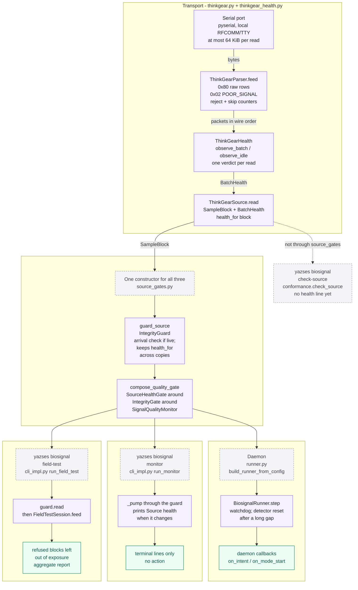
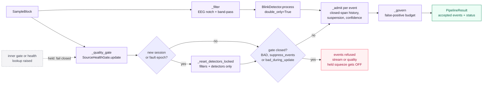
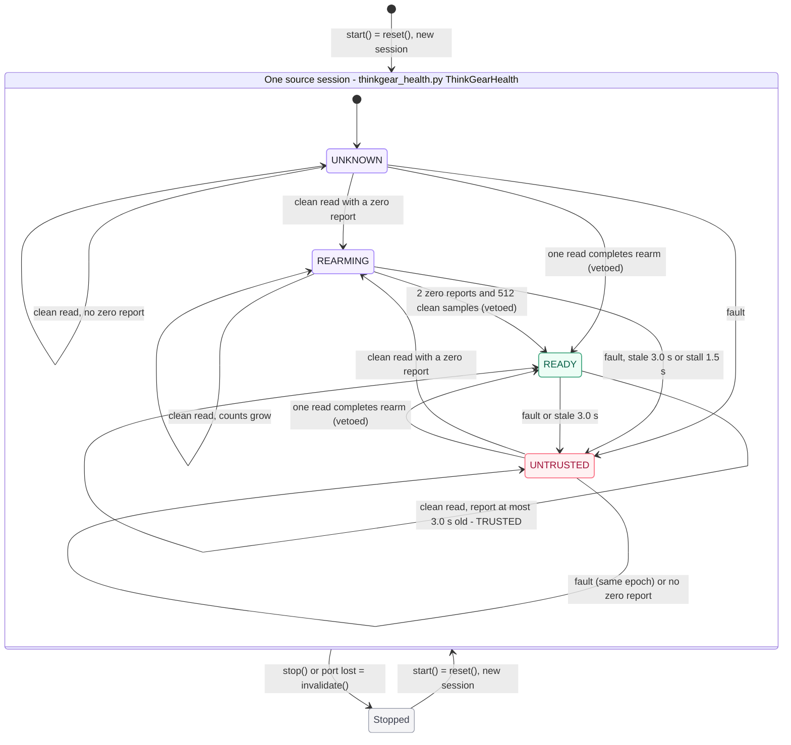
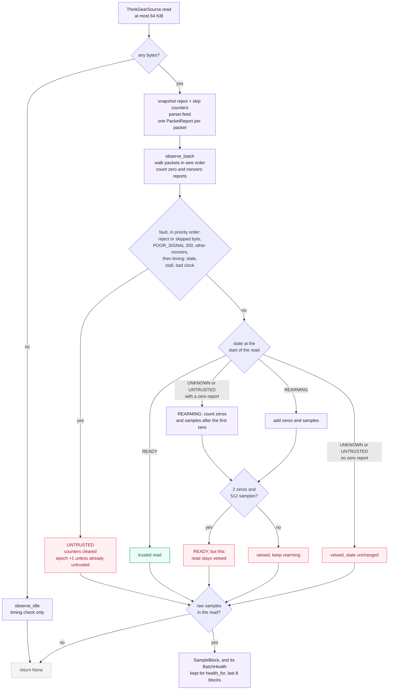
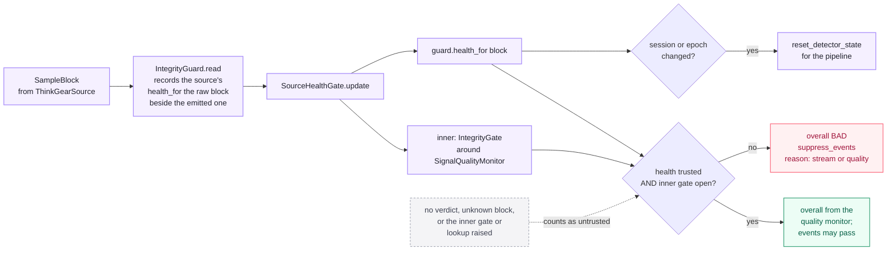
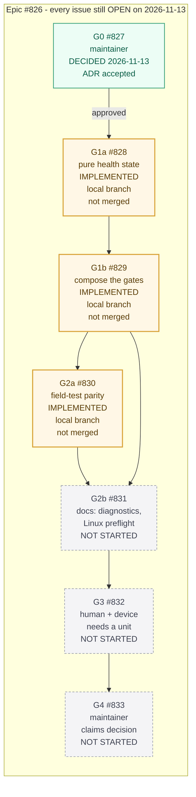

# ThinkGear blink-switch path — as built after ADR-v2-155, and the gates that remain

**Status:** Review aid for [ADR-v2-155](../adr/adr-v2-155-thinkgear-transport-safety.md) (Accepted 2026-11-13, G0 [#827](https://github.com/MSKazemi/yazses/issues/827)) and its implementation in [#828](https://github.com/MSKazemi/yazses/issues/828)–[#830](https://github.com/MSKazemi/yazses/issues/830). Every figure is drawn from the code at `2c5480d0` (`feat/thinkgear-parity-830`, stacked on `feat/thinkgear-gate-829` and `feat/thinkgear-health-828`), checked on 2026-11-13. Those branches are **not merged into `main`**, so the line numbers below are for that commit.  
**Related:** [ADR-v2-155](../adr/adr-v2-155-thinkgear-transport-safety.md), [implementation contract](../specs/thinkgear-hardware-qualification.md), [first-device roadmap](2026-11-03-first-device-roadmap.md), [biosignal pipeline spec](../specs/biosignal-pipeline.md).

The ADR and its spec describe the ThinkGear (TGAM-class headset) path in prose. This page draws
what the code does, so a reviewer can compare the two. Where the code differs from the spec, the
figures follow the code and the differences are listed under Figure 3. Each figure is a Mermaid
block: it renders on GitHub and on the docs site, and the block is the source, so edit it here.

Colours mean the same thing in every figure. Lavender is an ordinary step. Green is an outcome,
a trusted read, or a finished item. Red is a veto or a refused event. Amber is work that is
implemented and waiting for review and merge. Grey dashed boxes are annotations or items not
started.

## Figure 1 — As built: one transport, one constructor, three ways in



**The field-test gap is closed in this code.** Before #830, `biosignal field-test` read the
bare source with no `IntegrityGuard` and built its pipeline without `IntegrityGate`. Now the
daemon, `monitor` and `field-test` all build the guarded source and the event gate through
`source_gates.py`. With a `thinkgear:` source, that gate is `SourceHealthGate` around
`IntegrityGate` around `SignalQualityMonitor`. Every other source (synthetic, file, BrainFlow,
LSL, BITalino, Myo) gets the guard and a plain `IntegrityGate`, the same as before.

| Step in the figure | Where it is (file:line on `2c5480d0`) |
|---|---|
| One serial read, capped at 64 KiB | `biosignal/thinkgear.py:465` `ThinkGearSource.read`; cap at `:470` (`_MAX_READ`, `:143`) |
| Parser; a packet with several `0x02` rows reports the largest | `biosignal/thinkgear.py:197` `ThinkGearParser.feed`; `:283` |
| Health verdict for the read, or an idle tick | `biosignal/thinkgear.py:488` `observe_batch`; `:476` `observe_idle` |
| Block and verdict kept together, last 8 blocks | `biosignal/thinkgear.py:503`; `:515` `health_for`; depth `:145` |
| `start()` begins a new session; `stop()` and a lost port clear trust | `biosignal/thinkgear.py:458` `health.reset()`; `:509` and `:541` `_invalidate_health()` |
| `guard_source`: `IntegrityGuard`, arrival-rate check for live sources | `biosignal/source_gates.py:83` |
| The guard carries the verdict across a sanitized copy | `biosignal/integrity.py:664` (records `_source_health(raw)`, `:717`); `:696` `IntegrityGuard.health_for` |
| `compose_quality_gate`: adds `SourceHealthGate` for ThinkGear | `biosignal/source_gates.py:103`; scheme list `:65`; `needs_source_health` `:92` |
| Daemon uses the constructor | `biosignal/runner.py:922` (`compose_quality_gate`), `:926` (`guard_source`) |
| Daemon only: detector reset after a gap longer than the watchdog | `biosignal/runner.py:391-399` in `BiosignalRunner.step` (`:377`) |
| Monitor uses the constructor; prints `Source health:` when the verdict changes | `biosignal/cli_impl.py:756-759` in `run_monitor` (`:718`); pumped through the guard at `:850` |
| Field test uses the constructor and reads through the guard | `biosignal/cli_impl.py:1711` (`guard_source`), `:1721` (`compose_quality_gate`), `:1756` `guard.read()`, `:1766` `session.feed(block)` |
| Field test leaves refused blocks out of exposure | `biosignal/fieldtest.py:877` `FieldTestSession.feed`; `:1054` `_trust` |

Three things the figure shows that a reviewer may want to act on:

- **`yazses biosignal check-source` does not use `source_gates`.** `run_check_source`
  (`cli_impl.py:1532`) still passes the bare source to `conformance.check_source`
  (`:1553`). ADR-v2-155 decision 6 asks for a ThinkGear protocol-health line there. That
  line does not exist yet.
- **The daemon still has one extra reset.** After a silence longer than its watchdog, the
  daemon releases a held squeeze and resets the pipeline (`runner.py:391-399`). `monitor` and
  `field-test` rely on the stream gate's stall check instead. The #830 CHANGELOG entry
  records this difference.
- **`FieldTestSession` still holds the unguarded source.** `run_field_test` builds
  `FieldTestSession(src, ...)` with the raw `src` (`cli_impl.py:1732`). Today this does no
  harm: only `FieldTestSession.run()` reads that source (`fieldtest.py:902-911`), and
  `run_field_test` never calls `run()`. It feeds blocks from `guard.read()` instead. If the
  loop is ever replaced by `session.run()`, the field test would skip the guard again.

## Figure 2 — As built: inside `BiosignalPipeline.process`



`pipeline.py:630` `process` asks the quality gate (`_quality_gate`, `:787`), which for ThinkGear
is `SourceHealthGate.update`. If the report says the source started a new session or fault
epoch (`reset_detector_state`, read at `:798`), the pipeline resets only its filters and
detectors (`_reset_detectors_locked`, called at `:647`). The quality monitor, the closed-gate
history, the governor and the ledger are kept. That reset is what stops a double blink from
pairing a blink from before a contact loss with one after it. A closed gate refuses the events
and releases a held squeeze, as before (`_admit`, `:851`).

The dashed note marks a fail-closed change. Before ADR-v2-155, an exception in the quality
monitor turned the pipeline's whole gate off (`pipeline.py:794`). `SourceHealthGate` now catches
a failure of its inner gate and of the health lookup, and holds events instead
(`source_gates.py:165-216`). The pipeline's own "gate off" path is still there, so it only
applies if an exception escapes `SourceHealthGate.update` itself.

## Figure 3 — As built: the source-health state machine (`thinkgear_health.py`)



A **fault** is any of: a rejected packet or skipped framing byte (`corrupt_packet`),
`POOR_SIGNAL=200` (`no_contact`), any other nonzero `POOR_SIGNAL` (`contact_contaminated`), or a
clock that is not finite or went backwards (`clock_invalid`). A **clean read** is one with no
fault and no timing fault for the current state. An idle read (no bytes) runs only the timing
checks.

| From | Read | Verdict for this read | To | Code |
|---|---|---|---|---|
| (start) | `start()`: `reset()`, new session, epoch 0 | — | UNKNOWN | `thinkgear_health.py:208`; `thinkgear.py:458` |
| any | `stop()` or a lost port: `invalidate()`, same session | — | UNKNOWN (stopped) | `thinkgear_health.py:214`; `thinkgear.py:509`, `:541` |
| UNKNOWN | clean, no zero report | vetoed | UNKNOWN | `:300-301` |
| UNKNOWN or UNTRUSTED | clean, at least one zero report | vetoed | REARMING. Counts every zero in the read, and only the samples **after** the first zero | `:291-299` |
| UNKNOWN or UNTRUSTED | clean, and that one read already has 2 zeros and 512 samples after the first zero | vetoed | READY | `:299` via `_maybe_ready` `:325-329` |
| UNTRUSTED | clean, no zero report | vetoed | UNTRUSTED (reason unchanged) | `:291-301` |
| any but UNTRUSTED | fault | vetoed | UNTRUSTED, counters cleared, epoch + 1 | `:289-290`, `_enter_untrusted` `:351-357` |
| UNTRUSTED | fault | vetoed | UNTRUSTED, counters cleared, **same epoch** | `:352-353` |
| REARMING | clean | vetoed | REARMING, or READY once 2 zeros and 512 samples are counted | `:302-306` |
| REARMING or READY | no zero report for more than 3.0 s (`contact_stale`) | vetoed | UNTRUSTED | `_timing_fault` `:334-336` |
| REARMING | no bytes for more than 1.5 s (`transport_stalled`) | vetoed | UNTRUSTED | `:337-339` |
| READY | clean | **trusted** | READY | `:307-311` |

The thresholds are module constants (`:79-89`): `CONTACT_TTL_S = 3.0`, `REARM_GOOD_REPORTS = 2`,
`REARM_CLEAN_SAMPLE_S = 1.0` (512 samples at 512 Hz) and `TRANSPORT_STALL_S = 1.5`. They are
still engineering choices, not measured values (ADR decision 4).

**Where the code differs from the spec's state table** ([spec §3](../specs/thinkgear-hardware-qualification.md#state-table)):

1. **One read can go straight to READY.** The spec draws UNKNOWN → REARMING on the first zero.
   The code jumps to READY in a single read that already holds 2 zeros and 512 samples after the
   first one. That read is still vetoed. The spec's prose allows this ("two good reports in one
   large serial batch"), but its table does not show it.
2. **Leaving UNTRUSTED needs only a zero report.** The spec's row says "one good report; clean
   valid raw". The code moves to REARMING on a fault-free read with a zero report, even if that
   read has no raw samples. Raw samples are still needed later, to reach READY.
3. **A fault while UNTRUSTED does not start a new epoch.** The epoch goes up only when the
   source enters UNTRUSTED from another state. The counters are cleared either way. So the
   detector reset in Figure 2 happens once per fault episode, not once per bad read.
4. **The stall check runs only while REARMING.** In READY, a silent link is caught by the 3.0 s
   contact timeout, and by `IntegrityGuard`'s own stall check, which closes the stream gate.
   The 1.5 s health stall does not apply there.
5. **There is no timeout before the first zero.** The stale check runs only in REARMING and
   READY. UNKNOWN and UNTRUSTED do not need one, because nothing is trusted in those states.
6. **A late zero cannot rescue its own read.** The timing check runs before the read's own
   reports are counted (`:271`, then `:283-286`). A READY read whose zero arrives 3.1 s after
   the previous report is judged stale and moves to UNTRUSTED.
7. **A bad clock is its own fault in every state** (`clock_invalid`). The spec mentions it in
   prose, but its table has no row for it.
8. **Stop and start do different things.** `stop()` or a lost port calls `invalidate()`: back
   to UNKNOWN, with the same session. `start()` calls `reset()`: a new session. The spec's last
   row combines the two.
9. **Any skipped framing byte taints the read.** The spec says a lone extra byte "need not equal
   a dropped sample but may conservatively veto". The code takes the conservative choice every
   time.

Items 1, 2, 3, 5, 6, 8 and 9 were checked by calling `ThinkGearHealth` directly with
synthetic `PacketReport` sequences on `2c5480d0`. Item 4 was checked by idling 1.6 s in
REARMING (moves to UNTRUSTED) and in READY (stays READY, then moves to UNTRUSTED at 3.1 s).
Item 7 was checked with a clock that went backwards in UNKNOWN.

## Figure 4 — As built: one serial read



This is `ThinkGearSource.read` (`thinkgear.py:465`) and `ThinkGearHealth.observe_batch`
(`thinkgear_health.py:237`). The parser counters are read before and after `feed`, and the
differences are the read's reject and skipped-byte counts (`thinkgear.py:478-490`). Faults are
ranked in the order shown (`thinkgear_health.py:269-281`). A read with no raw samples returns
no block, but its health still moves the state and the epoch. The next block's verdict then
carries that change, so a fault in a sample-less read still causes the detector reset in
Figure 2.

## Figure 5 — As built: the gate stack for a ThinkGear block



`SourceHealthGate.update` (`source_gates.py:165`) runs the inner `IntegrityGate` and looks up
the verdict for this exact block (`guard.health_for`). The gate is closed unless the verdict is
trusted **and** the inner gate is open (`:206`). A block with no verdict, or a failure in either
lookup, counts as untrusted. A change in `(session, epoch)` sets `reset_detector_state`
(`:182-184`). Transport reasons (`corrupt_packet`, `transport_stalled`, `clock_invalid`,
`:69`) are filed as `stream` refusals. Contact reasons are filed as `quality`.

## Figure 6 — Gate dependencies, #827 to #833



Issue states were read from GitHub on 2026-11-13: #826 to #833 are all still **open**. The G0
decision is recorded as a maintainer comment on #827 (2026-11-13), and the ADR status now reads
Accepted. #828, #829 and #830 are implemented on the stacked local branches named at the top of
this page. They are not on `origin` and not merged into `main`. #831 depends on #829 and #830,
which are implemented but not merged. #832 needs a physical unit and a person; a cloud agent
cannot run it.

## Keeping this page true

The line numbers point at `2c5480d0`. A rebase or merge can move them. Before relying on them,
rerun the checks they rest on:

```sh
grep -n "source_gates\." src/yazses/biosignal/cli_impl.py src/yazses/biosignal/runner.py
grep -n "def _timing_fault\|def _enter_untrusted\|def _maybe_ready" src/yazses/biosignal/thinkgear_health.py
```

If `check-source` gains a health line, or `FieldTestSession` is built from the guard, update
Figure 1 and the notes under it.
