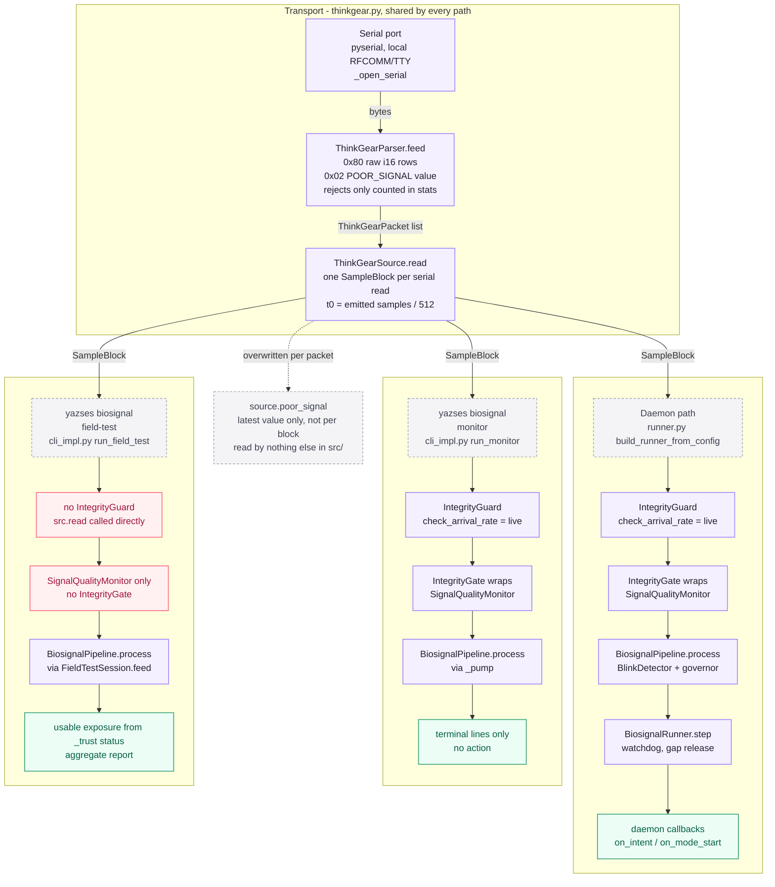
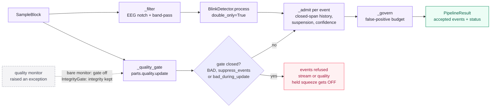
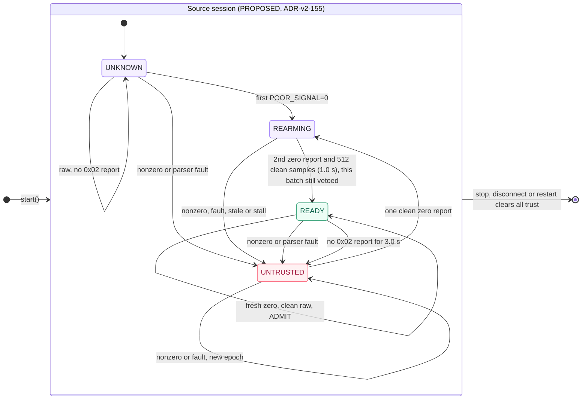
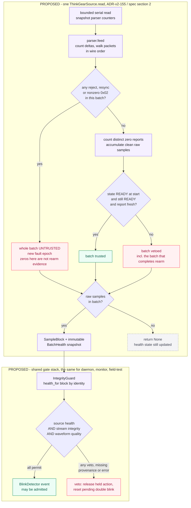
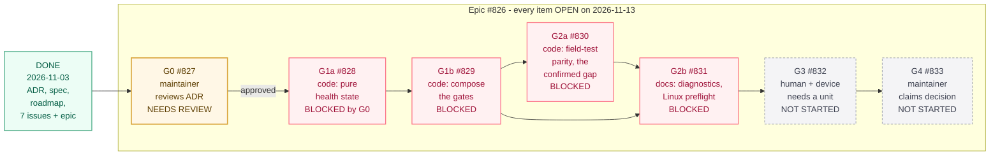

# ThinkGear blink-switch path — as built, as proposed, and the gates between

**Status:** Review aid for [ADR-v2-155](../adr/adr-v2-155-thinkgear-transport-safety.md) (issue [#827](https://github.com/MSKazemi/yazses/issues/827)). Figures 1 and 2 are **as built**, checked against `main` at `4a83e484` on 2026-11-13. Figures 3 and 4 are **PROPOSED**: none of that behaviour is implemented.  
**Related:** [ADR-v2-155](../adr/adr-v2-155-thinkgear-transport-safety.md), [implementation contract](../specs/thinkgear-hardware-qualification.md), [first-device roadmap](2026-11-03-first-device-roadmap.md), [biosignal pipeline spec](../specs/biosignal-pipeline.md).

The ADR and its spec describe the ThinkGear (TGAM-class headset) path in prose. This page shows
the same path as pictures, so the review can start from what the code does today and see
exactly what the proposal adds. Each figure is a Mermaid block: it renders on GitHub and on the
docs site, and the block is the source, so edit it here.

Colours mean the same thing in every figure: lavender is an ordinary step, green is an outcome
or something done, red is a gap, a veto or a blocked item, amber needs a maintainer decision,
and grey dashed boxes are annotations.

## Figure 1 — As built: one transport, three ways in



All three entry points open the same `ThinkGearSource`. They differ in what they put between
that source and the detector. The daemon and `yazses biosignal monitor` both wrap the source in
`IntegrityGuard` and put `IntegrityGate` in front of the quality monitor.
`yazses biosignal field-test` does neither: it reads the source directly and builds its pipeline
with the bare `SignalQualityMonitor`.

| Step in the figure | Where it is (file:line on `4a83e484`) |
|---|---|
| Serial port opened (pyserial, or an injected fake in tests) | `biosignal/thinkgear.py:290` `_open_serial`; `:402` `ThinkGearSource.start` |
| Packet parser; rejected packets only counted | `biosignal/thinkgear.py:170` `ThinkGearParser.feed`; counters at `:195`, `:203`, `:208` |
| One `SampleBlock` per serial read, `t0` = samples emitted / 512 | `biosignal/thinkgear.py:427` `ThinkGearSource.read`; `:451-452` |
| `poor_signal` overwritten per packet, latest value only | `biosignal/thinkgear.py:441-442`. A search of `src/` finds no reader outside `thinkgear.py` |
| Daemon builds the runner | `core/daemon.py:2390` calls `biosignal/runner.py:815` `build_runner_from_config` |
| Daemon: `IntegrityGuard` around the source | `biosignal/runner.py:923-924` (`check_arrival_rate=live`) |
| Daemon: `IntegrityGate` wraps the quality monitor | `biosignal/runner.py:918-919` |
| Daemon: read, process, watchdog/gap release, callbacks | `biosignal/runner.py:377` `BiosignalRunner.step`; `:589` `_handle_events`; `core/daemon.py:2663` `_biosignal_intent` |
| Monitor: same guard and gate | `biosignal/cli_impl.py:755-757` in `run_monitor` (`:718`); pumped through the guard at `:828` |
| Field test: pipeline without `IntegrityGate` | `biosignal/cli_impl.py:1690-1691` (`_build_pipeline`, `:215`, sets no gate) |
| Field test: source read directly, no `IntegrityGuard` | `biosignal/cli_impl.py:1701` `FieldTestSession(src, ...)`; `:1725` `src.read()`; `:1735` `session.feed(block)` |
| Field test: usable exposure judged from the pipeline status only | `biosignal/fieldtest.py:877` `FieldTestSession.feed`; `:1054` `_trust` |

**The field-test gap is real on current `main`.** The roadmap lists it as a *confirmed code gap*
(owned by [#830](https://github.com/MSKazemi/yazses/issues/830)), and it still holds: in
`run_field_test` there is no `IntegrityGuard` and no `IntegrityGate`, unlike `run_monitor`
(`cli_impl.py:753-757`) and the runner (`runner.py:918-924`). A dropped packet, a stall or a
drifting arrival rate therefore closes the event gate in the daemon and in `monitor`, but the
field test does not see it. Its exposure can include stretches the daemon would have refused.

Two smaller facts the figure makes visible:

- **`yazses biosignal check-source`** (`cli_impl.py:1510`) takes a fourth route, not drawn here.
  It hands the opened source to `conformance.check_source` (`conformance.py:203`), which runs
  `StreamIntegrityChecker` directly with no pipeline and no detector. It never looks at
  `poor_signal`.
- **`POOR_SIGNAL` does not gate anything today.** The parser decodes it and the source keeps
  the latest value, but no gate, detector or report reads it. That is the gap ADR-v2-155
  decision 2 addresses.

## Figure 2 — As built: inside `BiosignalPipeline.process`



`pipeline.py:617` `process` runs the quality gate (`_quality_gate`, `:769`) on the raw block,
and in parallel the filter and the double-blink detector (`_build_blink_detector`, `:1292-1310`,
`double_only=True`). Each candidate event then goes through `_admit` (`:830`). It is refused if
the gate is closed now or was closed when the event happened, or if the governor has suspended
the switches, or if the event is below the confidence floor. A closed gate also releases a held
squeeze.

The dashed note marks a difference the ADR cares about (decision 7). If a **bare** quality
monitor raises, the pipeline switches the whole quality gate off (`pipeline.py:774-776`). Wrapped
in `IntegrityGate`, the failing monitor is dropped and the stream-integrity half keeps working
(`integrity.py:826-834`). The field test has no `IntegrityGate`, so it has the first behaviour.

## Figure 3 — PROPOSED (ADR-v2-155, not implemented): source-health state machine



This is the state table in [spec §3](../specs/thinkgear-hardware-qualification.md#state-table),
drawn as states. Every transition in that table is in the figure.

| From | Input during one read | This batch | To |
|---|---|---|---|
| (start) | `start()` of a fresh source | — | UNKNOWN |
| UNKNOWN | valid raw, no `0x02` report | suppress | UNKNOWN |
| UNKNOWN | first `POOR_SIGNAL=0` with valid raw | suppress | REARMING |
| UNKNOWN / REARMING / READY | any nonzero `0x02` (including 200), even if a later packet in the batch reports 0 | suppress | UNTRUSTED, counters cleared |
| UNKNOWN / REARMING / READY | bad checksum, bad length, malformed row or significant resync | suppress; no sample count is inferred | UNTRUSTED, counters cleared |
| UNTRUSTED | another nonzero report or fault | suppress | UNTRUSTED, new fault epoch |
| UNTRUSTED | one clean zero report with clean raw | suppress | REARMING |
| REARMING | second distinct zero report **and** ≥ 512 contiguous clean samples (1.0 s at 512 Hz) | **suppress this batch too** | READY; admit no earlier than the next clean batch |
| REARMING | nonzero, fault, stale report or stall | suppress | UNTRUSTED |
| READY | fresh zero, no fault, clean raw | admit, still subject to integrity and waveform gates | READY |
| READY | no `0x02` report for 3.0 s of injected monotonic time | suppress | UNTRUSTED (stale) |
| any | `stop()`, serial disconnect, runtime restart | suppress; trust and provenance cleared | session ends; a new start begins at UNKNOWN |

The thresholds (3.0 s, two reports, 1.0 s) are the ADR's **untested engineering choices**, not
validated values (ADR decision 4).

## Figure 4 — PROPOSED (ADR-v2-155, not implemented): one read, then the shared gate stack



The upper half is [spec §2](../specs/thinkgear-hardware-qualification.md#2-wire-processing-and-the-contamination-problem),
steps 1–7. The whole batch is judged at once: a final good value cannot rescue packets that came
before it in the same read. The lower half is spec §4 and ADR decision 6. One shared constructor
builds the same stack for the daemon, `monitor` and `field-test`. That shared constructor is
what would close the gap in Figure 1. A block with no recognised health snapshot, or an
exception in the health gate, counts as a veto (fail closed).

## Figure 5 — Gate dependencies, #827 to #833



The order is the roadmap's dependency flow. #831 depends on both #829 and #830. Issue states
were read from GitHub on 2026-11-13: #826 to #833 are all **open**. Only the design artefacts
(the ADR, the spec, the roadmap and the issues) are done. Nothing below #827 can start until
the maintainer decides on the ADR. If #827 rejects or revises it, the blocked issues are updated
before any code is written. #832 also needs G2 passed and a physical unit in the hands of a
person. A cloud agent cannot do that step.

## Keeping this page true

The as-built figures cite line numbers on one commit, so they go stale when the code moves.
Before relying on them, rerun the checks they rest on:

```sh
grep -n "IntegrityGuard\|IntegrityGate" src/yazses/biosignal/runner.py src/yazses/biosignal/cli_impl.py
grep -rn "poor_signal" src/yazses --include=*.py
```

When #830 lands, `run_field_test` gains the guard and gate. Redraw Figure 1 at that point; do
not leave a red box for a gap that has been closed.
