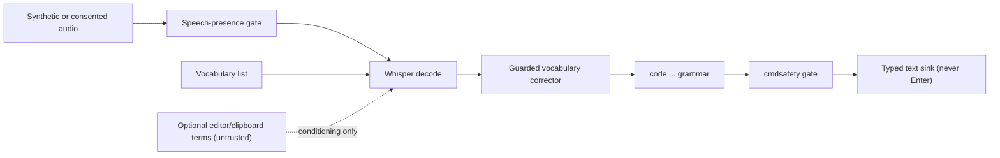

# Research: code-aware correction and spoken technical vocabulary, offline

**Issue:** [#804](https://github.com/MSKazemi/yazses/issues/804) · **Parent:** [#788](https://github.com/MSKazemi/yazses/issues/788)  
**Date / audited revision:** 2026-11-05, `MSKazemi/yazses@a241a77b6c59d65fb9265a0475d42f1a97fdfe6a` (`main`)  
**Status:** Research note (not a decision). ADR-030 freeze unchanged.  
**Companions:** [trust-boundary audit (#803)](2026-11-03-agent-mcp-trust-boundary-audit.md) · [ADR-030](../adr/adr-030-agent-era-direction.md) · [ADR-031](../adr/adr-031-send-to-prefill-handoff.md) · [ADR-032](../adr/adr-032-mcp-discoverability.md) · [ADR-021](../adr/adr-021-invest-in-error-cost.md)

**Question (#804):** how much can existing vocabulary, context priming, spoken symbols, editor context and (optionally) a local model reduce the cost of dictating identifiers, commands and code, without any cloud call?

**Verdict (options, not a decision):** **MEASURE FIRST** with a synthetic benchmark (section 6), because nothing below has been measured on code. If the owner wants a change, the evidence favours the smallest, already-advertised wiring and corrector-guard work (Pillar 1, "wiring a capability already advertised", ADR-030 section 3) over any new capability. **DEFER** local-LLM rewriting of dictated code. **REJECT** reading editor or terminal text into anything that can type, run or send it without a boundary. No implementation is proposed here.

## Evidence labels

**[Verified-in-code]** read in this checkout (`file:line`) · **[Verified-primary-source]** a primary page/preprint landing read on 2026-11-05 · **[Upstream-claim]** what an author or vendor states; not a YazSes measurement · **[Assumption]** reasoning with no source or measurement · **[Unknown]** not established. No audio, transcript, real repository or secret was used. Preprints are cited by arXiv *abs* landing pages only; the fetch tool returned abstracts or summaries, so every external source is **not read in full** unless stated.

## 1. What exists today (inventory)

| Layer | Where | State |
|---|---|---|
| Decoder prompt (`initial_prompt`) | `config.py:114`; composed in `core/daemon.py:6749` (`_effective_initial_prompt`), passed at `daemon.py:4445,4452`; token-budget warning `stt/faster_whisper.py:166-201`; built-in phrase `stt/vocabulary.py:24`, budget 223 at `:46` | Always on for Whisper; `[stt] initial_prompt` and `yazses vocab` words feed it [Verified-in-code] |
| Decoder `hotwords` / `prefix` kwargs | none in `src/yazses/stt/`; installed faster-whisper 1.2.1 accepts both (`transcribe.py:280,296`) | **Unused** by YazSes [Verified-in-code] |
| `[hotwords]` config section | `config.py:1700-1740`, `postprocess/hotwords.py:1-12` | Not a decoder feature: a second switch and extra terms for `vocab_correct` [Verified-in-code] |
| Post-ASR vocabulary corrector | `postprocess/vocab_correct.py:186`; `daemon.py:4497,6660` | Off unless `[stt] vocab_correction` (`config.py:120`) or hotwords is active; four guards (phonetic key, edit distance, tokens under 4 chars skipped, correct word is a fixed point) [Verified-in-code] |
| Phonetic corrector | `postprocess/phonetic.py:1-135`; `daemon.py:4955-4962` | Off by default; the daemon calls `correct_text(text, _vocab)` **without** `known`, which the module docstring says corrupts ordinary text ("get the file" -> "Git the file"); pinned by `tests/test_phonetic_needs_a_known_wordlist.py` [Verified-in-code] |
| Spoken symbols and cased identifiers | `code/spoken.py:26-191`; wired by `spokencmd/registry.py:69` behind the prefix "code ..." and `[code] enabled` (`config.py:1373`, default false) | 38 symbol phrases, 5 styles; **no** "dash"/"hyphen" in the code grammar (`dash` exists only in the spelling alphabet, `spelling/nato.py:20`) [Verified-in-code] |
| Voice punctuation | `postprocess/voice_punctuation.py:17-19` | Opt-in; "new line" emits `"\n"` [Verified-in-code] |
| Context from the focused app | `commands/context.py:61`, `system/context_read.py:26-60`, `daemon.py:6769-6805` | `[context] enabled` default false (`config.py:980`): window title (X11 `xdotool`), selection, optional clipboard, then terms into `initial_prompt` [Verified-in-code] |
| Screen-grounded terms | `screengrounded/harvest.py`, `daemon.py:6792-6803` | Opt-in, same chokepoint [Verified-in-code] |
| Editor (LSP-style) bridges | `commands/lsp_context.py:61-497` (Neovim socket `$NVIM`; VS Code via a JSON file) | The daemon calls `compose_context_prompt(..., use_lsp=False)` (`daemon.py:6792`); `CodeContext.to_prompt_string` has **no caller**; `LspContextProvider` is used only by `yazses jump` (`cli.py:511`). ADR-v04-002 describes injection that the decode path does not do [Verified-in-code] |
| Structural editing by voice | ADR-v2-115 (HatSelect), `jump` | Accepted designs; reuse, do not duplicate [Verified-in-code: ADR text] |
| Command safety gate | `cmdsafety/classify.py:17-51`, gate `daemon.py:5971`, applied on dictation (`:5188`) and spoken capabilities (`:7216`); `config.py:1658` | Off by default; a **denylist** of 13 dangerous and 4 caution patterns [Verified-in-code] |
| Local LLM rewriting | `postprocess/llm_cleanup.py` (loopback-only endpoint guard `:41,:97`; `[filters.disfluency] llm_enabled=false`, `config.py:397`); `commands/rewrite.py`; `slm_router.py` | All opt-in, local; none targets code [Verified-in-code] |

## 2. Strategy comparison

### 2.1 Decoder biasing (`initial_prompt`, `hotwords`, `prefix`)

- **Mechanism.** In faster-whisper 1.2.1, `hotwords` is tokenised and placed in the same "previous text" prompt slot as `initial_prompt`; `prefix` forces the start of the first window (`transcribe.py` `get_prompt`, lines 1532-1566). It is context, **not a logit bias** [Verified-in-code]. Docstring: hotwords "has no effect if prefix is not None" [Verified-in-code].
- **What primary sources say.** The [OpenAI Whisper prompting guide](https://developers.openai.com/cookbook/examples/whisper_prompting_guide) says the model follows the *style* of the prompt, not instructions, that a spelling list can help, that only the last 224 tokens count, and that the techniques are "not especially reliable" [Upstream-claim]. Stronger biasing exists in the literature: a tree-constrained pointer generator on frozen Whisper ([arXiv:2410.18363](https://arxiv.org/abs/2410.18363), Lall and Liu, 2024; abstract reports reduced WER, no figures on the page) and instruction fine-tuning that reports a 45.6% rare-word gain over a prompt-biased baseline ([arXiv:2502.11572](https://arxiv.org/abs/2502.11572), 2025; baseline setup not visible on the page) [Upstream-claim]. Neither uses code identifiers [Unknown for code]. ADR-v2-069 also cites 2506.01263 and 2509.09196, which were **not read** here.
- **Failure mode: echo.** On noise Whisper can return the prompt itself; YazSes measured this ("The app is called YazSes.", a personal word list, "Thanks for watching.") and added a Silero speech-presence gate before decoding, `audio/speech_presence.py:1-30`, wired at `daemon.py:4282-4300`, `speech_presence_check` default true (`config.py:449`) [Verified-in-code]. [#598](https://github.com/MSKazemi/yazses/issues/598) is still open (hotkey and eye-gesture bursts on Windows, root cause not reproduced) [Verified-in-code via `gh issue view`]. Hallucination on non-speech is documented independently ([arXiv:2402.08021](https://arxiv.org/abs/2402.08021): about 1% of transcriptions contained invented phrases) [Verified-primary-source, abstract only].
- **Why it matters more for code.** A prompt filled with identifiers is attacker- and secret-bearing text (section 3). An echo types it into the focused window. The gate fails open by design (`speech_presence.py` docstring), so a residual echo rate is expected, not zero [Verified-in-code].
- **Gap to measure.** `hotwords=` never reaches the decoder; whether it beats `initial_prompt` for identifiers is [Unknown]. It shares the prompt slot, so the same echo hazard is [Assumption].
- **Parakeet.** `initial_prompt` is Whisper-only; with another engine the vocabulary is dropped unless the post-ASR corrector runs (`vocab_correct.py:1-12`) [Verified-in-code].

### 2.2 Post-ASR correction (vocabulary lists, phonetic keys)

- **Exists:** section 1. Engine-agnostic and auditable (each substitution is logged and recorded, `daemon.py:6660-6690`) [Verified-in-code].
- **Failure modes (measured in repo):** phonetic twins collide exactly (`get`/`Git`, `had`/`head`: score 0.000 for both the wrong and the right rewrite), so no threshold separates them (`tests/test_phonetic_needs_a_known_wordlist.py`) [Verified-in-code]. `vocab_correct` also refuses multi-word joins over stopwords after "from this" became "Prometheus" (`vocab_correct.py` `_STOPWORDS`) [Verified-in-code]. Its tokenizer is letters only (`_WORD_RE`), so `parse_config2` or digit-bearing identifiers are never repaired as units; words under 4 characters (`id`, `url`, `dto`) are out of reach [Verified-in-code].
- **Safety.** A rewrite changes what the user said; the project rule is that a guard must fire rarely and on a checkable signal (AGENTS.md rule 9, [ADR-021](../adr/adr-021-invest-in-error-cost.md)). `phonetic.correct_text` skips URLs, paths, file names and versions via `structured_spans` (`phonetic.py:116-135`) [Verified-in-code].
- **Literature:** LLM generative error correction can fix tokens absent from the N-best list ([HyPoradise, arXiv:2309.15701](https://arxiv.org/abs/2309.15701), NeurIPS 2023 Datasets and Benchmarks) [Upstream-claim]; faster-whisper exposes no N-best list, so ADR-v2-069's rescorer has no producer (`hotwords.py:1-12`) [Verified-in-code]. General-purpose correction results do not establish code-identifier accuracy [Unknown].

### 2.3 Spoken-symbol grammars

- **Exists:** `spoken_symbols` (longest-match, word-bounded; order derived, not hand-kept, `code/spoken.py:26-62`) then `spoken_identifiers` ("camel case user name" -> `userName`) then `tighten_code` (`registry.py:45-90`). Order is load-bearing and tested (`tests/test_spoken_symbols_ordering.py`, `tests/test_code_spoken_identifiers.py`) [Verified-in-code].
- **Gaps:** no `dash`/`hyphen`/`double dash` (a flag like `--force` has no spoken form here except via `minus minus`); `dot` and `star` are ordinary words but active only after the "code" prefix (ADR-v2-031 caveat); operator spacing and indentation deliberately untouched (`registry.py` `tighten_code` docstring) [Verified-in-code]. Ordering with the vocabulary corrector: correction (`daemon.py:4497`) runs before the spoken router (`:4701`), so a corrector rewrite of a spoken word could precede the grammar [Verified-in-code; effect [Unknown]].
- **Prior art (not YazSes data):** [Cursorless](https://www.cursorless.org/docs/) documents "an action performed on a target" with hats on tokens; [Talon](https://talon.wiki/) is the keyboard-and-mouse replacement it runs on (the fetched wiki page did not cover formatters or engines) [Upstream-claim]. A W4A 2018 study of vocal programming (VocalIDE, 8 participants with upper-limb impairments) reported speech-recognition errors and a timeout executing half-formed commands as main problems (summary read via a search listing only; **not read in full**) [Upstream-claim]. Earlier academic work (for example a 2012 IEEE paper arguing engines lack programming models) was seen only as search metadata [Unknown].

### 2.4 Casing and identifier modes

`to_case` (`code/spoken.py:66`) covers camel, pascal, snake, constant, kebab; `end case` terminates a run. Risks: ordinary words ("snake", "constant", "screaming") begin a run only when followed by "case" (word-bounded regex, `spoken.py` `_CASE_KEYWORD`); acronym handling (`HTTPServer` vs `HttpServer`), digits ("three" vs `3`) and mixed-case brand names are [Unknown]; the module emits lower-cased tokens and capitalises, so `userID` is not producible [Verified-in-code, derived from `to_case`].

### 2.5 Context from the focused editor, terminal and screen

- **Value claim:** nearby identifiers prime the decoder (ADR-v04-002, ADR-v2-004) [Upstream-claim by ADR; no measurement in the repo]. Decode-path wiring of editor symbols is **absent** (`use_lsp=False`), so the claimed value is currently unreachable; wiring it is "wiring an advertised capability" under ADR-030 section 3, an owner call [Verified-in-code].
- **Editor contract gap.** The LSP specification defines the editor/language-server relationship; the fetched [LSP landing page](https://microsoft.github.io/language-server-protocol/) does not describe a standard way for a third-party app to read the live document or cursor [Verified-primary-source for the absence on that page; full spec **not read**]. YazSes therefore depends on per-editor bridges: Neovim over `$NVIM`, VS Code over a JSON file with no published extension (`cli.py:517-523`) [Verified-in-code].
- **Privacy and injection (links the [trust-boundary audit](2026-11-03-agent-mcp-trust-boundary-audit.md), Boundaries B, E, F; AGT-07):**
  1. *Confidentiality.* Clipboard, selection and screen text can hold secrets. They enter `initial_prompt`; the echo mechanism of 2.1 can type them into whatever has focus, possibly a different window [Assumption derived from #598; not reproduced].
  2. *Untrusted content.* File, repository, web-page and terminal text is attacker-controllable data. In the current decode path it only conditions Whisper, which imitates style rather than obeying instructions [Upstream-claim, OpenAI guide]; no LLM reads it. The risk becomes **indirect prompt injection** the moment any LLM, MCP tool or agent consumes that text ([Greshake et al., arXiv:2302.12173](https://arxiv.org/abs/2302.12173); [OWASP LLM01](https://genai.owasp.org/llmrisk/llm01-prompt-injection/): least privilege, human approval for privileged operations, segregate untrusted content) [Verified-primary-source, abstracts and summary].
  3. *Logs.* Prompts are not logged at INFO in the lines inspected (`daemon.py:4370-4452`), and `[context]` states content is never stored; transcripts are DEBUG-logged (AGT-07) [Verified-in-code; completeness of log audit [Unknown]].
  4. *Terminal contents.* Reading a terminal buffer exposes shell history and credentials; no reader exists today (`context_read.py` reads title, selection, clipboard only) [Verified-in-code]. A new terminal reader would cross Boundary B and needs its own threat model [Assumption].
  5. *Wayland.* Window title needs X11 `xdotool` (`context_read.py:26-30`); the signal is absent on many Wayland sessions [Verified-in-code].

### 2.6 Small local LLM rewriting

Existing opt-in, local-only paths: `llm_cleanup.py` refuses a non-loopback endpoint (`is_loopback_endpoint`, `endpoint_is_permitted`), has length-ratio guards and falls back to the raw transcript (ADR-013); `rewrite.py` rewrites a *selection* with per-instruction length bands [Verified-in-code]. For code this is the highest-risk option: a model can "fix" an identifier into a different one, and the LLM sees dictated text (and, if context is added, untrusted editor text; section 2.5 item 2). **Excluded unless offline, opt-in, off by default, and measured first** [Assumption, consistent with ADR-011, AGENTS.md rules 1-3]. Freeze implications: a new code-specific rewrite mode is a new capability outside the pillars, so under ADR-030 section 3 it is written as a *Proposed* ADR or research issue and stops; pointing the existing `[filters.disfluency]` cleaner at code would be a behaviour change to an existing feature and needs the same review [Verified-in-code: ADR-030 text]. A model download is a separate consent matter (ADR-019 egress inventory).

## 3. Safety: dictated shell commands are never auto-executed

- YazSes types text; the safety property is "nothing submits". The gate is a **denylist** (`classify.py:17-51`), off by default (`config.py:1658`), and cannot see a command broken by spoken-symbol spacing: "rm minus r f slash" yields `rm - r f /`, scored **safe** (docstring at `daemon.py:7165-7190`); the phonetic alphabet can assemble `rm -rf /` exactly and is gated since `:7216` [Verified-in-code]. `tests/test_cmdsafety_sees_the_typed_text.py` pins that the gate judges the text as typed [Verified-in-code].
- A trailing newline would submit a command in a terminal. Opt-in voice punctuation can emit `"\n"` (`voice_punctuation.py:17-19`); that typed `"\n"` reaches Return in a terminal is [Assumption, not tested]. The no-go from the audit applies: no automatic send or Enter.
- Option for the owner: treat any code-mode output destined for a terminal as text-only (never newline-terminated by the code grammar), test it, and keep the confirm gate as defence in depth rather than the control. An allowlist approach was not evaluated here [Unknown].
- Context text must not alter or authorise a command (no instruction-from-data path), consistent with the audit's no-go on heuristic injection detectors.

## 4. Failure-mode catalogue to test

Homophone and near-homophone pairs: `null`/`no`/`now`, `tree`/`three`, `for`/`four`/`4`, `two`/`to`/`too`, `eight`/`8`/`ate`, `char`/`car`, `pi`/`pie`, `bool`/`bull`, `cache`/`cash`, `sudo`/`pseudo`, `grep`/`grape`, `git`/`get`, `ls`/`else`, `sed`/`said`. Numerals and units (digits vs words), acronyms and letter runs ("i d" vs `id`), `dot`/`period` clash with sentence punctuation, `--force` vs `minus minus force`, path and flag shapes, and non-English accents saying English identifiers. The repository already measured `get`->`Git` and `had`->`head` [Verified-in-code]; every other pair is a hypothesis to measure [Unknown].

## 5. Revised dataflow (for review only)

Dotted edge = untrusted data allowed to condition the decoder only, never to reach a tool, shell or LLM.

## 6. Evaluation plan (synthetic first; nothing run)

**Corpus (script-based, versioned, synthetic).** Classes: A identifiers (camel/snake/pascal/constant, with digits and acronyms); B code snippets with symbols (calls, assignments, comparisons, flags); C shell commands, split into benign, dangerous and near-miss pairs; D homophone-collision lists from section 4; E ordinary prose controls containing symbol words ("the dot on the map", "I get it"); F adverse text: strings such as "ignore previous instructions" and "press enter" placed in simulated editor context and in dictated text; G no-speech noise bursts. Each item has a reference string and class label. Use only invented project names and fake repositories; no real code, secrets or transcripts.

**Audio.** Phase 0: offline local TTS reading the scripts (engine and voice licence to be recorded; TTS speech is cleaner than human speech, so results are an optimistic bound [Assumption]). Phase 1, later and only with written consent: volunteers reading the same scripts, handled per AGENTS.md data rules (no upload to any third-party agent). No recording exists now.

**Arms (ablation, same audio, pinned model and versions):** A0 no prompt; A1 current prompt; A2 prompt with scripted vocabulary; A3 decoder `hotwords=` (needs a harness-only call, not a product change); A4 +`vocab_correct`; A5 +`code` grammar; A6 simulated editor-context terms; A7 optional local LLM, only if separately approved. Report each against the previous arm.

**Metrics.**
- Identifier exact-match rate (IEM): output equals reference after the grammar; per class, with 95% Wilson interval. With 300 items per arm the worst-case half-width is about 5.7 points (arithmetic: 1.96 x sqrt(0.25/300)), so arms closer than that are not separable.
- Symbol character error rate (SCER): edit distance over symbol characters only, after aligning to the reference; also separate counts for dropped, inserted and substituted symbols.
- Command exact-match and dangerous false-accept rate: fraction of dangerous scripts whose *typed* output `assess_command` scores `safe`; target is reported with an upper bound (zero events in n gives roughly 3/n at 95%, so 1,000 scripts bound it near 0.3%).
- Command-injection false-accept rate: fraction of class F items in which text from simulated context or dictated data appears in typed output, or alters a command, when it was not spoken. The sink is a harness buffer, never a shell.
- Prose false-fire (corruption) rate on class E; echo rate on class G with the speech-presence gate on and off.
- Cost-weighted view per [ADR-021](../adr/adr-021-invest-in-error-cost.md): weight a silent corruption of a command above a visible mis-hearing.

**Pre-registration.** Fix corpus, arms, metrics and the stop rule before the first run; no result is claimed in this note. The suite would be offline, mock the model layers where it can, and live as pure-module tests plus a manual benchmark script in a later, separately approved change [Assumption].

## 7. Options for the owner

1. **Measure only** (recommended first step): build the class A-G corpus and run arms A0-A5 on TTS audio. Cost: scripts and a harness, no product code.
2. **Fix guard gaps found by 1**, using only the pillar-allowed lane: for example the `known` word list for phonetic correction (a data decision left open at `phonetic.py:1-35`), or wiring editor symbols into the decode path with a bounded timeout. Each needs its own approval.
3. **Defer** local-LLM rewriting of code and any terminal-content reader until 1 shows a gap that grammars and vocabularies cannot close.
4. **Reject** any path where editor, terminal or clipboard text can reach a tool, shell, MCP call or LLM unmediated, and any automatic Enter.

A *Proposed* ADR is warranted only if option 2 changes a public interface (config keys or IPC); none is drafted here.

## 8. Strategy summary (one line each)

| Strategy | In product today | Strongest evidence | Main risk | First measurement |
|---|---|---|---|---|
| Decoder prompt / `hotwords` / `prefix` | prompt yes; kwargs no | style-following, 224-token tail, "not especially reliable" (vendor guide) | echo of prompt on noise (#598); prompt holds secrets | IEM and echo rate, A0-A3 |
| Post-ASR corrector | opt-in, guarded | repo-measured collisions; LLM-correction papers are general-domain | silent rewrite of correct words | prose false-fire, IEM, A4 |
| Spoken-symbol grammar | opt-in, "code" prefix | tests pin ordering; prior art is Talon/Cursorless | symbol words in prose; missing `dash` | SCER, class B, A5 |
| Casing modes | opt-in | tests pin styles | acronyms, digits, `userID` | IEM class A |
| Editor / screen context | window title, selection, clipboard, screen terms opt-in; editor symbols not wired | ADR claims only | secrets and untrusted text enter the prompt | echo rate, injection FAR, A6 |
| Local LLM rewrite | generic cleanup only | general-domain papers | changes identifiers, sees untrusted text | defer; A7 only if approved |

## 9. Sources and how they were read (all accessed 2026-11-05)

| Source | Landing page | Read as |
|---|---|---|
| OpenAI Whisper prompting guide | [cookbook](https://developers.openai.com/cookbook/examples/whisper_prompting_guide) | fetched page, summarised by the fetch tool |
| faster-whisper 1.2.1 `transcribe.py` | installed in the project venv | read locally (hotwords, prefix, `get_prompt`) |
| Lall and Liu, contextual biasing | [arXiv:2410.18363](https://arxiv.org/abs/2410.18363) | abstract only |
| Jogi et al., rare-word recognition | [arXiv:2502.11572](https://arxiv.org/abs/2502.11572) | abstract only |
| Chen et al., HyPoradise | [arXiv:2309.15701](https://arxiv.org/abs/2309.15701) | abstract only |
| Koenecke et al., Careless Whisper | [arXiv:2402.08021](https://arxiv.org/abs/2402.08021) | abstract only |
| Greshake et al., indirect injection | [arXiv:2302.12173](https://arxiv.org/abs/2302.12173) | abstract only |
| OWASP LLM01:2025 | [genai.owasp.org](https://genai.owasp.org/llmrisk/llm01-prompt-injection/) | summary of the entry |
| Cursorless docs | [cursorless.org](https://www.cursorless.org/docs/) | landing summary; hats not defined there |
| Talon wiki | [talon.wiki](https://talon.wiki/) | landing summary; formatters not covered |
| Language Server Protocol | [microsoft.github.io](https://microsoft.github.io/language-server-protocol/) | landing summary |
| Rosenblatt et al., W4A 2018 | not opened (search listing only) | **not read in full**, no link relied on |

A faster-whisper README fetch did not document `hotwords`, `prefix` or `initial_prompt`; the installed source is the only evidence for them.

## 10. Open questions

- Does decoder `hotwords=` beat `initial_prompt` for identifiers, and does it echo less or more? [Unknown]
- What fraction of code-mode utterances are corrupted by the vocabulary corrector running before the grammar? [Unknown]
- Does a typed `"\n"` from voice punctuation submit in each supported terminal and agent client? [Unknown] (links #800)
- Which editor surface could supply identifiers without a plugin the project does not publish? [Unknown]
- Is any public, licence-clean code-dictation corpus available for a later comparison? [Unknown]

## 11. Limits

No measurement of any strategy on code exists in the repository or in this note. External sources were read as abstracts, landing pages or search summaries, as marked; none was read in full. Claims that vendor or library behaviour holds in a given YazSes install are [Unknown] until tested.
