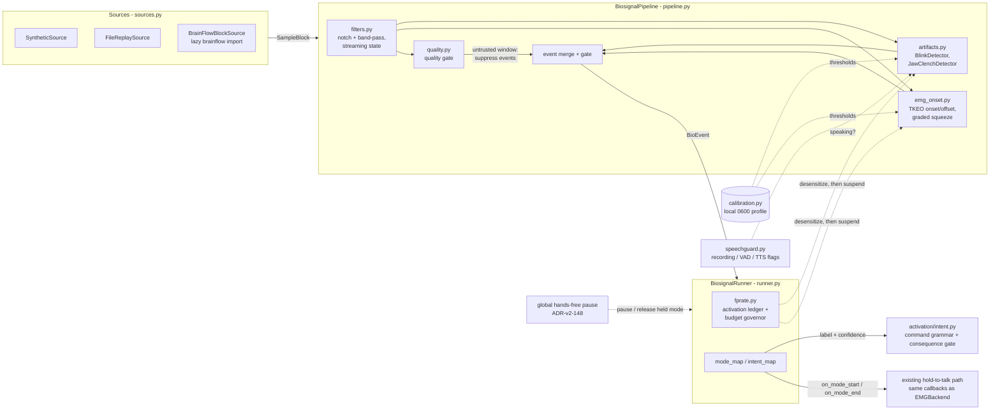

# Spec: Biosignal Pipeline — Artifact-Grade EMG/EOG/EEG Switches Under a Measured False-Positive Budget

| Field | Value |
|---|---|
| **ID** | spec-biosignal-pipeline |
| **Status** | Proposed |
| **Date** | 2026-10-29 |
| **Modules** | `yazses.biosignal` (new); reuses `yazses.platform.emg` (serial + BrainFlow sources, `pressure.py`), `yazses.activation` (`intent.py`) and the hands-free global pause (`yazses.handsfree`) |
| **Related** | ADR-v2-152, ADR-v2-153 (governor), ADR-v2-129, ADR-v2-135, ADR-v2-147, ADR-v2-148, ADR-v04-003, ADR-005, ADR-011, ADR-019, ADR-021 |
| **Research** | `docs/research/muscle-brain-control.md`; serial protocol `design/emg-protocol.md` |

## Goal

Turn raw multichannel electrode samples into a small closed set of **artifact-grade events**
(squeeze on/off, blink, double blink, jaw clench), refuse to emit any of them when the signal
cannot be trusted, and hold the whole switch to a false-positive budget that is measured and
enforced on the user's own machine.

## Non-goals

- no thought, intent, motor-imagery, SSVEP or P300 decoding (rejected by ADR-v2-129; unchanged);
- no silent-speech or open-vocabulary decoding;
- no identity, emotion, fatigue or medical inference from a signal;
- no network use of any kind (ADR-v2-152, Egress);
- no recommended threshold, budget or "accuracy" claim before field measurement;
- no change to the YESP serial protocol or to `EMGBackend`.

## Architecture

Dashed lines are control and configuration, solid lines are data. The detectors never import the
runner, the runner never imports the daemon: it is handed the same two callbacks the other
activation sources receive.

## Data flow

1. A `BlockSource` produces `SampleBlock(data[n_channels, n_samples], fs, channels, t0)`, in
   microvolts, in order. `read()` returns `None` when nothing is new and raises `EOFError` when a
   finite source ends.
2. `filters.py` applies streaming DSP with state carried across blocks (notch at `mains_hz`,
   band-pass per signal kind). Output must not depend on how the stream was cut into blocks.
3. `quality.py` scores each window per channel. A channel whose window fails any check is
   *untrusted* for that window.
4. Detectors consume filtered blocks and return `BioEvent`s with a time on the source clock and a
   confidence in `[0, 1]`. A detector reading an untrusted channel returns nothing.
5. The runner records each activation in the ledger, applies `mode_map` (hold events become
   `on_mode_start` / `on_mode_end`) or `intent_map` (event becomes a label plus confidence into
   `activation/intent.py`), and lets the governor adjust or suspend the source.
6. An unmapped event is logged and does nothing.

## Module table

| Module | Responsibility | Purity |
|---|---|---|
| `types.py` | The shared contract: `SignalKind`, `EventKind`, `ChannelInfo`, `SampleBlock`, `BioEvent`, `BlockSource`, `StreamDetector`. No behaviour. | pure (numpy + stdlib) |
| `filters.py` | Streaming numpy DSP: notch, band-pass, rectify/envelope helpers with explicit state. | pure |
| `quality.py` | Per-window signal-quality gate: flatline, saturation, mains interference, baseline drift, sample dropout. Returns a verdict and reason per channel. | pure |
| `emg_onset.py` | TKEO double-threshold onset/offset with a frozen baseline, max-hold watchdog and graded light/hard squeeze. | pure |
| `artifacts.py` | `BlinkDetector` (with double-blink gesture) and `JawClenchDetector` (takes a `speech_guard` callable; a guard that raises counts as speaking). | pure |
| `speechguard.py` | `SpeechGuard`: combines zero-argument sources (dictation recording, VAD, TTS playback) into the one `speech_guard` callable, with a hangover tail, a pre-roll for retrospective queries and a stuck-source watchdog. Fails closed (a raising source counts as speaking). Reads audio-side state only. | pure |
| `calibration.py` | RELAX / SQUEEZE_LIGHT / SQUEEZE_HARD (+ optional BLINK_X3 / CLENCH_X3) session; derives thresholds; reads and writes the local profile. | pure maths + one file write |
| `fprate.py` | Activation ledger (per active exposure time), cancelled-fraction proxy with Wilson confidence interval, budget governor: desensitize, then suspend, auto-recover with backoff, one-action `release()` (ADR-v2-153). Persists aggregate counters only. | pure |
| `evaluate.py` | Evaluation harness: scores detectors or a pipeline against a recording with scripted events (recall, precision, latency; per-kind one-to-one matching inside a tolerance) and counts phantom activations per hour on an idle stream, with Wilson and Poisson intervals. Prints a synthetic-data caveat on every report. | pure |
| `boards.py` | Table of known boards with their BrainFlow ids and electrode hints; advice only, never opens a device or imports `brainflow`. | pure |
| `sources.py` | `SyntheticSource`, `FileReplaySource`, `BrainFlowBlockSource`, and `open_source('synthetic' \| 'file:<path>' \| 'brainflow:<id>')`. | backend; BrainFlow imported lazily |
| `pipeline.py` | `BiosignalPipeline`: wires filters, gate, detectors; blocks in, events out. No I/O, no threads. | pure |
| `runner.py` | `BiosignalRunner`: the polling thread, the mode and intent mapping, the stuck-hold watchdog thread, lifecycle, status snapshot. `build_runner_from_config` builds it from `[biosignal]` and hands the daemon's `speech_active` callable to the jaw detector. | backend (thread) |
| `cli_impl.py` | The `yazses biosignal` command bodies, the `BiosignalActivationSource` adapter the daemon starts, and persistence of the ledger counters. | backend (file I/O) |

Config lives in `[biosignal]` (`enabled = false`; `source`, `mains_hz`, `emg`, `double_blink`,
`jaw_clench`, `mode_map`, `intent_map`, `max_cancelled_per_hour`, `ledger_autosave_seconds`,
`speech_guard`, `calibration_file`). CLI:
`yazses biosignal doctor | calibrate | monitor | replay | report | record | evaluate | boards | resume`
and `yazses biosignal profile | profile-clear`. The generated reference docs
(`docs/configuration.md`, `docs/command-index.md`) are the authority for what exists.

## Event semantics

| Event | Meaning | Notes |
|---|---|---|
| `SQUEEZE_ON` | Muscle burst crossed the *on* threshold and held for the minimum duration. | Carries the graded level (light or hard) in `detail`. Opens a hold. |
| `SQUEEZE_OFF` | Envelope fell below the *off* threshold (hysteresis), or the max-hold watchdog ended the hold. | `detail` says which. Always closes an open `SQUEEZE_ON`. |
| `BLINK` | A single eye-closure artifact within the plausible duration and amplitude window. | Not mapped to anything by default: natural blink rate makes it a poor commit signal (same policy as `eye-face-switch.md`). |
| `DOUBLE_BLINK` | Two blinks inside the configured gap. | The deliberate gesture; the single blinks that form it are not also reported as an action. |
| `JAW_CLENCH` | A short, strong masseter/temporal burst on the configured channels. | Suppressed while the speech guard says the user is talking. |

Rules that hold for all of them:

- An event time `t` is on the source's own monotonic clock, never wall-clock.
- `SQUEEZE_ON` and `SQUEEZE_OFF` are strictly paired: no second `ON` before an `OFF`, no `OFF`
  without a preceding `ON`, including across a source stop or a suspend (the pipeline emits the
  closing `OFF` when it stops or is suspended mid-hold).
- A detector must see the signal return below the off threshold before it can fire again, and a
  refractory period follows every event. No event is emitted while its channel is untrusted.
- `confidence` is a detector's own margin over threshold mapped to `[0, 1]`. It is not a
  probability and is never presented as one.

## Safety invariants

These are the properties the package exists to guarantee. Each has a test in the checklist below.

1. **Off by default, dormant when off.** With `enabled = false` nothing is imported beyond the
   config dataclass, no thread starts, no device is opened.
2. **Quality gate suppresses events.** Flatline, saturation, mains interference, drift and dropout
   each produce silence, never a trigger. A detached or dead electrode is a *quiet* failure.
3. **Max-hold watchdog.** A hold that never releases (stuck threshold, wedged signal) is ended by
   the watchdog, so the microphone cannot stay open indefinitely. The runner also closes any open
   hold on stop, suspend and error.
4. **Frozen baseline.** The noise baseline used for thresholds is estimated while the signal is
   quiet and *frozen during activity*, so a long squeeze cannot raise its own threshold and end
   itself.
5. **FP budget enforced, not just reported.** The governor escalates in one order only:
   *desensitize, then suspend*. Suspension is a stop (any held squeeze is closed), not a
   degradation to a quieter detector that keeps firing; it ends by itself after a timer that grows
   on repeats, resuming into the desensitized state, and at once on a single user action
   (`release()`, ADR-v2-153). The desensitize scale returns to exactly 1.0 when the state returns
   to OK. The governor acts on a conservative lower bound of the cancelled *rate* with a minimum
   amount of evidence, never on the displayed fraction.
6. **Speech guard on the jaw.** Jaw clench is not reported while the user is talking. The guard is
   a *suppressor*; it is allowed to miss a clench, never to invent one. A guard source that raises
   counts as speaking, and a source stuck at "speaking" for longer than a watchdog period is
   ignored until it reports false once, so a wedged flag cannot lock the switch out.
7. **Detectors emit events, not actions.** No detector imports daemon, injector, pointer or window
   modules. Intents are labels through the ordinary command grammar and its confirmation policy.
8. **Local-only data.** No network call exists in the package. Recordings, profiles and the ledger
   never leave the machine (see Privacy).
9. **Degrade to a logged no-op.** A missing library or device logs the fix and leaves the daemon
   running, as the serial and BrainFlow paths already do.
10. **Block-size independence.** Feeding the same samples in any partition produces the same
    events (same kinds, same times within one-sample tolerance).
11. **Global pause wins.** While the hands-free global state (ADR-v2-148) is not ACTIVE the daemon
    ignores the source's squeezes and intents, and a squeeze held when a pause arrives is released
    at once and latched off until the signal relaxes. This is enforced in the daemon-side adapter,
    not inside the package. The pipeline and ledger keep running while paused (a known limit: the
    exposure clock does not stop).
12. **The measurement survives a crash.** The activation ledger is persisted periodically
    (`ledger_autosave_seconds`) and on stop, as aggregate counters, by an atomic, owner-only write
    that adds only the change since the previous save.

## Calibration protocol

Thresholds are per person and per electrode placement; no shipped default is claimed to be
recommended. `yazses biosignal calibrate` runs a guided session of timed phases:

| Phase (`CalibrationPhase`) | The user | Used for |
|---|---|---|
| `RELAX` | rests, face and arm still | resting level (`baseline_rms`) and noise floor; becomes the frozen baseline |
| `SQUEEZE_LIGHT` | a light squeeze, several repeats | the *light* level (`light_rms`) |
| `SQUEEZE_HARD` | a hard squeeze, several repeats | the maximum-contraction reference (`mvc_rms`); graded thresholds are fractions of the span between rest and this level |
| `BLINK_X3` (optional) | three deliberate blinks | `blink_amplitude` |
| `CLENCH_X3` (optional) | three deliberate jaw clenches | `clench_power` |

The profile also carries a plain `thresholds` mapping (`light`, `hard`, `onset`, `offset` for the
squeeze family; `blink`; `clench`; only the keys for phases that ran) so a detector can be built
from it without the calibration module importing the detector modules. These are the **calibration
hooks**: the EMG detectors are built from the baseline and maximum-contraction values today
(`from_calibration`); a `from_calibration` constructor on the blink and jaw-clench detectors, and a
runtime `set_sensitivity_scale` that the governor drives, are planned (see "Round-2 status"). A
speech sample to tune the speech guard is not part of the session; the guard reads audio-side
state instead.

Rules:

- The session aborts, and writes nothing, if the quality gate rejects the RELAX window or if a
  phase's repeats do not separate from the baseline (a clear message names the phase and the
  reason: electrode, contact, mains).
- Thresholds are derived from robust statistics of the recorded phases (median and a robust spread),
  not from a single peak, and the session reports the margin it found so a thin separation is
  visible rather than hidden.
- The result is a **profile**: derived values, the session date, the schema version, the channel
  list and sampling rate it was made for. It does not contain raw samples.
- A profile is valid only for the board, channel set and sampling rate it was made for
  (`profile_matches`; amplitudes do not transfer between placements), and is stale after a reuse
  limit of age (`profile_is_stale`), which `doctor` reports. A re-seated electrode needs a new
  session. Warning when the live baseline has drifted far from the profile's is planned, not
  built.
- Calibration is repeatable and resettable. Re-running replaces the profile atomically.

## Privacy and data classification

Electrode signals describe a person's body. Treat them as **biometric-adjacent** even though no
shipped feature identifies anyone from them: a long enough EMG/EEG trace can in principle carry
health and identity information, and a leaked recording cannot be rotated like a key.

| Artifact | Classification | Rule |
|---|---|---|
| Raw samples / recordings (replay files) | Sensitive, biometric-adjacent | Written only by an explicit user action. Local only. Never uploaded, never attached to a diagnostics bundle by default, never used for central model tuning. |
| Calibration profile | Sensitive, derived | Local JSON, file mode `0600`, no raw samples. Never transmitted. |
| Activation ledger | Sensitive, behavioural | In memory: per-activation records on the monotonic clock, bounded in number, used only to match a cancel inside the grace window. On disk: aggregate counters only (sessions, active seconds, activations and cancellations per event kind), file mode `0600`, no timestamps, no per-event record. Local only; reports show aggregates. |
| Quality verdicts and logs | Low | Verdict codes and channel names only, no sample values. |

Consequences: no field of a `BioEvent`, log line or CLI output contains raw samples; an issue
template or `doctor` output pasted publicly must not include a recording or a profile; and the
research-consent rules in ADR-v2-150 apply to anyone who contributes recordings to a study, which
is a separate, explicit, opt-in act and not a feature of this package.

## Open questions

1. Defaults: what on-threshold, off-threshold, minimum hold and refractory are acceptable before
   any field data exists, other than "do less when unsure"? (Provisional; unmeasured.)
2. Is the cancelled-fraction proxy good enough to drive a governor, or does it punish a user who
   cancels for reasons unrelated to the switch? Needs real ledgers.
3. Should the governor's desensitize step be a fixed multiplier, or derived from the observed
   margin? Which is easier to explain to the user?
4. Speech guard: is a simple energy and spectral-tilt test on the same electrode enough, or does it
   need the microphone's VAD (and then the jaw switch depends on the audio path)?
5. Graded squeeze: two levels, or does a third survive a workday (research page, open question 2)?
6. Which BrainFlow boards are worth documenting as supported rather than "may work"? Needs reports
   from owners.
7. Re-seating: can the profile be adjusted by a short RELAX-only re-baseline instead of the full
   session?
8. Mains: automatic 50/60 Hz detection versus `mains_hz`; is wrong-mains a doctor error or a
   silent fallback to the quality gate?

## Open questions / known limits

Open questions above are about design. These are about evidence and are stated so that no page,
log line or report overstates what exists:

- **Thresholds are untuned on real recordings.** Detector, quality-gate, calibration and governor
  numbers are design choices (each is labelled as such at its definition). None is a measured
  operating point, and none may be called recommended.
- **Validation is synthetic only.** Tests, the evaluation harness and `replay` fixtures use
  generated signals. They prove the logic; they say nothing about real sensitivity, real
  false-positive rate or real latency.
- **The cancelled fraction is a proxy.** It is not an error rate: it misses false positives the
  user does not notice and counts cancels unrelated to the switch. It is reported with a Wilson
  interval and a caveat everywhere.
- **The budget is only as good as the cancel signal.** It needs the integrator to report an undo
  or cancel of a switch-initiated action; with none reported the governor never acts.
- **The speech guard reads audio-side state** (dictation recording, VAD, TTS playback), not the
  jaw electrode. If those are absent or late a clench during speech can still pass. Chewing and
  yawning are not covered except by the detector's own rhythm checks.
- **Not every detector takes calibration values yet** (see "Round-2 status"), and the pipeline does
  not yet call the profile-matches check, so a profile for a different montage is not refused at
  load.
- **Only the synthetic source runs without hardware.** BrainFlow boards are reached through
  BrainFlow's own support and are not individually verified.
- **Electrode drift, fatigue and time of day** are not modelled.

## Round-2 status

What the tree contained when this spec was last updated, so the checklist below can be read against
it. "Present" means the module or behaviour exists in the source and is described above; it does not
mean tuned or field-tested.

| Item | State |
|---|---|
| Quality gate, detectors, calibration session + profile, sources, pipeline, runner, daemon wiring, ledger, governor, `doctor` / `calibrate` / `monitor` / `replay` / `report` | present |
| `speechguard.py` (`SpeechGuard`, `from_daemon_flags`) | present; the daemon builds a `SpeechGuard` over the dictation state (recording and the states that follow it), with the default hangover, and hands it to the runner as `speech_active` when `[biosignal] speech_guard` is true (the default) |
| `evaluate.py` (`evaluate`, `evaluate_idle`, report formatters) | present as a module; surfaced by `yazses biosignal evaluate` |
| Periodic ledger autosave | present (`ledger_autosave_seconds`, default 60 s, plus a save on stop) |
| Global hands-free pause integration | present in the daemon adapter (gate poll, heartbeat, release-and-latch of a held squeeze, intents ignored while paused); not inside the package |
| Public runner API (`ledger`, `pipeline`, `note_cancelled`, `governor_release`, `save_ledger`, `status`) | present |
| Governor release bound to a user action | present: an explicit hands-free Resume (`yazses handsfree resume`) releases it |
| `[activation]` confirm / reject thresholds read by the biosignal intent path | present in the daemon (`_biosignal_policy`); falls back to built-in defaults when `[activation]` is off |
| `BlinkDetector` warm-up fix, `from_calibration` and `set_sensitivity_scale` on blink/clench detectors | present: the missed pair was band-pass ringing merging two blinks into one excursion, fixed by splitting excursions at deep valleys; `from_calibration` and `set_sensitivity_scale` exist on both detectors (still validated on synthetic signal only) |
| Commands `record`, `evaluate`, `boards`, `resume`, `profile` / `profile-clear`; board table (`boards.py`) | present |

## Acceptance criteria

- With `enabled = false` the daemon behaves exactly as before and imports nothing from
  `yazses.biosignal` beyond config.
- A flatline, a saturated, a mains-dominated, a drifting and a dropout-ridden signal each emit
  zero events.
- A calibrated synthetic squeeze emits exactly one paired ON/OFF; a stuck-high signal is closed by
  the watchdog.
- Speech-like jaw activity emits no `JAW_CLENCH`.
- Exceeding `max_cancelled_per_hour` desensitizes and then suspends, and the user is told; one
  release action returns the switch to normal at any state.
- No test needs hardware, a network or a model download.

## Tests to write later (checklist)

The tests come with the code, in the same change (AGENTS.md rule 7). Properties each module needs:

**All modules**
- [ ] `yazses.biosignal` imports with only numpy and the standard library; no module imports
      `brainflow`, `serial`, `torch` or a daemon module at top level.
- [ ] No module opens a socket; `tests/test_egress_inventory.py` stays green with no new entry.

**`filters.py`**
- [ ] **Block-size independence:** one block of N samples equals the same samples fed as 1-sample
      blocks, as prime-sized blocks, and as random-sized blocks (outputs match within a stated
      tolerance).
- [ ] State survives across blocks (no edge transient at a block boundary); `reset()` clears it.
- [ ] Notch attenuates `mains_hz` and passes a nearby in-band tone; band-pass rejects DC.
- [ ] Multichannel rows stay independent; an empty block is a no-op.

**`quality.py`**
- [ ] Constant (flatline) input is flagged as such, not as "quiet but fine".
- [ ] Clipped/saturated input, strong mains tone, slow drift and gaps each raise their own reason.
- [ ] Clean synthetic signal is trusted; verdict is per channel; verdict does not flicker on one
      borderline window (hysteresis or hold, as designed).
- [ ] Block-size independence of verdicts.

**`emg_onset.py`**
- [ ] **No phantom trigger on flatline, on pure noise at the calibrated floor, or on a constant
      offset.**
- [ ] A calibrated burst gives exactly one paired ON/OFF; a burst shorter than the minimum hold
      gives none; a threshold-hugging signal does not chatter (hysteresis).
- [ ] Baseline is frozen during activity: a long squeeze does not end itself.
- [ ] Max-hold watchdog ends a never-releasing hold and then requires release before re-arming.
- [ ] Light versus hard classification on synthetic bursts at the calibrated levels.
- [ ] Event times are within tolerance of the true onset at several fs values; block-size
      independence of events.

**`artifacts.py`**
- [ ] Single blink gives `BLINK`; two inside the gap give `DOUBLE_BLINK`; two outside it give two
      `BLINK`s; a too-slow or too-large deflection (e.g. a head movement) gives none.
- [ ] No phantom blink on flatline or on EEG-like background.
- [ ] Jaw clench is detected on a synthetic burst and **suppressed on speech-like activity**;
      the guard may miss a clench but a speech fixture must never produce one.
- [ ] **Speech guard suppresses jaw clench:** a burst that begins before the guard rises, during
      it, or within the hangover after it produces no event; a raising guard suppresses too.
- [ ] **Blink detected after any warm-up delay:** a blink that occurs after the detector's warm-up
      period is reported whatever the block size and whatever delay precedes it (no blink is lost
      because the baseline window had not filled), and nothing is reported inside the warm-up.
- [ ] `from_calibration` and `set_sensitivity_scale` (when present) change thresholds
      monotonically, and a scale of 1.0 restores the original behaviour exactly.
- [ ] Refractory and release-before-rearm; block-size independence.

**`speechguard.py`**
- [ ] The guard is true while any source is true and for the hangover after the last true reading;
      it is false when all are false and the hangover has passed.
- [ ] A source that raises counts as speaking; a source stuck at true past the watchdog is ignored
      until it reports false once; both are visible in `snapshot()`.
- [ ] `was_speaking(t0, t1)` back-dates a rising edge by the pre-roll.
- [ ] Runs on an injected clock with no audio, no daemon import and no hardware.

**`evaluate.py`**
- [ ] Matching is one-to-one per event kind inside the tolerance; a second detection of one truth
      event is a false positive.
- [ ] The same source and seed give the same numbers; the idle evaluation of a clean synthetic
      stream reports zero phantom activations for a correctly quiet detector.
- [ ] Every report text carries the synthetic-data caveat; a source that reports scripted truth is
      refused by the idle evaluation.

**`calibration.py`**
- [ ] Synthetic phased session yields a profile that, fed back to the detectors, detects the
      calibration gestures and ignores the RELAX phase.
- [ ] Session aborts and writes nothing on a bad RELAX window or an inseparable phase.
- [ ] Profile round-trips; file mode is `0600`; the write is atomic; a profile for a different
      channel set or fs is refused with a reason; no raw samples are stored.

**`fprate.py`**
- [ ] Ledger counts activations and cancellations; the Wilson interval is correct on known
      counts (including zero and all) and widens for small n.
- [ ] Governor: under budget does nothing; over budget desensitizes first, then suspends; the
      budget window slides; suspend is reported; a reset restores it.
- [ ] **Desensitize scale resets when OK:** after recovery the factor in force is exactly 1.0 and
      every detector that took a scale is told so.
- [ ] **Governor release is one action:** from OK, DESENSITIZE and SUSPEND a single `release()`
      call returns to OK, resets the backoff, and starts a fresh evidence window (no immediate
      re-fire).
- [ ] Auto-recovery: a suspension ends after its timer into DESENSITIZE, lengthens on repeats,
      and is capped.
- [ ] The governor acts on the lower bound of the rate with a minimum evidence floor: three quick
      cancels in a minute do not suspend; a disabled budget only reports.
- [ ] **Ledger autosave survives kill:** killing the process mid-session (no clean shutdown)
      leaves a readable counters file that contains the activations recorded up to the last
      autosave; the write is atomic, mode `0600`, and merging with earlier totals never
      double-counts a session.

**`sources.py`**
- [ ] `open_source` parses `synthetic`, `file:<path>` and `brainflow:<id>` and rejects anything
      else with a message listing the valid forms.
- [ ] `FileReplaySource` ends with `EOFError`; a missing/short/corrupt file gives a clear error.
- [ ] `BrainFlowBlockSource` with a fake board: blocks are contiguous with correct `t0`; a missing
      `brainflow` module is a logged no-op with the install hint.

**`pipeline.py` / `runner.py`**
- [ ] End to end on synthetic input: squeeze produces `on_mode_start` then `on_mode_end` exactly
      once each; an unmapped event does nothing.
- [ ] Untrusted window suppresses an event that would otherwise fire.
- [ ] Stop, suspend or source error while a hold is open closes the hold.
- [ ] Labels-only intents reach `activation/intent.py` and an out-of-vocabulary label is refused.
- [ ] Runner survives a source that raises, returns `None` forever, or ends with `EOFError`.
- [ ] **Global pause releases a held mode:** with a squeeze held, a global pause ends the
      dictation turn exactly once, squeezes and intents arriving while paused do nothing, and
      after resume nothing restarts until the signal has relaxed (no stale hold, no orphan end).
- [ ] The source's heartbeat registers with the global gate only once blocks have arrived, and a
      source that stops delivering ages out like any other (no permanent "not ready").
- [ ] The governor's suspend, the quality gate and the global pause each release a held squeeze
      exactly once.
- [ ] The public runner API (`note_cancelled`, `governor_release`, `save_ledger`, `status`) works
      without touching private attributes and from a thread other than the runner's.
- [ ] `enabled = false` constructs nothing.

**Config and CLI**
- [ ] `[biosignal]` defaults to disabled; unknown keys and malformed values are rejected with a
      message; the generated docs are in sync (`scripts/gen-docs.py`).
- [ ] `yazses biosignal doctor | calibrate | monitor | replay | report` each have `--help`, run
      against the synthetic source with no hardware, and exit non-zero on a real failure. Once
      they exist, the same holds for `record | evaluate | profile | boards | resume`.
- [ ] `ledger_autosave_seconds` and `speech_guard` (when added) have safe defaults, appear in the
      generated configuration reference, and reject malformed values.
- [ ] Run the CLI through `script -qec` as well as `CliRunner` (the `[section]` help escape lives in
      `cli.main()`, which `CliRunner` skips).

## Measurement

Primary field metric: **cancelled activations per hour** per event kind (a proxy), with its Wilson
interval, alongside the user's count of deliberate attempts, detected attempts, misses and latency.
Collect electrode type and placement, board, sampling rate and environment notes. Synthetic traces
are regression tools, not evidence for recommended defaults; community-measured rates are what the
research page asks for and what would justify changing any default.
