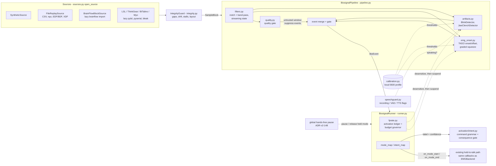

# Spec: Biosignal Pipeline — Artifact-Grade EMG/EOG/EEG Switches Under a Measured False-Positive Budget

| Field | Value |
|---|---|
| **ID** | spec-biosignal-pipeline |
| **Status** | Proposed |
| **Date** | 2026-10-30 |
| **Modules** | `yazses.biosignal` (new); reuses `yazses.platform.emg` (serial + BrainFlow sources, `pressure.py`), `yazses.activation` (`intent.py`) and the hands-free global pause (`yazses.handsfree`) |
| **Related** | ADR-v2-152, ADR-v2-153 (governor), ADR-v2-129, ADR-v2-135, ADR-v2-147, ADR-v2-148, ADR-v04-003, ADR-005, ADR-011, ADR-019, ADR-021 |
| **Research** | `docs/research/muscle-brain-control.md`; serial protocol `design/emg-protocol.md` |
| **Validation** | `design/specs/biosignal-validation-protocol.md` (how the numbers in this spec get measured on real hardware; the ADR-v2-152 gates) |

## Goal

Turn raw multichannel electrode samples into a small closed set of **artifact-grade events**
(squeeze on/off, blink, double blink, jaw clench), refuse to emit any of them when the signal
cannot be trusted, and hold the whole switch to a false-positive budget that is measured and
enforced on the user's own machine.

## Non-goals

- no thought, intent, motor-imagery, SSVEP or P300 decoding (rejected by ADR-v2-129; unchanged);
- no silent-speech or open-vocabulary decoding;
- no identity, emotion, fatigue or medical inference from a signal;
- no network use of any kind (ADR-v2-152, Egress);
- no recommended threshold, budget or "accuracy" claim before field measurement;
- no change to the YESP serial protocol or to `EMGBackend`.

## Architecture

Dashed lines are control and configuration, solid lines are data. The detectors never import the
runner, the runner never imports the daemon: it is handed the same two callbacks the other
activation sources receive.

## Data flow

1. A `BlockSource` produces `SampleBlock(data[n_channels, n_samples], fs, channels, t0)`, in
   microvolts, in order. `read()` returns `None` when nothing is new and raises `EOFError` when a
   finite source ends.
2. `filters.py` applies streaming DSP with state carried across blocks (notch at `mains_hz`,
   band-pass per signal kind). Output must not depend on how the stream was cut into blocks.
3. `quality.py` scores each window per channel. A channel whose window fails any check is
   *untrusted* for that window.
4. Detectors consume filtered blocks and return `BioEvent`s with a time on the source clock and a
   confidence in `[0, 1]`. A detector reading an untrusted channel returns nothing.
5. The runner records each activation in the ledger, applies `mode_map` (hold events become
   `on_mode_start` / `on_mode_end`) or `intent_map` (event becomes a label plus confidence into
   `activation/intent.py`), and lets the governor adjust or suspend the source.
6. An unmapped event is logged and does nothing.

## Module table

| Module | Responsibility | Purity |
|---|---|---|
| `types.py` | The shared contract: `SignalKind`, `EventKind`, `ChannelInfo`, `SampleBlock`, `BioEvent`, `BlockSource`, `StreamDetector`. No behaviour. | pure (numpy + stdlib) |
| `filters.py` | Streaming numpy DSP: notch, band-pass, rectify/envelope helpers with explicit state. | pure |
| `quality.py` | Per-window signal-quality gate: flatline, saturation, mains interference, baseline drift, sample dropout. Returns a verdict and reason per channel. | pure |
| `emg_onset.py` | TKEO double-threshold onset/offset with a frozen baseline, max-hold watchdog and graded light/hard squeeze. | pure |
| `artifacts.py` | `BlinkDetector` (with double-blink gesture) and `JawClenchDetector` (takes a `speech_guard` callable; a guard that raises counts as speaking). | pure |
| `speechguard.py` | `SpeechGuard`: combines zero-argument sources (dictation recording, VAD, TTS playback) into the one `speech_guard` callable, with a hangover tail, a pre-roll for retrospective queries and a stuck-source watchdog. Fails closed (a raising source counts as speaking). Reads audio-side state only. | pure |
| `calibration.py` | RELAX / SQUEEZE_LIGHT / SQUEEZE_HARD (+ optional BLINK_X3 / CLENCH_X3) session; derives thresholds; reads and writes the local profile. | pure maths + one file write |
| `fprate.py` | Activation ledger (per active exposure time), cancelled-fraction proxy with Wilson confidence interval, budget governor: desensitize, then suspend, auto-recover with backoff, one-action `release()` (ADR-v2-153). Persists aggregate counters only. | pure |
| `evaluate.py` | Evaluation harness: scores detectors or a pipeline against a recording with scripted events (recall, precision, latency; per-kind one-to-one matching inside a tolerance) and counts phantom activations per hour on an idle stream, with Wilson and Poisson intervals. Prints a synthetic-data caveat on every report. | pure |
| `fieldtest.py` | In-situ field test: a guided session (rest, speech, chew, typing and mouse, movement, then a deliberate gesture per switch) that counts phantom activations per usable hour by activity and the hit rate on cue, with one-sided Poisson upper bounds and Wilson intervals; `FieldTestAggregate` merges reports; reports hold counts and whole-second durations only. Clock-injected and deterministic. See the validation protocol. | pure |
| `boards.py` | Table of known boards with their BrainFlow ids and electrode hints; advice only, never opens a device or imports `brainflow`. | pure |
| `sources.py` | `SyntheticSource`, `FileReplaySource` (CSV, `.npz`, EDF/BDF, XDF), `BrainFlowBlockSource`, and `open_source` for `synthetic`, `file:<path>`, `brainflow:<id>`, `lsl:`, `thinkgear:`, `bitalino:`, `myo:`. | backend; every device library imported lazily |
| `lsl_source.py` | Lab Streaming Layer inlet, machine-only discovery, foreign hosts refused. | backend (`pylsl`) |
| `thinkgear.py`, `bitalino.py` | Pure parsers + pyserial transports for NeuroSky ThinkGear and PLUX BITalino. | pure parser / backend transport |
| `myo.py` | Myo raw EMG over BLE (counts, not µV). | backend (`bleak`) |
| `edf.py`, `xdf.py` | EDF/EDF+/BDF reader/writer (pure); XDF reader (`pyxdf`). | pure / backend |
| `integrity.py` | `IntegrityGuard` (a `BlockSource` wrapper) and `IntegrityGate` (a drop-in for the quality monitor): transport-contract breaches close the event gate. | pure |
| `conformance.py` | `check_source`: drives any source and grades 18 contract clauses. | pure |
| `pipeline.py` | `BiosignalPipeline`: wires filters, gate, detectors; blocks in, events out. No I/O, no threads. | pure |
| `runner.py` | `BiosignalRunner`: the polling thread, the mode and intent mapping, the stuck-hold watchdog thread, lifecycle, status snapshot. `build_runner_from_config` builds it from `[biosignal]` and hands the daemon's `speech_active` callable to the jaw detector. | backend (thread) |
| `cli_impl.py` | The `yazses biosignal` command bodies, the `BiosignalActivationSource` adapter the daemon starts, and persistence of the ledger counters. | backend (file I/O) |

Config lives in `[biosignal]` (`enabled = false`; `source`, `mains_hz`, `emg`, `double_blink`,
`jaw_clench`, `mode_map`, `intent_map`, `max_cancelled_per_hour`, `ledger_autosave_seconds`,
`speech_guard`, `calibration_file`, `calibration_max_age_days`, `watchdog_seconds`,
`min_event_confidence`). CLI:
`yazses biosignal doctor | calibrate | monitor | replay | report | record | evaluate | field-test | boards`
and `yazses biosignal profile | profile-clear`. There is no `yazses biosignal resume`: a suspended
switch is released by `yazses handsfree resume` (the global Resume). The generated reference docs
(`docs/configuration.md`, `docs/command-index.md`) are the authority for what exists.

## Event semantics

| Event | Meaning | Notes |
|---|---|---|
| `SQUEEZE_ON` | Muscle burst crossed the *on* threshold and held for the minimum duration. | Carries the graded level (light or hard) in `detail`. Opens a hold. |
| `SQUEEZE_OFF` | Envelope fell below the *off* threshold (hysteresis), or the max-hold watchdog ended the hold. | `detail` says which. Always closes an open `SQUEEZE_ON`. |
| `BLINK` | A single eye-closure artifact within the plausible duration and amplitude window. | Not mapped to anything by default: natural blink rate makes it a poor commit signal (same policy as `eye-face-switch.md`). |
| `DOUBLE_BLINK` | Two blinks inside the configured gap. | The deliberate gesture; the single blinks that form it are not also reported as an action. |
| `JAW_CLENCH` | A short, strong masseter/temporal burst on the configured channels. | Suppressed while the speech guard says the user is talking. |

Rules that hold for all of them:

- An event time `t` is on the source's own monotonic clock, never wall-clock.
- `SQUEEZE_ON` and `SQUEEZE_OFF` are strictly paired: no second `ON` before an `OFF`, no `OFF`
  without a preceding `ON`, including across a source stop or a suspend (the pipeline emits the
  closing `OFF` when it stops or is suspended mid-hold).
- A detector must see the signal return below the off threshold before it can fire again, and a
  refractory period follows every event. No event is emitted while its channel is untrusted.
- `confidence` is a detector's own margin over threshold mapped to `[0, 1]`. It is not a
  probability and is never presented as one.

## Safety invariants

These are the properties the package exists to guarantee. Each has a test in the checklist below.

1. **Off by default, dormant when off.** With `enabled = false` nothing is imported beyond the
   config dataclass, no thread starts, no device is opened.
2. **Quality gate suppresses events.** Flatline, saturation, mains interference, drift and dropout
   each produce silence, never a trigger. A detached or dead electrode is a *quiet* failure.
3. **Max-hold watchdog.** A hold that never releases (stuck threshold, wedged signal) is ended by
   the watchdog, so the microphone cannot stay open indefinitely. The runner also closes any open
   hold on stop, suspend and error.
4. **Frozen baseline.** The noise baseline used for thresholds is estimated while the signal is
   quiet and *frozen during activity*, so a long squeeze cannot raise its own threshold and end
   itself.
5. **FP budget enforced, not just reported.** The governor escalates in one order only:
   *desensitize, then suspend*. Suspension is a stop (any held squeeze is closed), not a
   degradation to a quieter detector that keeps firing; it ends by itself after a timer that grows
   on repeats, resuming into the desensitized state, and at once on a single user action
   (`release()`, ADR-v2-153). The desensitize scale returns to exactly 1.0 when the state returns
   to OK. The governor acts on a conservative lower bound of the cancelled *rate* with a minimum
   amount of evidence, never on the displayed fraction.
6. **Speech guard on the jaw.** Jaw clench is not reported while the user is talking. The guard is
   a *suppressor*; it is allowed to miss a clench, never to invent one. A guard source that raises
   counts as speaking, and a source stuck at "speaking" for longer than a watchdog period is
   ignored until it reports false once, so a wedged flag cannot lock the switch out.
7. **Detectors emit events, not actions.** No detector imports daemon, injector, pointer or window
   modules. Intents are labels through the ordinary command grammar and its confirmation policy.
8. **Local-only data.** No network call exists in the package. Recordings, profiles and the ledger
   never leave the machine (see Privacy).
9. **Degrade to a logged no-op.** A missing library or device logs the fix and leaves the daemon
   running, as the serial and BrainFlow paths already do.
10. **Block-size independence.** Feeding the same samples in any partition produces the same
    events (same kinds, same times within one-sample tolerance).
11. **Global pause wins.** While the hands-free global state (ADR-v2-148) is not ACTIVE the daemon
    ignores the source's squeezes and intents, and a squeeze held when a pause arrives is released
    at once and latched off until the signal relaxes. This is enforced in the daemon-side adapter,
    not inside the package. The pipeline keeps running while paused, but the daemon calls the runner's
    `pause_accounting()` / `resume_accounting()` on the gate's transitions, so paused time does not accrue
    as ledger exposure and cannot dilute the measured rate.
12. **The measurement survives a crash.** The activation ledger is persisted periodically
    (`ledger_autosave_seconds`) and on stop, as aggregate counters, by an atomic, owner-only write
    that adds only the change since the previous save.
13. **Calibration provenance is enforced, fail closed.** The pipeline checks the loaded profile against
    the live board, channel set, signal kinds and sampling rate on the first block, again if they change,
    and hourly for age (`calibration_max_age_days`). A profile that is stale, mismatched or that cannot be
    examined is **not used**: the switches built from it are held off, a held squeeze is released, the
    status says why in plain words, and the squeeze (which has no built-in defaults) stays off until
    `calibrate` is run again. Blink and clench, which have built-in conservative defaults, are built
    without the profile when the mismatch is already known at build time.
14. **A stream gap does not erase the governor's verdict.** `pipeline.reset(keep_governor_state=True)`
    (the default, and what a gap, reconnect or recalibration uses) clears filters, detector and quality
    state and the held-squeeze bookkeeping but leaves desensitization and suspension in force; only
    `keep_governor_state=False` (or `full_reset()`) releases them. A user's explicit release arms a one-shot
    hold: the next governor evaluation only refreshes the numbers, so the cancellations the user just
    dismissed, still in the recent-rate average, cannot re-suspend the switch at once.
15. **The quality monitor judges every hop.** Evaluations sit on a fixed grid of `hop_s` of signal, and a
    large block is judged hop by hop exactly as many small blocks would be, so a long block cannot hide a
    bad stretch inside one verdict. Beyond the earlier checks it recognises lead-off (an abrupt step
    followed by a flat tail) and common-mode motion (all judgeable channels excursing together), and
    reports a per-channel `contact_score` that is a derived display number, not an impedance.
16. **Artifacts blank the squeeze detector; channels must agree.** A large DC step, a pop or (when the
    amplifier range is configured) a saturation blanks the onset detector for a settle time, and while
    blanked a hold already open is released and no new one starts. `min_channel_fraction` (design
    default 0.5) requires that share of channels to agree before the mean envelope can cross a
    threshold, so one loose electrode cannot trigger a squeeze alone. Every blanking is counted.
17. **Jaw-clench timing does not depend on how the stream was cut.** Event time is a property of the
    signal, not of the chunking. An optional chew hold-off (`chew_holdoff_s`, fixed or
    `confirm_holdoff_policy='adaptive'`) can only *remove* events, never add or advance them; it is a
    detector constructor option, not a `[biosignal]` key, and is off by default.
18. **A dead stream cannot hold the microphone.** `watchdog_seconds` (default 1.5 s) releases a held
    squeeze when no block has arrived for that long (cable pulled, Bluetooth stall, board crash). The
    daemon's shutdown is ordered: stop the gate watcher, then release the squeeze and save the ledger
    synchronously, then join the threads with a bounded wait; a failure in one step never skips the next.
    `min_event_confidence` (default 0, no filtering) drops low-confidence events before they become a
    switch press and never gates a release.

## Calibration protocol

Thresholds are per person and per electrode placement; no shipped default is claimed to be
recommended. `yazses biosignal calibrate` runs a guided session of timed phases:

| Phase (`CalibrationPhase`) | The user | Used for |
|---|---|---|
| `RELAX` | rests, face and arm still | resting level (`baseline_rms`) and noise floor; becomes the frozen baseline |
| `SQUEEZE_LIGHT` | a light squeeze, several repeats | the *light* level (`light_rms`) |
| `SQUEEZE_HARD` | a hard squeeze, several repeats | the maximum-contraction reference (`mvc_rms`); graded thresholds are fractions of the span between rest and this level |
| `BLINK_X3` (optional) | three deliberate blinks | `blink_amplitude` |
| `CLENCH_X3` (optional) | three deliberate jaw clenches | `clench_power` |

The profile also carries a plain `thresholds` mapping (`light`, `hard`, `onset`, `offset` for the
squeeze family; `blink`; `clench`; only the keys for phases that ran) so a detector can be built
from it without the calibration module importing the detector modules. These are the **calibration
hooks**: the EMG detectors are built from the baseline and maximum-contraction values
(`from_calibration`), and the blink and jaw-clench detectors have a `from_calibration` constructor and a
runtime `set_sensitivity_scale` that the governor drives (see "Round-2 status"; all validated on
synthetic signal only). A
speech sample to tune the speech guard is not part of the session; the guard reads audio-side
state instead.

Rules:

- The session aborts, and writes nothing, if the quality gate rejects the RELAX window or if a
  phase's repeats do not separate from the baseline (a clear message names the phase and the
  reason: electrode, contact, mains).
- Thresholds are derived from robust statistics of the recorded phases (median and a robust spread),
  not from a single peak, and the session reports the margin it found so a thin separation is
  visible rather than hidden.
- The result is a **profile**: derived values, the session date, the schema version, the channel
  list and sampling rate it was made for. It does not contain raw samples.
- A profile is valid only for the board, channel set, signal kinds and sampling rate it was made for
  (`profile_matches`, with `check_kinds` on in `check_profile`; amplitudes do not transfer between
  placements), and is stale after `calibration_max_age_days` (design default 30 days; the module
  constant and the config default agree). `check_profile` returns a plain-language reason; `doctor`
  reports it, and the running pipeline enforces it (invariant 13). The age shown to a user is human
  ("3 days ago"), never an amplitude. A re-seated electrode needs a new session. Warning when the
  live baseline has drifted far from the profile's is planned, not built.
- Calibration is repeatable and resettable. Re-running replaces the profile atomically.

## Privacy and data classification

Electrode signals describe a person's body. Treat them as **biometric-adjacent** even though no
shipped feature identifies anyone from them: a long enough EMG/EEG trace can in principle carry
health and identity information, and a leaked recording cannot be rotated like a key.

| Artifact | Classification | Rule |
|---|---|---|
| Raw samples / recordings (replay files) | Sensitive, biometric-adjacent | Written only by an explicit user action. Local only. Never uploaded, never attached to a diagnostics bundle by default, never used for central model tuning. |
| Calibration profile | Sensitive, derived | Local JSON, file mode `0600`, no raw samples. Never transmitted. |
| Activation ledger | Sensitive, behavioural | In memory: per-activation records on the monotonic clock, bounded in number, used only to match a cancel inside the grace window. On disk: aggregate counters only (sessions, active seconds, activations and cancellations per event kind), file mode `0600`, no timestamps, no per-event record. Local only; reports show aggregates. |
| Quality verdicts and logs | Low | Verdict codes and channel names only, no sample values. |

Consequences: no field of a `BioEvent`, log line or CLI output contains raw samples; an issue
template or `doctor` output pasted publicly must not include a recording or a profile; and the
research-consent rules in ADR-v2-150 apply to anyone who contributes recordings to a study, which
is a separate, explicit, opt-in act and not a feature of this package.

## Open questions

1. Defaults: what on-threshold, off-threshold, minimum hold and refractory are acceptable before
   any field data exists, other than "do less when unsure"? (Provisional; unmeasured.)
2. Is the cancelled-fraction proxy good enough to drive a governor, or does it punish a user who
   cancels for reasons unrelated to the switch? Needs real ledgers.
3. Should the governor's desensitize step be a fixed multiplier, or derived from the observed
   margin? Which is easier to explain to the user?
4. Speech guard: is a simple energy and spectral-tilt test on the same electrode enough, or does it
   need the microphone's VAD (and then the jaw switch depends on the audio path)?
5. Graded squeeze: two levels, or does a third survive a workday (research page, open question 2)?
6. Which BrainFlow boards are worth documenting as supported rather than "may work"? Needs reports
   from owners.
7. Re-seating: can the profile be adjusted by a short RELAX-only re-baseline instead of the full
   session?
8. Mains: automatic 50/60 Hz detection versus `mains_hz`; is wrong-mains a doctor error or a
   silent fallback to the quality gate?

## Open questions / known limits

Open questions above are about design. These are about evidence and are stated so that no page,
log line or report overstates what exists:

- **Thresholds are untuned on real recordings.** Detector, quality-gate, calibration and governor
  numbers are design choices (each is labelled as such at its definition). None is a measured
  operating point, and none may be called recommended.
- **Validation is synthetic only.** Tests, the evaluation harness and `replay` fixtures use
  generated signals. They prove the logic; they say nothing about real sensitivity, real
  false-positive rate or real latency.
- **The cancelled fraction is a proxy.** It is not an error rate: it misses false positives the
  user does not notice and counts cancels unrelated to the switch. It is reported with a Wilson
  interval and a caveat everywhere.
- **The budget is only as good as the cancel signal.** It needs the integrator to report an undo
  or cancel of a switch-initiated action; with none reported the governor never acts.
- **The speech guard reads audio-side state** (dictation recording, VAD, TTS playback), not the
  jaw electrode. If those are absent or late a clench during speech can still pass. Chewing and
  yawning are not covered except by the detector's own rhythm checks.
- **Per-person adaptation is only as good as the calibration the person could produce.** Blink and
  clench take calibration values and a sensitivity scale, and the pipeline refuses a profile for a
  different montage or one past `calibration_max_age_days` (invariant 13), but none of it has been
  tried on a real person; whether intended users can perform the calibration gestures is unmeasured.
- **Only the synthetic source runs without hardware.** BrainFlow boards are reached through
  BrainFlow's own support and are not individually verified.
- **Electrode drift, fatigue and time of day** are not modelled.

## Round-2 status

What the tree contained when this spec was last updated, so the checklist below can be read against
it. "Present" means the module or behaviour exists in the source and is described above; it does not
mean tuned or field-tested.

| Item | State |
|---|---|
| Quality gate, detectors, calibration session + profile, sources, pipeline, runner, daemon wiring, ledger, governor, `doctor` / `calibrate` / `monitor` / `replay` / `report` | present |
| `speechguard.py` (`SpeechGuard`, `from_daemon_flags`) | present; the daemon builds a `SpeechGuard` over the dictation state (recording and the states that follow it), with the default hangover, and hands it to the runner as `speech_active` when `[biosignal] speech_guard` is true (the default) |
| `evaluate.py` (`evaluate`, `evaluate_idle`, report formatters) | present as a module; surfaced by `yazses biosignal evaluate` |
| Periodic ledger autosave | present (`ledger_autosave_seconds`, default 60 s, plus a save on stop) |
| Global hands-free pause integration | present in the daemon adapter (gate poll, heartbeat, release-and-latch of a held squeeze, intents ignored while paused); not inside the package |
| Public runner API (`ledger`, `pipeline`, `note_cancelled`, `governor_release`, `save_ledger`, `status`) | present |
| Governor release bound to a user action | present: an explicit hands-free Resume (`yazses handsfree resume`) releases it |
| `[activation]` confirm / reject thresholds read by the biosignal intent path | present in the daemon (`_biosignal_policy`); falls back to built-in defaults when `[activation]` is off |
| `BlinkDetector` warm-up fix, `from_calibration` and `set_sensitivity_scale` on blink/clench detectors | present: the missed pair was band-pass ringing merging two blinks into one excursion, fixed by splitting excursions at deep valleys; `from_calibration` and `set_sensitivity_scale` exist on both detectors (still validated on synthetic signal only) |
| Commands `record`, `evaluate`, `boards`, `profile` / `profile-clear`; board table (`boards.py`) | present (the release of a suspension is the global `yazses handsfree resume`, not a `biosignal` subcommand) |

## Round-3 status

Hardening round, checked against the tree when this spec was last updated. "Present" means the behaviour
exists in the source and a test names it; it does not mean tuned or field-tested. **Nothing in this
table has been exercised on a real person.**

| Item | State |
|---|---|
| Squeeze detector artifact blanking (DC step, pop, opt-in saturation) and multi-channel agreement (`min_channel_fraction`) | present (`emg_onset.py`; counted in `stats`) |
| Jaw-clench event timing independent of block size; optional chew hold-off (`chew_holdoff_s`, `confirm_holdoff_policy`); detector `health()` snapshots | present (`artifacts.py`; the hold-off is a constructor option, off by default, not a config key) |
| Quality monitor evaluating every hop inside large blocks; lead-off and common-mode checks; per-channel `contact_score` | present (`quality.py`) |
| Calibration provenance enforcement in the pipeline (stale or mismatched profile held off, reason in `status`); `check_profile`; human-readable profile ages | present (`pipeline.py`, `calibration.py`; config `calibration_max_age_days`, default 30) |
| `pipeline.reset(keep_governor_state=...)` and `full_reset()`; governor release survives one evaluation | present (`pipeline.py`, `fprate.py`) |
| Runner `pause_accounting()` / `resume_accounting()` (called by the daemon on the global gate); `recent_events()`; richer `status()` (detectors, calibration, governor, ledger, event journal) | present (`runner.py`, `pipeline.py`) |
| Config `watchdog_seconds` (1.5), `calibration_max_age_days` (30), `min_event_confidence` (0) | present (`config.py`; generated reference docs are the authority) |
| Daemon `biosignal` block in the status payload; ordered shutdown of the guarded source | present (`core/daemon.py`) |
| `SyntheticSource.ground_truth(pairs=True)`, `schedule_motion_artifact`, `schedule_dc_step` | present (`sources.py`) |
| `fieldtest.py` and `yazses biosignal field-test [--source] [--minutes] [--json] [--out]`; `FieldTestAggregate` | present; the protocol is `design/specs/biosignal-validation-protocol.md`; no result has been collected |
| `yazses biosignal doctor` closing `Verdict:` line; the system `yazses doctor` row for the switch | present (`cli_impl.py`, `system/doctor.py`) |

**Planned, not built:** a participant and configuration key on the field-test report (so merging and
de-duplication stop being the merger's job); a protocol-file option on `field-test`; an
instrumented-dictation phase that could observe a stuck microphone; a warning when the live baseline has
drifted far from the profile's; a re-baseline shorter than the full calibration.

## Round-4 status: market devices and stream integrity

Built and tested against published protocol documents and independent implementations, never on
real hardware or a real person.

| Item | State |
|---|---|
| `lsl:` source (Lab Streaming Layer), machine-only discovery pinned and guarded by `test_egress_inventory` | present (`lsl_source.py`; fake `pylsl` in tests) |
| EDF/EDF+/BDF reader and writer, XDF reader; file annotations as `evaluate` ground truth; `record --out *.edf` | present (`edf.py`, `xdf.py`; cross-checked against pyedflib 0.1.42 and pyxdf 1.18.0) |
| NeuroSky ThinkGear and BITalino (r)evolution serial sources | present (`thinkgear.py`, `bitalino.py`; frames built from the datasheets, CRC checked against PLUX's own APIs) |
| Myo armband raw EMG over BLE | present (`myo.py`; fixtures from `myohw.h`, fake bleak) |
| BrainFlow EMG presets: gForce Pro/Dual, ANT Neuro eego 8, Mentalab Explore 4/8 | present (`boards.py`; ids from BrainFlow 5.23.0) |
| Stream-integrity guard on every daemon source and in `monitor`; integrity reason in `status`; `check-source` command | present (`integrity.py`, `conformance.py`, `runner.py`, `cli_impl.py`) |
| Events judged by when they happened: a detector reporting late (a double blink about 1.3 s after its second blink) cannot slip past a gate that has reopened; a pair is judged over both blinks; refusals tally as `stream` or `quality` | present (`pipeline.py`; `test_biosignal_integrity_e2e.py` drives it through the real runner, with a no-gate control) |
| LSL, NeuroSky, BITalino and Myo listed by `yazses biosignal boards` | present (`boards.py`) |

Known limits from this round:

- **Low-rate EMG (Myo 200 Hz, Ganglion 200 Hz).** The 20–450 Hz band silently becomes 20–90 Hz with
  the mains notch inside it. Measured on synthetic signal only, 200 seeds per cell (2026-10-31):
  no squeeze was missed at 200, 250, 500 or 1000 Hz. A genuine squeeze is sometimes *cut short* by the
  mean-shift test at its 4-sample floor: 2 of 200 at 200 Hz with a white-noise burst, 8 of 200 with
  an int8 8-channel burst. A 50 ms step window removes those cuts but is **not** adopted: a
  200 µV, 40 ms rectangular bump, rejected every time today (0 of 200), then fires every time
  (200 of 200) at both 200 and 250 Hz. An early release is the cheaper error, so the default stays.
- **Artifacts that do fire the squeeze switch** (false ON, synthetic, 200 seeds). A 1000 µV step with a
  25 ms rise: 192 at 200 Hz, 172 at 250 Hz, 181 at 500 Hz, 130 at 1000 Hz, so not a low-rate problem.
  Below 500 Hz only: a 15 ms bump (66 of 200 at 200 µV, 200 Hz) and a 1000 µV single-sample pop
  (20 of 200, 200 Hz). None has been compared with what a real electrode does; a jolted cable on real
  skin is the measurement that would say whether these shapes matter.
- **The gate reads as a stretch of time, so a noisy quality monitor costs more events.** On the clean
  synthetic EOG stream with its default 10 µV hum the quality monitor already drops most double blinks
  (seen while writing the end-to-end tests, not investigated). Judging events by when they happened
  can only increase that. Worth measuring before reading blink rates from that fixture.
- **Counts, not microvolts.** Myo (int8) and the gForce boards report ADC counts. Relative thresholds
  work after calibration on the same stream, but `quality.py`'s µV limits (flatline 0.5/0.1 µV, EMG
  saturation 10 000 µV, drift 50 µV) do not mean what they say there. An 8-bit band also clips during
  an ordinary hard squeeze, so its rail must not be used as `rail_limit_uv`.
- **LSL** holds its machine-only pin only if YazSes makes the first liblsl call in the process.
- **Integrity thresholds** (gap tolerance, 1 s recovery, rate-drift window) are untuned design choices.

## Acceptance criteria

- With `enabled = false` the daemon behaves exactly as before and imports nothing from
  `yazses.biosignal` beyond config.
- A flatline, a saturated, a mains-dominated, a drifting and a dropout-ridden signal each emit
  zero events.
- A calibrated synthetic squeeze emits exactly one paired ON/OFF; a stuck-high signal is closed by
  the watchdog.
- Speech-like jaw activity emits no `JAW_CLENCH`.
- Exceeding `max_cancelled_per_hour` desensitizes and then suspends, and the user is told; one
  release action returns the switch to normal at any state.
- No test needs hardware, a network or a model download.

## Test checklist: what the suite pins, and what remains

The tests came with the code (AGENTS.md rule 7), in `tests/test_biosignal_*.py` (one file per module,
plus `_cli`, `_config`, `_daemon_wiring` and `_doctor_features`). This section was re-read against the
test **names** when it was last updated; it says which properties are pinned by a test whose name states
the property, and which are not. A name is a pointer, not a proof: read the test before relying on it.
`[x]` means a test names the property; `[ ]` means none was found. Everything the suite pins is pinned
on **synthetic or replayed signal and fakes**; none of it is evidence about a person (see "Open
questions / known limits" and `design/specs/biosignal-validation-protocol.md`).

**All modules**
- [ ] `yazses.biosignal` imports with only numpy and the standard library; no module imports
      `brainflow`, `serial`, `torch` or a daemon module at top level. *Partly pinned:* the default
      daemon never imports the package, parsing a BrainFlow source spec does not import `brainflow`,
      and `speechguard` imports no audio, daemon or hardware module (each has its own test). There is
      no single test that walks every module's imports.
- [x] No module opens a socket; `tests/test_egress_inventory.py` stays green with no new entry. *Pinned
      repository-wide* by the egress inventory test; there is no biosignal-specific socket test.

**`filters.py`**
- [x] Block-size independence (`random_block_splits_equal_one_block`,
      `one_sample_prime_and_empty_blocks_equal_one_block`, `chain_is_block_size_independent`, and the
      TKEO, envelope and detrend equivalents).
- [x] State survives across blocks (`no_edge_transient_at_block_boundaries`); `reset` clears it
      (`reset_matches_fresh_filter`).
- [x] Notch attenuates `mains_hz` and passes a nearby tone (`notch_kills_mains_and_passes_a_nearby_tone`);
      band-pass rejects DC.
- [x] Multichannel rows stay independent; an empty block is a no-op.
- [x] Non-finite input is repaired and counted, independent of block size.

**`quality.py`**
- [x] Flatline is flagged as such, not as "quiet but fine" (`constant_input_is_flagged_flatline_not_quiet_but_fine`).
- [x] Saturation, mains, drift and gaps each raise their own reason.
- [x] Clean noise is trusted; the verdict does not flap on one borderline window
      (`good_channel_does_not_flap_on_a_borderline_window_when_enter_windows_is_two`,
      `leaving_bad_needs_recover_windows_extra_clean_evaluations`).
- [ ] Block-size independence of the **monitor's** verdicts (the metrics are tested directly; a
      whole-monitor split test was not found by name).

**`emg_onset.py`**
- [x] No phantom trigger on flatline, on pure noise at the calibrated floor, or on a constant offset.
- [x] A calibrated burst gives exactly one paired ON/OFF; a too-short burst gives none; a
      threshold-hugging signal does not chatter.
- [x] Baseline frozen during activity (`baseline_is_frozen_during_a_hold_so_a_long_squeeze_does_not_end_itself`).
- [x] Max-hold watchdog ends a never-releasing hold and requires release before re-arming.
- [x] Light versus hard classification; event times independent of block size at several `fs`.

**`artifacts.py`**
- [x] Blink, double blink and the gap/width rules; no phantom blink on flatline or EEG background.
- [x] Jaw clench detected and suppressed on speech-like activity; the speech guard suppresses before,
      during and after (hangover); a raising guard suppresses.
- [x] Blink and clench found after the warm-up for any block size and delay.
- [x] `from_calibration` and `set_sensitivity_scale` change thresholds monotonically; the scale is
      clamped, not cumulative, and survives reset.
- [x] Refractory, release-before-rearm, block-size independence.

**`speechguard.py`**
- [x] True while any source is true and for the hangover; a raising source counts as speaking; a stuck
      source is ignored by the watchdog and visible in the snapshot; `was_speaking` back-dates; runs on
      an injected clock with no audio, daemon or hardware.

**`evaluate.py`**
- [x] One-to-one matching per kind inside the tolerance (`match_events_one_detection_matches_only_once`,
      `match_events_one_truth_is_claimed_once`); seeded determinism; the idle evaluation of a clean
      stream reports no phantom activations (`idle_real_emg_detector_has_no_phantom_activations`) and a
      non-zero upper bound near the rule of three; a source with scripted truth is refused for idle use.
- [ ] That **every** report text (text and JSON) carries the synthetic-data caveat is pinned for some
      surfaces (the CLI tests check the hint) but not for all formatters by name.

**`calibration.py`**
- [x] Profile round-trips; the write is atomic and leaves no temp file; a profile for a different
      channel set or `fs` is refused; a corrupt, wrong-schema, implausible or oversized file loads as none;
      staleness by age (including future-dated and unparsable timestamps).
- [x] A noisy RELAX is rejected and the phase restarts; an abort drops the data.
- [ ] File mode `0600` is pinned for the ledger and the recording tap; for the profile it is stated in
      the module and exercised by the save path, but a test that stats the profile file's mode on its own
      was not found by name.

**`fprate.py`**
- [x] Ledger counting, Wilson interval on known values (including 0 and all), cancellation inside the
      grace window only, pause and resume exclude time, aggregate-only serialisation, tolerant loading.
- [x] Governor: under budget does nothing; escalates in order; auto-recovery into `DESENSITIZE`;
      one-call release from every state; the scale returns to exactly 1.0 (`factor_resets_to_exactly_one_when_governor_returns_ok`).
- [x] Poisson lower bound is conservative with little evidence and matches the exact quantile for
      large counts.

**`sources.py`**
- [x] `open_source` parses `synthetic`, `file:<path>` (colons allowed) and `brainflow:<id>[:<port>]`
      without opening hardware, and rejects anything else with a message listing the valid forms.
- [x] `FileReplaySource` ends with `EOFError`; missing, malformed and pickled files give clear errors.
- [x] BrainFlow source with a fake board: contiguous `t0`; a missing `brainflow` is a logged no-op with an
      install hint; an unplugged device is a logged no-op.
- [x] The recording tap writes mode `0600`.

**`pipeline.py` / `runner.py`**
- [x] End to end on a fake source (`built_runner_runs_end_to_end_on_a_fake_source`); unmapped events do
      nothing; squeezes never become intents.
- [x] An untrusted window suppresses events (`flatline_source_makes_no_phantom_trigger_with_the_real_monitor`);
      a gate closing, a governor suspension, a source error, a finite source end and a stop each release a
      held squeeze exactly once.
- [x] Intents are labels drawn only from the declared vocabulary.
- [x] A raising monitor, ledger, governor, chain factory or `on_mode_end` is contained.
- [x] Global pause: a held squeeze is released the moment a pause lands, squeezes while paused are
      refused and latched, a squeeze refused while paused is not started by the resume, a stale runner
      does not feed the gate (daemon wiring tests).
- [ ] A source that returns `None` forever: no test by that name (a stalled source is covered through the
      stale-runner and watchdog tests, not by a "nothing ever arrives" case).
- [x] `enabled = false` constructs nothing; enabled without a source builds nothing and imports nothing.

**Config and CLI**
- [x] `[biosignal]` defaults to off with no source; unknown keys, bad maps, out-of-range values and
      hostile values are reported or replaced by defaults; the problem check does not import the package.
- [x] Every `yazses biosignal` subcommand has `--help` that exits zero; `doctor`, `monitor`, `evaluate`,
      `record` and `replay` run against the synthetic source with no hardware; unusable requests exit 2.
- [ ] The CLI through a real terminal (`script -qec`), as well as `CliRunner`: the `[section]` help escape
      lives in `cli.main()`, which `CliRunner` skips. No such test was found in the biosignal files.

**Not covered by any test, by nature** (these need the protocol, not more unit tests)
- [ ] Any behaviour on real electrodes or a real board: phantom rate, hit rate, latency, calibration
      time, stuck-mic on a real USB unplug, a real daemon `SIGKILL` mid-hold, laptop sleep and wake.
- [ ] The cancelled-activation proxy against labelled phantom activations.
- [ ] Day-to-day and re-seat variation of thresholds; fatigue; the intended users' ability to perform
      the calibration gestures.

## Measurement

Primary field metric: **cancelled activations per hour** per event kind (a proxy), with its Wilson
interval, alongside the user's count of deliberate attempts, detected attempts, misses and latency.
Collect electrode type and placement, board, sampling rate and environment notes. Synthetic traces
are regression tools, not evidence for recommended defaults; community-measured rates are what the
research page asks for and what would justify changing any default.
