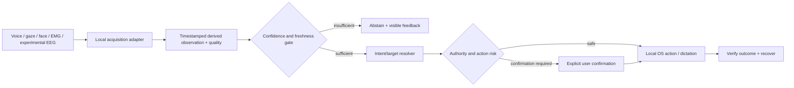

# Hugging Face × YazSes: multimodal HCI lab

*Proposal dated 2026-10-27. **Research roadmap, not shipped product functionality.** [Epic #692](https://github.com/MSKazemi/yazses/issues/692).*

YazSes is already a multimodal system: local speech recognition, gaze-routing, facial gestures, shared camera perception and EMG activation are documented and partly implemented. Hugging Face can make its **model artifacts, evaluation methods, documentation and demos reproducible**. It must **not** become a dependency of core offline dictation or an excuse to add unsupported claims about brain control.

!!! warning "Existing product prioritization remains binding"
    [ADR-030](https://github.com/MSKazemi/yazses/blob/main/design/adr/adr-030-agent-era-direction.md) pauses new capability waves pending reliability and external-user evidence. This page describes a **research and documentation track**, not a commitment to ship new sensors or cloud inference. No automatic model downloads on hot paths; no new daemon integration without a separately reviewed decision.

## Work items

The programme is tracked under [epic #692](https://github.com/MSKazemi/yazses/issues/692). Existing tasks cover [static synthetic Space #693](https://github.com/MSKazemi/yazses/issues/693), [model provenance #694](https://github.com/MSKazemi/yazses/issues/694), [camera evaluation #695](https://github.com/MSKazemi/yazses/issues/695) and [EEG/EOG feasibility #696](https://github.com/MSKazemi/yazses/issues/696). Additional bounded tasks handle [publishing governance #698](https://github.com/MSKazemi/yazses/issues/698), [synthetic fixtures #699](https://github.com/MSKazemi/yazses/issues/699), [safe multimodal fusion replay #700](https://github.com/MSKazemi/yazses/issues/700) and [independent HF privacy preflight #701](https://github.com/MSKazemi/yazses/issues/701).

See the [phased engineering roadmap](https://github.com/MSKazemi/yazses/blob/main/design/hci-huggingface/ROADMAP.md) for dependencies, milestones and acceptance criteria. Prototypes, published HF accounts/Spaces and validated biosignal capabilities remain **proposed**, not delivered.

## Five practical HF roles

| HF service | YazSes use | Boundary |
|---|---|---|
| [Model Hub](https://huggingface.co/docs/hub/models) | Versioned upstream model cards, license checks, exact commit hashes, hashes, quantization, CPU footprint and reproducible offline installation | Download/import only with explicit user action; infer locally |
| [Datasets](https://huggingface.co/docs/hub/datasets) | Publish synthetic gaze/switch/audio-event traces and test schemas; compare WER, latency and false triggers | No real speech, camera frames, face templates, private corpus or participant EEG |
| [Static Spaces](https://huggingface.co/docs/hub/spaces-sdks-static) | A browser-based **synthetic** multimodal interaction explainer; offline-compatible JS artifacts | Never require a hosted live webcam/mic backend |
| [Gradio](https://www.gradio.app/guides/quickstart) | Local-only researcher UI for replay of fixtures, metrics, model selection and annotation | A hosted Gradio webcam UI may send frames to its server; do not call it private/on-device |
| [Hub client](https://huggingface.co/docs/huggingface_hub/index) | `hf_hub_download`/`snapshot_download`, `revision`, checksums, cache inventory, license/provenance registry | Not embedded in the daemon's continuous loop; respect HF cache-first / offline semantics |

Hardware pricing/eligibility changes. Start from **free static HTML/JS Space** rather than assuming free hosted Python inference or GPU. Run any expensive analysis locally in a separate, opt-in researcher process. HF is a model **registry and distribution surface**, not a mandatory cloud inference provider.

## Existing internal seams to reuse

- `src/yazses/stt/` includes the pluggable STT engine and `faster_whisper.py` cache-first model loading. Android has a separate checksum/pinned-revision issue [#683](https://github.com/MSKazemi/yazses/issues/683).
- `src/yazses/perception/` defines `SharedPerceptionSource`, `PerceptionSample` and derived gaze/head/face signals (ADR-v2-145 and [eye programme](../../design/eye-control/ROADMAP.md)). Never open a second webcam or expose raw frames to general feature consumers.
- `src/yazses/gaze/` already supports MediaPipe FaceLandmarker; improve calibration and test real hardware rather than claiming pixel-accurate eye typing.
- `src/yazses/platform/emg/` includes YESP and BrainFlow activation sources and graded squeeze logic; the hardware breadth proposal [#103](https://github.com/MSKazemi/yazses/issues/103) is closed.
- `design/emg-protocol.md`, [intent-source issue #137](https://github.com/MSKazemi/yazses/issues/137), [external activation contract #139](https://github.com/MSKazemi/yazses/issues/139) and [research review](muscle-brain-control.md) define the right boundary for biosignal experiments.
- [Interaction Kernel](interaction-kernel.md) and [grounded targets](grounded-multimodal-interaction.md) supply explicit uncertainty, authority, abstention, confirmation and outcome verification.

## Camera and gaze: evidence before model churn

**Baseline:** existing OpenCV + MediaPipe FaceLandmarker, one camera owner. Candidates for a *separately evaluated* offline backend include ONNX Runtime for a properly licensed gaze/head-pose model; PyTorch only as an optional research dependency, not the default runtime. A Hugging Face model's presence is not evidence of accuracy or license suitability.

Use a calibration dataset with **device, resolution, lighting, screen geometry, distance, glasses, head pose, participant-specific baseline, latency and dropped-frame rate**. Metrics: median and 95th-percentile angular error; window-selection correctness; target abstention rate; false activations/hour; end-to-end action latency; CPU/RAM; camera power; accessibility recovery. Split **by participant and device**, never by adjacent frames (which leak identities and conditions across train/test). Measure X11/Wayland/macOS/Windows permissions separately; do not claim identical behavior.

Prioritize **coarse gaze routing + voice deixis** ('this window', 'that field') over character-level gaze typing. Camera frames are processed only in volatile RAM; derived numeric signals are not identity, emotion, fatigue or attention diagnoses. Include clear capture-on indicator, an immediate off control, and fallback to hotkey/voice when tracking fails. Existing validation [#419](https://github.com/MSKazemi/yazses/issues/419) owns co-design.

## EMG, EEG and EOG: honest roles

| Source | Appropriate first experiment | What cannot be claimed |
|---|---|---|
| sEMG/YESP/BrainFlow | On/off or graded squeeze to start/end a speech turn | General silent-speech transcription from one inexpensive sensor |
| EOG/eye artifacts | Deliberate blink switch with refractory period and abstention | Continuous reliable semantic eye intent without calibration |
| Scalp EEG | Bounded P300/SSVEP/motor-imagery *laboratory* comparisons with controls and safe visual-stimulation protocol | Consumer-grade mind reading, unconstrained word decoding or medical efficacy |
| Intracortical BCI | Literature review or externally approved research partnership | A commodity-hardware feature |

Software candidates: [BrainFlow](https://brainflow.org/) for supported device streams and synthetic boards; [MNE-Python](https://mne.tools/stable/index.html) for offline EEG filtering, epochs and artifacts; [Lab Streaming Layer / pylsl](https://github.com/labstreaminglayer/pylsl) for local timestamped acquisition; [MOABB](https://moabb.neurotechx.com/) for standardized *offline* benchmark datasets; [scikit-learn](https://scikit-learn.org/stable/) for interpretable classifiers; [LibEMG](https://libemg.github.io/libemg/) for muscle pipelines. Evaluate licenses and board capabilities individually. Keep EEG as an **optional research source** of high-confidence activation events, not direct actions. Never infer diagnosis, mental state, identity or consent from a biometric stream.

## Interaction contract



A minimal **research-only** fixture schema is `{schema_version, time_ms, modality, sample_type, quality, confidence, intent_candidate, target_id, decision, outcome}`. No raw sensor payload, biometric identity, transcript or screen content. Timestamps are relative; file IDs synthetic. Separate **observation**, **hypothesis**, **proposed action**, **confirmed action**, and **verified outcome**; never let a model emit an unreviewed OS command.

## First reproducible prototype: static Hugging Face Space

1. Use an HF account/organization only if the owner chooses. Create a **Static HTML Space** named, for example, `yazses-multimodal-hci-lab`. Place `index.html`, `style.css`, `app.js` and synthetic `fixtures.json` in its Space repository. No backend, token or secrets are needed for synthetic public display.
2. Show a fake desktop with three target windows, a simulated gaze point (slider), a voice-intent dropdown, a squeeze/blink toggle, confidence and freshness, and an action-preview pane. All interactions are local Javascript and **never actually inject** an OS event.
3. Simulate uncertain gaze, mismatched voice command, stale camera frame, and accidental double blink. Require explicit confirmation for risky action; always expose reset/stop.
4. Show an evaluation table that computes accuracy, abstention, errors/hour and replay latency from **documented synthetic traces**. Label all numbers 'illustrative; not device benchmarks'.
5. Add README/model and dataset cards with license, provenance, supported hardware, intended use, limitations, prohibited uses, test splits and versioned artifacts. Provide local launch instructions from the YazSes main repo. A GitHub→Space sync, if later added, must use reviewed least-privilege credentials, never user sensor data.
6. Optionally run a **local Gradio** comparison dashboard on the researcher's machine. Real camera processing stays inside the local YazSes process; a hosted Space cannot be advertised as local merely because it uses Gradio.

A first local Python model catalog experiment (independent of the daemon):

```python
from huggingface_hub import hf_hub_download

# Explicitly replace with an audited repo, exact commit and expected file.
path = hf_hub_download(
    repo_id="AUDITED_ORG/AUDITED_MODEL",
    filename="AUDITED_FILE",
    revision="FULL_VERIFIED_COMMIT_SHA",
    local_files_only=True,  # never makes a network request
)
print(path)
```

First review actual license, model-format compatibility, hash and source. For an explicit online installation step, a separate installer can use `snapshot_download(..., revision=<full commit>)` after consent and verification. Do not train or share real human biosignal datasets by default.

## Evidence gates and measurements

| Gate | Required evidence | Release consequence |
|---|---|---|
| Documentation and synthetic demo | Public fixture schema, reproducible build, clearly labeled simulations | May publish as research now |
| Model survey | License/provenance, exact revision, local inference proof, CPU budget, negative examples | Remains research |
| Live webcam/EMG pilot | Camera isolation, permission, battery/latency, per-device reliability, physical stop | Experiment only, off by default |
| EEG/EOG feasibility | Hardware protocol, ethics/consent, held-out sessions, artifacts vs neurological signal, unintended activations/hour | No product claims until validated |
| Product promotion | External daily-user request, maintainer, OS matrix, privacy threat model, accessibility co-design, reliability tests, ADR-030 re-review | Separate product decision |

## References and related planning

- [Hugging Face Hub: models](https://huggingface.co/docs/hub/models), [datasets](https://huggingface.co/docs/hub/datasets), [Spaces](https://huggingface.co/docs/hub/spaces-overview), [Hub client](https://huggingface.co/docs/huggingface_hub/index).
- [MediaPipe Face Landmarker](https://ai.google.dev/edge/mediapipe/solutions/vision/face_landmarker/python).
- [Eye/camera roadmap](https://github.com/MSKazemi/yazses/blob/main/design/eye-control/ROADMAP.md), [brain-control review](muscle-brain-control.md), [epic #692](https://github.com/MSKazemi/yazses/issues/692).
- [Engineering and phased roadmap](https://github.com/MSKazemi/yazses/blob/main/design/hci-huggingface/ROADMAP.md).
