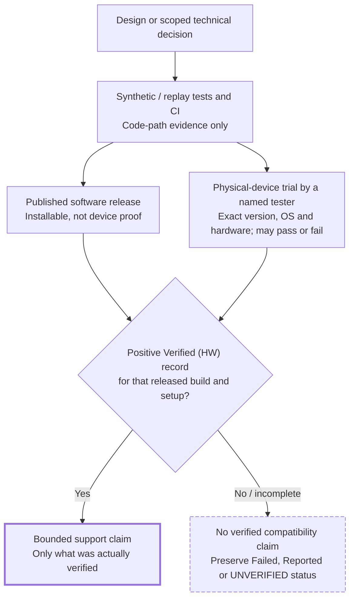
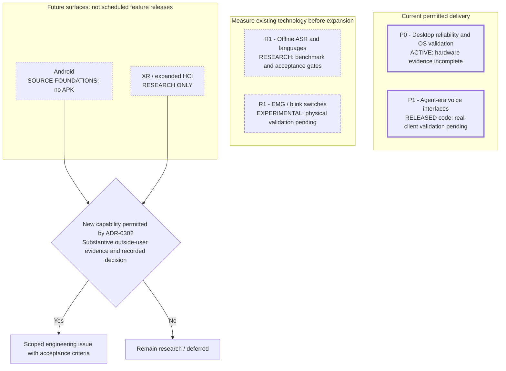
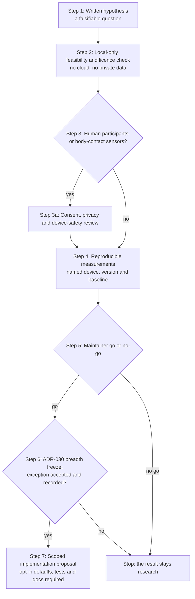
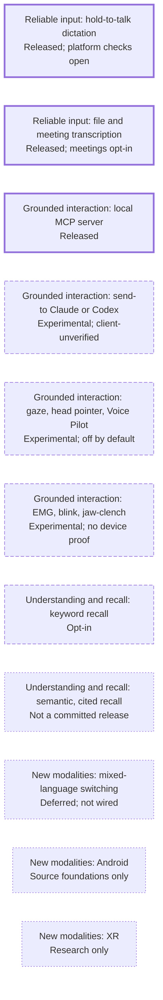
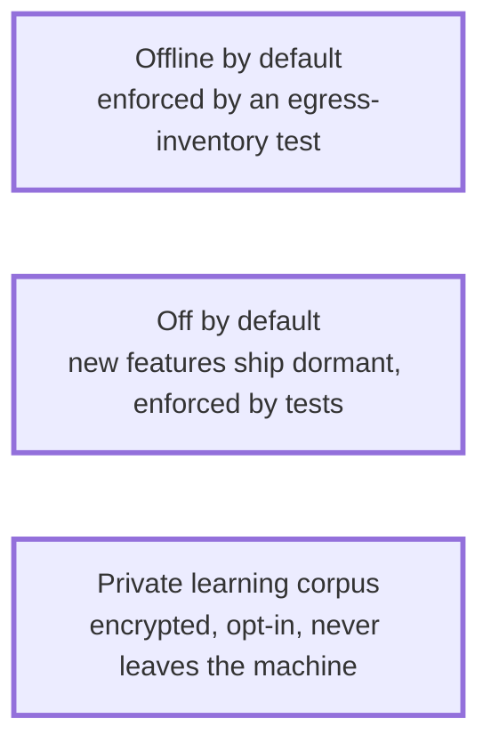

# Roadmap

YazSes is an Apache-2.0, privacy-first voice dictation and local interaction
project for Linux, macOS and Windows. It runs speech recognition on your own
hardware, without an account or cloud transcription service.
**The current stable release is v2.51.0**, with installers and package channels
described in [platform support](platform-support.md). A published installer
does **not** by itself prove that every input method works on that operating
system or on every physical device.

**Our direction:** make YazSes the **offline, keyboard-level microphone for the
agent era**: dependable on Linux, evidence-backed across platforms, usable by
people who cannot comfortably hold a key, and interoperable with AI tools
without silently sending prompts. This direction and its limits are recorded
in [ADR-030](https://github.com/MSKazemi/yazses/blob/main/design/adr/adr-030-agent-era-direction.md)
(Accepted, 2026-10-22).

This is a **decision and evidence roadmap**, not a schedule or product promise.
It separates shipped code, real-hardware proof, technical research, and
conditional ideas. For the freshest development state read
[what we're building now](now.md), the [release notes](releases/index.md),
and the [changelog](https://github.com/MSKazemi/yazses/blob/main/CHANGELOG.md).
For actionable work use [milestones](https://github.com/MSKazemi/yazses/milestones),
the [contributor ROADMAP.md](https://github.com/MSKazemi/yazses/blob/main/ROADMAP.md),
and the issue linked for each item.

## What our status words mean

A release, a working code path, a passing synthetic test, and a successful
experiment on physical hardware are **different claims**.

| Label | What is established | What is not established |
|---|---|---|
| **Released** | A command or capability is in a tagged build and can be reached where its documented prerequisites are met. | Full compatibility with every OS, package, application or sensor. |
| **Experimental / hardware-unverified** | Opt-in code exists and has synthetic, replay or CI evidence. | Acceptable false activations, independently validated hardware, or a supported clinical/accessibility outcome. |
| **In progress** | A bounded, permitted issue has a deliverable and acceptance criteria. | A promised release date or a completed result. |
| **Research / proposed** | A hypothesis, comparison, draft ADR or prototype is open to evaluation. | A new enabled feature, an accepted ADR, or scheduled implementation. |
| **Deferred / conditional** | Demand and an explicit decision must precede implementation. | A commitment to build it. |

For reachable features, the source of truth is the
[feature registry and `yazses features` command](features.md), which distinguish
wired capabilities from designed-but-unwired ones. For actual installation
and usage evidence, consult the [platform validation matrix](validation-matrix.md).
It distinguishes **Verified (HW)**, **Reported**, **CI only** and **UNVERIFIED**,
records the exact release tested, and does not confer validation on later
versions automatically.

### How a claim gets earned

Release availability and real-device verification are **separate evidence
paths**. A package can ship while a specific device remains unverified;
a hardware trial can also fail. Only a complete positive hardware record
for the **same released build and setup** can support a narrow
compatibility claim.

**Text equivalent:**

| Evidence | Supports | Does **not** support |
|---|---|---|
| Design / ADR | Architecture or intention has been recorded. | A working implementation. |
| Synthetic / replay / CI | The specified test passed under simulated, recorded or runner conditions. | Physical hardware, microphone permission or real app interaction. |
| Published release | A named build and package can be installed. | Compatibility with any particular device, desktop or feature path. |
| Real-device test | A named tester records the exact build, OS, device, install path, actual result and relevant diagnostics. Results can be **Verified (HW)**, **Failed (HW)** or **Reported** when incomplete. | Any untested version, OS, device or other claim. |
| Bounded compatibility claim | **Both** a published build and a complete positive **Verified (HW)** record for that tested route. | Automatic promotion of every platform or a later release. |

See the [validation evidence standard](contribute/validation.md) and
[validation matrix](validation-matrix.md). Failed and incomplete reports
remain visible; neither becomes a positive compatibility claim.

## Current technical position — November 2026

| Area | Status | Evidence gap or next step |
|---|---|---|
| **Desktop dictation and transcription** | **Released**: local hold-to-talk, staged dictation, optional meeting/file transcription and multiple speech engines. Packages exist on Linux, macOS and Windows. | The entire capture → decode → text-injection path requires [per-platform physical validation](contribute/validation.md). |
| **Linux X11 / Wayland** | **Released with outstanding compositor and Unicode checks**. Linux-first is not a claim of universal Wayland correctness. | [Current X11 verification #642](https://github.com/MSKazemi/yazses/issues/642) and [GNOME/KDE Wayland #643](https://github.com/MSKazemi/yazses/issues/643). The ydotool non-ASCII drop ([#329](https://github.com/MSKazemi/yazses/issues/329)) is fixed; confirming it on real GNOME and KDE sessions is part of #643. |
| **Windows / macOS** | **Released installers; preview-level end-to-end interaction evidence** under ADR-030. Installing is not equivalent to successfully dictating. | [Cross-platform field tests #504](https://github.com/MSKazemi/yazses/issues/504) and [desktop first-use campaign](desktop-validation-campaign.md). |
| **AI-agent microphone** | **Released**: the local stdio MCP server; since v2.45.0 its `ask_human` stops listening when you stop speaking, and an opt-in, off-by-default `send-to` opens the Claude or Codex desktop app with your prompt filled in and **never sent**; and the v2.49.0 release carries a one-click `.mcpb` bundle. **Experimental / client-unverified**: neither `send-to` nor the bundle has been tried in the real Claude or Codex apps, so pre-fill-without-send is the vendors' documented behaviour, not yet observed here. **Not available**: a listing in the official MCP registry (the entry is prepared; publishing is switched off). | [Send-to #637](https://github.com/MSKazemi/yazses/issues/637), [MCP bundle #638](https://github.com/MSKazemi/yazses/issues/638) and [registry listing #639](https://github.com/MSKazemi/yazses/issues/639) stay open until verified in real clients; [stop-listening #640](https://github.com/MSKazemi/yazses/issues/640) is done. |
| **Speech quality / languages** | **Released engines and language settings**. Language-specific performance and Mandarin support must be demonstrated, not inferred from a setting. | [ASR research epic #787](https://github.com/MSKazemi/yazses/issues/787), [model evaluation #503](https://github.com/MSKazemi/yazses/issues/503), [Mandarin release gate #505](https://github.com/MSKazemi/yazses/issues/505). |
| **EMG, blink, jaw-clench switches** | **Experimental, off by default, real-device evidence not established**. Source readers and synthetic/replay paths exist; these do not read thoughts and are not medical devices. | [Biosignal validation protocol](https://github.com/MSKazemi/yazses/blob/main/design/specs/biosignal-validation-protocol.md); [ThinkGear first-device epic #826](https://github.com/MSKazemi/yazses/issues/826). |
| **Android** | **Source foundations only**, including early Kotlin modules. There is **no installable YazSes Android app/APK**. | [Mobile programme](mobile/index.md), [epic #81](https://github.com/MSKazemi/yazses/issues/81), [research #789](https://github.com/MSKazemi/yazses/issues/789). |
| **XR / expanded HCI** | **Research only**. A synthetic demonstration or an architecture document does not establish headset/device integration. | [XR programme](https://github.com/MSKazemi/yazses/tree/main/design/xr) and [HCI programme #692](https://github.com/MSKazemi/yazses/issues/692), subject to ADR-030. |

**A shipped experimental hardware reader is not a qualified hardware device.**
The software may be part of a stable release even though no specific
headset, armband, sensor, electrode setup or user has passed physical
acceptance testing.

## Execution order — outcomes first, not feature count

These are **priorities and evidence states**, **not release dates or a
four-era timeline**. The engineering lanes can progress independently;
only the arrows entering the decision gate express a prerequisite.

**Text equivalent:** P0 is the first priority but **not yet
fully verified**; it covers the installed dictation path on actual OS
and compositor combinations. P1 interfaces have shipped but still need
client-version tests to establish review-before-send behavior.
R1 ASR work is benchmark research; R1 biosignal input has released
experimental code but awaits real-device and safety evidence. Android
has source foundations without an installable application; XR and
expanded HCI remain research only. Neither is scheduled for delivery
without the explicit ADR-030 entry gate. **None of these labels is a
promise to ship the next stage.**

| Lane | Success looks like | Required evidence / issue |
|---|---|---|
| **P0 — Make every existing claim true** | A first dictation succeeds; text arrives in the correct application; error and fallback reporting is honest; supported OS/compositors have current-version hardware evidence. | [X11 #642](https://github.com/MSKazemi/yazses/issues/642), [Wayland #643](https://github.com/MSKazemi/yazses/issues/643), [Windows/macOS #504](https://github.com/MSKazemi/yazses/issues/504). The engine-status ([#644](https://github.com/MSKazemi/yazses/issues/644)) and unwired-feature ([#646](https://github.com/MSKazemi/yazses/issues/646)) fixes are done; a regression in either is a bug. **Active**. |
| **P1 — Agent-era input, narrowly scoped** | A user dictates, reviews, and **personally submits** a prompt. The shipped hand-off and MCP bundle are confirmed in the real client apps, named by version, without cloud transcription or automatic sending. | [ADR-031](https://github.com/MSKazemi/yazses/blob/main/design/adr/adr-031-send-to-prefill-handoff.md) and [ADR-032](https://github.com/MSKazemi/yazses/blob/main/design/adr/adr-032-mcp-discoverability.md) (both Accepted); open verification in [#637](https://github.com/MSKazemi/yazses/issues/637), [#638](https://github.com/MSKazemi/yazses/issues/638) and [#639](https://github.com/MSKazemi/yazses/issues/639). **Shipped; real-client verification pending**. |
| **P1 — First-use and distribution reliability** | Install, microphone permissions, model setup, text delivery and recovery are understandable to a new person. | [Desktop campaign](desktop-validation-campaign.md), [independent first-use reports #714](https://github.com/MSKazemi/yazses/issues/714), [distribution evidence](platform-support.md). **Active**. |
| **R1 — More accurate local speech, measured** | Compare available models fairly by language and workload before suggesting a default or backend change. | [ASR research #787](https://github.com/MSKazemi/yazses/issues/787), [benchmark protocol #793](https://github.com/MSKazemi/yazses/issues/793), [engine decision #645](https://github.com/MSKazemi/yazses/issues/645). **Research / bounded correctness changes**. |
| **R1 — Existing hands-free input, physically qualified** | Document false-trigger rates, user effort, stoppability, source integrity and recovery on real devices instead of assuming success from simulation. | [Hands-free #102](https://github.com/MSKazemi/yazses/issues/102), [ThinkGear #826](https://github.com/MSKazemi/yazses/issues/826), [accessibility research #790](https://github.com/MSKazemi/yazses/issues/790). **Validation, not approval of a new feature wave**. |
| **R2 — Mobile and multimodal expansion** | A confirmed user problem, feasible offline/privacy model and reviewable architectural decision justify a small next experiment. | [Android #81](https://github.com/MSKazemi/yazses/issues/81), [HCI #692](https://github.com/MSKazemi/yazses/issues/692), [XR evidence-gated plan](https://github.com/MSKazemi/yazses/blob/main/design/xr/ROADMAP.md). **Conditional / research-only while frozen**. |

Delivery items with accepted scope belong to
[existing milestones](https://github.com/MSKazemi/yazses/milestones).
There are **no dates, committed device models or unmeasured performance
improvements** hidden in this table.

## How a research idea earns implementation

The accepted [ADR-030 breadth freeze](https://github.com/MSKazemi/yazses/blob/main/design/adr/adr-030-agent-era-direction.md)
prioritizes reliability, truthful capabilities, first-use adoption and two
small agent interfaces. Beyond that scope, a proposal stops at a **Proposed
ADR** or an `evergreen:research` issue unless substantive outside-user
feedback and a maintainer-recorded amendment justify it. Accessibility
feature expansion also needs evidence from real hands-free users.

**Text equivalent:**

1. Write the hypothesis as a question that a measurement could answer **no** to.
2. Check feasibility and licensing using local resources only, with no
   cloud service and no private data.
3. For human participants, on-body sensors or accessibility trials, review
   consent, privacy, device safety and research requirements before measurement.
4. Take reproducible measurements: named device, release, configuration
   and baseline, including the failures.
5. A maintainer records a go or no-go. No-go ends as published research.
6. Even a go meets the ADR-030 breadth freeze: without a recorded exception
   it also ends as research.
7. Only an accepted exception can become a scoped implementation task. Any
   eventual release must be opt-in by default and include tests and docs. The
   [stage chart above](#how-a-claim-gets-earned) then decides what may be
   claimed about it.

A code test does not replace physical tests, and no step guarantees the next.

**Explicit non-goals:** no cloud dictation fallback, always-listening
wake-word assistant, voice-triggered routing to third-party online services,
or automatic sending of user prompts/messages. Installed models may be
downloaded at a user's explicit request, but recognition must not rely on
network access. [ADR-019](https://github.com/MSKazemi/yazses/blob/main/design/adr/adr-019-egress-inventory-and-escalation.md)
defines strict outbound-data and consent rules.

## Technical evaluation paths — independently reproducible

The project welcomes public, evidence-led evaluation of its **existing
interfaces** on different devices. A report can be useful even if the
result is negative; it does not imply any manufacturer relationship,
endorsement, validated compatibility or release commitment.

| Evaluation | What to measure and report | Blocking gate |
|---|---|---|
| **Offline dictation on an edge CPU or desktop** | Exact hardware, OS, microphone and install channel; model revision/checksum and licence; cold start, real-time factor, end-to-end latency distribution, peak memory, error/recovery cases and offline-after-install behavior. When ground truth is permitted, WER/CER. | [Hardware validation guide](contribute/validation.md), [ASR benchmark methodology #793](https://github.com/MSKazemi/yazses/issues/793). |
| **Mandarin and multilingual speech** | Chinese CER with native-reviewed ground truth; code-switch cases, punctuation/script behavior, failure examples; pinned model, provenance, resource use and latency. | [Mandarin architecture/model work #503](https://github.com/MSKazemi/yazses/issues/503), [native release gate #505](https://github.com/MSKazemi/yazses/issues/505). |
| **EMG or blink activation** | Source/firmware, safe electrode setup and stream integrity; intended-event hit rate, unwanted activations **per usable hour with uncertainty bounds**, stale/disconnected-source handling, max-hold release and recovery. | [Hardware guide](how-to/biosignal-hardware.md), [validation protocol](https://github.com/MSKazemi/yazses/blob/main/design/specs/biosignal-validation-protocol.md), [first ThinkGear physical test #832](https://github.com/MSKazemi/yazses/issues/832). |
| **Accessible hands-free tasks** | Task completion, wrong-target rate, fatigue, emergency stop, recovery, keyboard alternatives and actual OS accessibility API limits. | [Accessible-workspace research #790](https://github.com/MSKazemi/yazses/issues/790) and [eye-control programme](https://github.com/MSKazemi/yazses/blob/main/design/eye-control/ROADMAP.md). |

Each result needs a dated version/commit, tested device, OS, configuration,
model/source revision, baseline, method, measurements, failures and
limitations. Distinguish **synthetic replay**, **CI**, **single-device
feasibility** and **independent multi-person evidence**. Do not upload
participants' raw audio, transcripts, voiceprints, personal learning data
or biosignals to public issues or third-party coding agents. Human-subject
research requires its own consent and review process; a single-person
technical trial is not a clinical study. YazSes is not a medical device,
and its biosignal switch does not decode thoughts.

## Where contributors can make measurable progress

The [milestone policy](https://github.com/MSKazemi/yazses/blob/main/design/milestone-policy.md)
distinguishes delivery issues (one milestone), epics (derived from their
children), and evergreen research, translation and open-ended field
reports (the appropriate `evergreen:*` label, no milestone). A research
idea is not a release obligation.

| Work you can join | Tracking |
|---|---|
| A release-versioned real-user dictation test | [Verified everywhere — #13](https://github.com/MSKazemi/yazses/milestone/13), [first-use #714](https://github.com/MSKazemi/yazses/issues/714) |
| Safe voice prompts for coding agents | [Agent-era mic — #14](https://github.com/MSKazemi/yazses/milestone/14), [workflow research #788](https://github.com/MSKazemi/yazses/issues/788) |
| Packaging, measured accuracy and contributor documentation | [Install anywhere — #6](https://github.com/MSKazemi/yazses/milestone/6), [speech accuracy — #7](https://github.com/MSKazemi/yazses/milestone/7), [contributor experience — #9](https://github.com/MSKazemi/yazses/milestone/9) |
| Real-world hands-free safety and accessibility | [Hands-free — #10](https://github.com/MSKazemi/yazses/milestone/10), [ThinkGear #826](https://github.com/MSKazemi/yazses/issues/826), [research #790](https://github.com/MSKazemi/yazses/issues/790) |
| Android foundations, not a promised APK | [Android M0–M3](mobile/index.md), [epic #81](https://github.com/MSKazemi/yazses/issues/81) |

There is also [voice control — milestone #8](https://github.com/MSKazemi/yazses/milestone/8),
[Hugging Face and multimodal HCI research](research/huggingface-multimodal-hci.md)
and the [future XR study](https://github.com/MSKazemi/yazses/blob/main/design/xr/ROADMAP.md).
None overrides ADR-030's active constraints.

## The destination — vision, not a delivery calendar { #the-destination }

YazSes aims to make a keyboard optional for more people, with private
speech processing under the user's control. Foundation dictation is
released; selected perception and editing functions exist as opt-in
features; more ambitious understanding and interaction need evidence.

| Horizon | Question | Status today |
|---|---|---|
| **Reliable input** | Does speech arrive in the intended application without loss or surprise? | **Active P0**; cross-platform validation remains incomplete. |
| **Grounded interaction** | Can a user direct and revise input safely without a keyboard? | Parts released; hands-free user and compositor evidence still required. |
| **Local understanding / recall** | Can a person search and manipulate their own material with verifiable sources? | Some local building blocks exist; semantic cited recall is not a committed release. |
| **New modalities and spaces** | Do accessible sensors, mobile surfaces or XR meaningfully reduce effort? | **Conditional research**, not the next automatic feature wave. |

### The faculties, by how far each has got

Each box carries its status in words, so the picture still reads in greyscale; the
table under it gives the same information as text for screen readers. A thick outline is released, a dashed outline is experimental or
opt-in, a dotted outline is research or not committed. The shapes say nothing about
dates, and a dotted box is not a promise.

**Text equivalent:**

| Horizon | Faculty | Status today |
|---|---|---|
| Reliable input | Hold-to-talk dictation | **Released**; per-platform physical validation is still open. |
| Reliable input | File and meeting transcription | **Released**; meeting capture is opt-in. |
| Grounded interaction | Local MCP server with `ask_human` | **Released**. |
| Grounded interaction | Send-to Claude or Codex | **Experimental / client-unverified**; off by default; pre-fills and never sends. |
| Grounded interaction | Gaze, head pointer, Voice Pilot | **Experimental**; off by default. |
| Grounded interaction | EMG, blink and jaw-clench switches | **Experimental**; real-device evidence not established. |
| Local understanding and recall | Keyword recall of your own words | Opt-in; needs the local learning corpus. |
| Local understanding and recall | Semantic, cited recall | **Not a committed release.** |
| New modalities and spaces | Mixed-language switching | **Deferred**; designed but not wired. |
| New modalities and spaces | Android | **Source foundations only**; no installable app. |
| New modalities and spaces | XR | **Research only.** |

The boxes run from the most established faculty to the least. Their order says
nothing about what is built next, and a dotted box is not a promise.

### Three promises that hold across all of it

**Text equivalent:**

| Promise | What backs it |
|---|---|
| Offline | `tests/test_egress_inventory.py` fails the build when a module gains an unregistered outbound path ([ADR-019](https://github.com/MSKazemi/yazses/blob/main/design/adr/adr-019-egress-inventory-and-escalation.md)). |
| Off by default | New features ship dormant; `tests/test_features_defaults.py` and `tests/test_dormant_features.py` check it. |
| Private learning corpus | The corpus is encrypted, opt-in, and `nothing leaves your machine`; it is one of the three categories that may never leave ([ADR-019](https://github.com/MSKazemi/yazses/blob/main/design/adr/adr-019-egress-inventory-and-escalation.md)). |

Read the [architecture](architecture.md), the
[ADRs](https://github.com/MSKazemi/yazses/tree/main/design/adr),
[mobile programme](mobile/index.md) and
[research participation guide](research/get-involved.md) for design
background and evidence requirements.

## Shipped history — where to verify it

The authoritative source for a historical claim is the
[release notes](releases/index.md),
[GitHub tags/releases](https://github.com/MSKazemi/yazses/releases),
and [changelog](https://github.com/MSKazemi/yazses/blob/main/CHANGELOG.md).
Representative milestones include v1 offline hold-to-talk, v2.12 Meeting
Mode and file import, v2.14 the optional Parakeet and gaze interfaces,
and later experimental biosignal source integrations.
**Releasing code does not certify a physical device or an end-to-end OS path.**

The latest version entries are generated from the changelog at docs
build time:

<!-- yazses-status:recent-releases -->

## Future work

Nothing here is scheduled. Each item is labelled with the status words defined
[above](#what-our-status-words-mean), and none overrides the ADR-030 breadth
freeze.

| Idea | Status | Why it is not built, and what would change that |
|---|---|---|
| **Cloud escalation for transcription** | **Deferred**: designed, deliberately not implemented | Offline stays the only path, so "nothing leaves your machine" is never quietly weakened. [ADR-019](https://github.com/MSKazemi/yazses/blob/main/design/adr/adr-019-egress-inventory-and-escalation.md) applies the same guardrails to any future feature, lists every way data can leave today, and names three things that may never leave whatever the consent: voiceprint embeddings, the learning corpus, and anything captured from someone who did not consent. |
| **Third-party plug-ins** | **Declined**, not deferred | A plug-in would sit on the dictation hot path with the microphone, the transcript and the injector. [ADR-018](https://github.com/MSKazemi/yazses/blob/main/design/adr/adr-018-feature-packs-and-the-plugin-question.md) records the reasoning and what would reverse it: a real isolation boundary. |
| **Other agent protocols** | **Released**: MCP server over stdio. **Declined**: FastAPI and agent-to-agent | [ADR-020](https://github.com/MSKazemi/yazses/blob/main/design/adr/adr-020-agent-protocols.md) gives the reasons. |
| **Personal speech adapters (LoRA)** | **Deferred** | On-device fine-tuning for your own voice, including atypical speech, waits for a measured accuracy win on held-out data. Prompt-level personalisation from your own corpus already ships. |
| **Per-language model switching and code-switch dictation** | **Deferred** | The routing logic exists but nothing calls it yet: no decode path produces the per-span language IDs it needs, and no code-switch-adapted model ships. |
| **Silent-speech input (sEMG)** | **Experimental / hardware-unverified** | The activation seam ships; real-device evidence is not established. |
| **Vision-based screen commanding** | **Conditional** | Gaze targeting exists as an experimental, off-by-default capability (not hardware-validated); deeper pure-vision commanding depends on platform support that is not universal. |
| **Spoken recall with cited retrieval** | **Research** | `yazses recall` already searches your past dictation by keyword (opt-in). Semantic, cited, fully offline retrieval is not a committed release. |
| **Multi-step task chaining over long sessions** | **Research** | No design is accepted. |

When a research direction does ship, it follows the same rule as everything
else: off by default, opt-in, on-device.

## Known limits

- **Physical validation is incomplete** and does not carry forward
  automatically to newer versions. See the [evidence matrix](validation-matrix.md).
- **Wayland input varies with compositor and injector.** GNOME and KDE
  require current-version evidence [#643](https://github.com/MSKazemi/yazses/issues/643),
  and the ydotool non-ASCII fix ([#329](https://github.com/MSKazemi/yazses/issues/329))
  still needs confirming on real GNOME and KDE sessions.
  Do not infer universal Wayland support.
- **macOS and Windows remain preview-level for complete dictation**
  under [ADR-030](https://github.com/MSKazemi/yazses/blob/main/design/adr/adr-030-agent-era-direction.md)
  even while desktop installers are published.
- **Models trade speed, memory and language coverage.** First model
  installation may need an explicit download; local transcription
  does not. Optional features may need separate lazy-loaded extras.
- **Mandarin needs native validation** [#505](https://github.com/MSKazemi/yazses/issues/505);
  configuration is not proof of high-quality support.
- **Biosignal input is experimental and off by default.**
  A parser, simulator, replay or driver test does not establish
  real-board accuracy, safety, or accessibility outcomes.
- **There is no Android app or XR integration to install today.**
  Their source and research programmes are linked above.

## Request a feature or report a verifiable result

Use the [GitHub issue templates](https://github.com/MSKazemi/yazses/issues/new/choose)
and review the [validation standard](contribute/validation.md).
Include the exact build, device, OS and non-sensitive reproduction steps.
For new research, identify the user need, falsifiable hypothesis, baseline,
failure/stop criteria and existing issues. For studies and community
contributions see [students, researchers and industry](research/get-involved.md).

**A single reproducible success or failure on a named real system can
advance this roadmap more than another untested feature proposal.**
