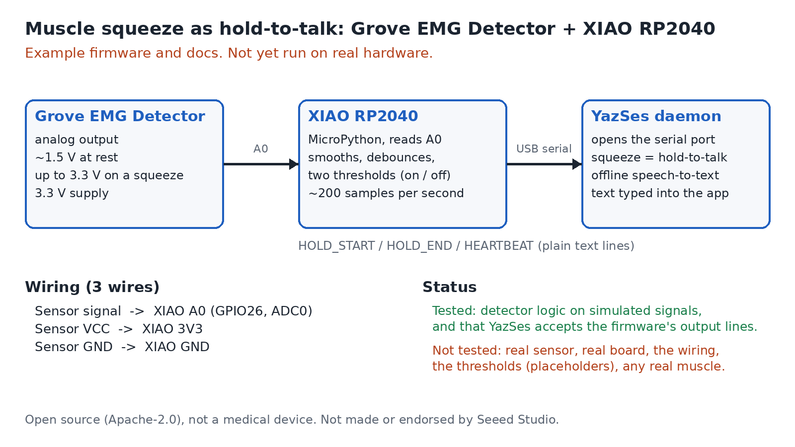

# Muscle switch on a XIAO RP2040 (example firmware)

MicroPython for a [Seeed XIAO RP2040](https://wiki.seeedstudio.com/XIAO-RP2040/) that reads a
[Seeed Grove EMG Detector](https://wiki.seeedstudio.com/Grove-EMG_Detector/) and sends `HOLD_START` and `HOLD_END` over
USB serial, so that squeezing a muscle works as hold-to-talk in YazSes.

> **Status: simulated only. This has never run on a real sensor or board.**
> Tested: the detector logic on simulated signals, and that YazSes's real serial reader accepts the firmware's output
> lines (`tests/test_emg_xiao_firmware_example.py`, 55 tests). Not tested: a real sensor, a real board, the wiring, the
> thresholds (placeholders), any real muscle. The two Seeed products have not been verified together yet.

## Wiring

| Sensor | XIAO RP2040 |
|---|---|
| Signal (analog output) | `A0` (GPIO26, ADC0) |
| VCC | `3V3` |
| GND | `GND` |

Use the pin labels printed on your sensor. Seeed documents the sensor at 3.3 V to 5 V with an output that idles at about
1.5 V and rises to at most 3.3 V; the board's I/O pins accept at most 3.3 V.

## Files

| File | What it is |
|---|---|
| [`emg_detector.py`](emg_detector.py) | The detector: smoothing, a learned idle level, two thresholds, debounce. Pure Python, no imports, so it is unit-tested directly |
| [`main.py`](main.py) | Reads `A0` about 200 times a second and prints `HEARTBEAT`, `HOLD_START` and `HOLD_END`; set `DEBUG = True` to print levels for tuning |

## Use it

1. Install MicroPython on the board, then copy both files: `mpremote cp emg_detector.py main.py :`
2. Read the serial output with any terminal to check it before connecting YazSes.
3. In YazSes `config.toml`: `[emg]`, `device_port = "/dev/ttyACM0"`, `mode = "full_text"`.

Full instructions, tuning, how the detector decides, and the safety notes are in
[the how-to page](../../docs/how-to/emg-xiao-rp2040.md). The serial protocol is in
[`design/emg-protocol.md`](../../design/emg-protocol.md).

## Bench check for anyone who has the parts

A serial terminal is enough; YazSes is not needed for this.

1. Wire the sensor as above, copy both files to the board, and set `DEBUG = True` in `main.py`.
2. Stay relaxed for about 10 seconds. Note the largest `level` the board prints: that is the noise.
3. Squeeze the way you would use it, about 10 times. Note the typical `level`, and whether exactly one `HOLD_START` and
   one `HOLD_END` line appear per squeeze.
4. Leave the sensor attached and idle for about a minute. Note any `HOLD_START` that appears without a squeeze.
5. Report back: which sensor and board, the numbers from steps 2 to 4, and anything about the wiring that was wrong or
   unclear. A few lines are enough. Open an issue on the [YazSes repository](https://github.com/MSKazemi/yazses/issues),
   or reply by email.

These steps are a proposed checklist, not results.

## Safety and independence

Not a medical device: Seeed says the sensor cannot be used for medical purposes. Electrodes on a person while the board is
connected to a mains-powered computer are an open question; prefer a battery-powered computer and read the sensor's
manual. YazSes is not made, reviewed or endorsed by Seeed Studio. Seeed, XIAO and Grove are their names.

If you try it, a result from real hardware, good or bad, is the most useful thing you can add: open an issue on the
[YazSes repository](https://github.com/MSKazemi/yazses/issues).
